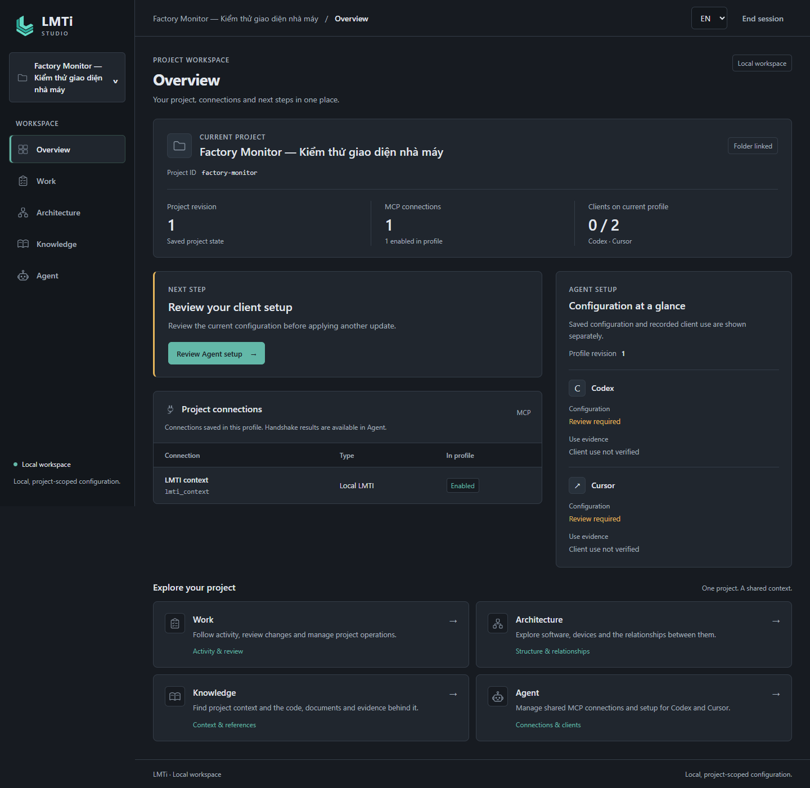
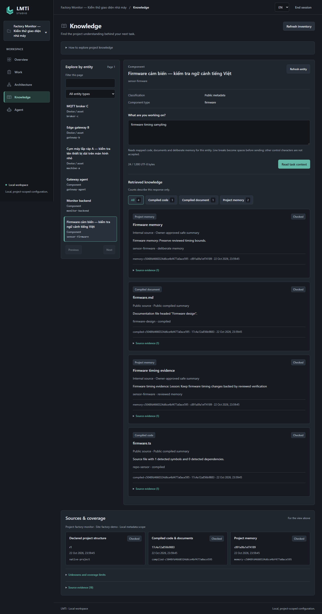

# LMTI


### Local-first project context for AI coding agents

Keep project knowledge on your machine. Give agents scoped context from project
structure, reviewed summaries and eligible memory, with evidence you can inspect.
The local browser workspace uses **React + Vite**, backed by a Node.js API and
native C++/SQLite and Python owners. The Windows package retains Qt desktop as
a fallback; the web interface runs in your browser.

`v0.2.0-alpha.1` is a local release candidate. See the
[release notes](docs/releases/v0.2.0-alpha.1.md) for changes, compatibility and
open acceptance gates. Hosted CI status belongs to the public branch, not this
unpublished candidate. Public alpha APIs and storage contracts can change.

[Build from source](#build-from-source) ·
[Windows setup](docs/local-web.md) ·
[Validation and open gates](docs/releases/v0.2.0-alpha.1-qa.md) ·
[Contribute](CONTRIBUTING.md)



*Actual React workspace, captured with synthetic test data. Client configuration
and recorded client use are shown separately; this image does not certify a
live provider connection.*

## Project context, with evidence

- **Understand the project.** Explore declared structure and scoped context from
  reviewed code/document summaries and eligible memory.
- **Inspect the evidence.** Trace context to its sources and distinguish reviewed
  knowledge from pending proposals.
- **Control the scope locally.** Select the project and allowed scope. External
  AI clients and providers retain their own permissions and data handling;
  local-first does not guarantee that an external model receives no data.



*Synthetic code, document and memory sources in the implemented Knowledge view.*

## Available in the candidate

- Local React workspace with English/Vietnamese presentation and authenticated
  loopback API; native C++/SQLite owners retain authority over project data.
- Project library, software/hardware structure, desired configuration, reviewed
  proposals and controlled project copy/activation/recovery workflows.
- MCP profile preview/apply/restore for Codex and Cursor configuration. Actual
  client/provider acceptance is recorded separately from config generation.
- Scoped Python SDK/MCP for structure, reviewed code/document summaries, eligible
  memory and evidence. Controlled observation replay is labeled as replay.
- TypeScript project-memory/context/privacy CLI, reviewed lessons and publish
  checks. Go is retained as an experimental compatibility path.
- Qt desktop fallback during the local-web transition.

## Windows package quickstart

Use the prepared Windows x64 ZIP from a trusted source. Verify `SHA256SUMS.txt`
and extract into a new local directory. Node.js 24+ x64, Python 3.11+ x64 and the
compatible Microsoft C++ runtime are prerequisites; Node/Python are not bundled.

```powershell
& .\scripts\test-local-web-package.ps1
& .\scripts\start-local-web.ps1 -DataDirectory 'C:\path\to\studio-data'
```

The data directory must contain a Studio library and registered projects; use
the [Qt fallback](docs/topology-studio.md) to create/register them when needed.
The launcher opens the browser with a one-use code. Keep launch URLs and tokens
private. Do not open `index.html` directly. The service binds `127.0.0.1` and
must not be exposed through LAN, tunnels or port forwarding.

Start with a disposable sample project. Keep backups before trying existing
data. Public downloads will be linked here after the release acceptance gates
are complete; a release candidate is not a published download.

See [local web setup and scope grants](docs/local-web.md),
[project MCP configuration](docs/project-mcp.md),
[Agent SDK/MCP](docs/agent-layer.md) and
[upgrade/rollback](docs/releases/v0.2.0-alpha.1.md#upgrade-and-rollback).

## Build from source

Use a fresh checkout and the pinned pnpm version. Native/Qt integration also
requires the C++/Qt toolchain; see [release build instructions](docs/release-build.md).

```powershell
corepack pnpm install --frozen-lockfile --ignore-scripts
corepack pnpm build
corepack pnpm web:build
corepack pnpm test
```

The `lmti` CLI is available from source at `packages/cli/dist/index.js` after
build. Registry installation through npm/PyPI is not a verified distribution
path for this candidate. Internal `@atlas/*` namespaces are retained.

## Support and limits

Windows x64 is the runtime packaging target. Linux component tests do not imply
full Linux Studio support; macOS binaries are not prepared. Actual Cursor,
provider OAuth, live Google consent, independent operator acceptance and a fresh
Windows installation remain separate gates unless the acceptance report says
otherwise. Google Drive is experimental and needs publisher OAuth configuration;
tokens and secrets are never distributed with LMTI.

Controlled replay is not live IoT connectivity. Device execution, a shared hosted
service, multi-user authorization and encrypted topology storage are outside
this alpha. Local launch grants do not create an OS sandbox against the same
filesystem user. Memory guides reasoning; source code and current evidence
remain authoritative.

## Contributing and security

Read [CONTRIBUTING.md](CONTRIBUTING.md), [AGENTS.md](AGENTS.md),
[component ownership](docs/component-support.md) and [SECURITY.md](SECURITY.md).
Check `.gitignore` and tracked files before pushing. Never commit credentials,
operational stores, private memory or session material. Use environment variables
or ignored configuration for secrets. Run `lmti publish preflight` before public
pushes, PRs, remote changes or releases; a blocked gate stops publication.

Publisher: Edgar Vu — Cyno Software. Source license: [Apache-2.0](LICENSE).
Third-party components retain their licenses; see
[THIRD-PARTY-NOTICES.txt](THIRD-PARTY-NOTICES.txt).
