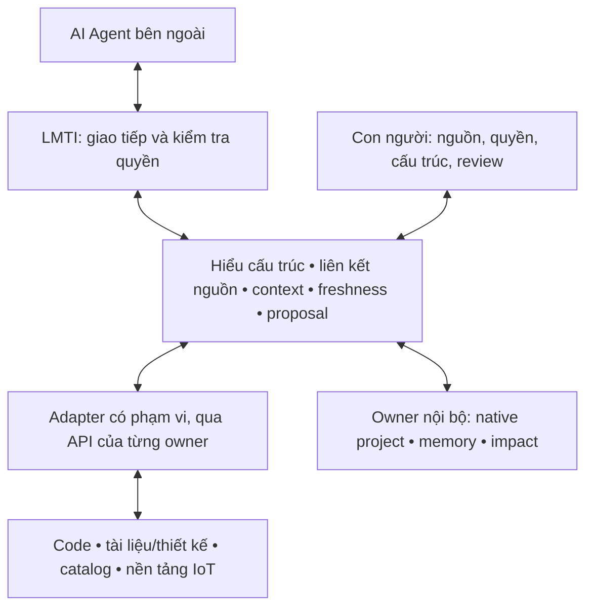

# LMTI — Kế hoạch tổng thể: quản trị MCP và lớp kết nối Agent với dự án

## Ưu tiên hiện hành — 24/10/2026

Chủ sản phẩm yêu cầu hoàn thiện khởi động/phục hồi, cài đặt dễ dùng và đồng bộ
tài liệu, kiểm thử lại đầy đủ; **chưa merge main, tạo tag hay publish**. Thực hiện
theo [kế hoạch startup readiness](plans/2026-10-24-startup-readiness.md).

1. Một lối thiết lập workspace local mới bằng demo hoặc dự án trống, có xem và
   duyệt quyền; mở lại bằng launcher đã lưu cấu hình nonsecret.
2. Phiên browser dùng một lần, thông báo rõ khi kết nối/hết phiên/owner lỗi và
   luồng phục hồi giữ nguyên kiểm tra writer, đích ban đầu và kết quả unknown.
3. Tài liệu, package và bằng chứng cùng candidate; chạy lại test cho source đổi.
   Không tự cài dependency, nâng schema, ghi lại thao tác unknown hay xác nhận
   phục hồi thay người vận hành.

[Remediation 23/10](plans/2026-10-23-audit-remediation.md) đã có library management
và 13 nhóm nội dung web. Baseline `771fc40` có bốn job CI thành công; xem
[QA theo commit](releases/v0.2.0-alpha.1-qa.md). Kết quả đó không nghiệm thu source
đang đổi, Windows sạch hay người vận hành độc lập. Drive/Impact nâng cao vẫn
[để sau](plans/2026-10-23-optional-integrations.md); nguồn live/client/provider
giữ các gate riêng. React + Vite tiếp tục là giao diện duy nhất.

## Hồ sơ định hướng và bằng chứng trước 24/10

Các mốc r6, thống kê test, package và điều kiện Qt/web bên dưới được giữ theo
ngày của từng lượt triển khai. Chúng không phải trạng thái mới nhất hoặc yêu cầu
khôi phục Qt desktop. Khi có khác biệt, ưu tiên hiện hành ở trên, ADR browser-only,
runbook hiện tại và QA theo đúng commit có hiệu lực.

**Chỉ đạo 23/10/2026:** loại bỏ ứng dụng Windows native Qt; React + Vite là
giao diện duy nhất. Giữ backend C++/Qt Core/Sql và Python/TS, cùng khả năng chạy
web trên Windows. [Quyết định thay thế](adr/2026-10-23-browser-only-ui.md). Các
mốc Qt và điều kiện giữ desktop bên dưới là lịch sử; gate Windows sạch và người
nghiệm thu độc lập cho web/backend vẫn mở.

Hồ sơ r6 bắt đầu ngày 2026-10-19 (giữ thứ tự build/nghiệm thu và bằng chứng có ngày).

**Chỉ đạo bổ sung của chủ sản phẩm ngày 19/10:** xây nền tảng bằng controlled
replay trước, chọn thiết bị/nguồn thật sau khi build sẵn sàng. Người vận hành
độc lập và Windows sạch thuộc nghiệm thu sau build. Chưa có endpoint/protocol
hoặc quyền nguồn thật được cung cấp; không suy từ câu trả lời đồng ý chung.
Không hỏi lại pilot/live trước khi nền tảng sẵn sàng.
Các gate Cursor/OAuth/operator/Windows sạch giữ nguyên cho nghiệm thu và cutover,
nhưng không chặn triển khai M2/M3 bằng contract và dữ liệu mẫu. Không coi fixture
hay adapter chưa kết nối là bằng chứng observation/client thật.
Thứ tự build hiện tại: hoàn thiện luồng web đã có → context cấu trúc/code/tài liệu
và memory qua owner → proposal/review → adapter observation chỉ đọc và UI → gói
MVP tích hợp. Sau đó mới chạy nghiệm thu client/provider/pilot/người thứ hai.
Đã triển khai [projection tham chiếu repository/tài liệu cho Agent](plans/2026-10-14-mvp-build-r6.md)
qua owner native. [Bản tích hợp 2026-10-19](plans/2026-10-19-integrated-mvp.md)
bổ sung task context từ summary code/tài liệu và memory an toàn qua TS owner,
web Structure/evidence, review/commit desired configuration qua native owner,
và observation phát lại có kiểm soát. **Đính chính rà soát hoàn tất ngày 19/10:**
tuyên bố trước đó rằng build bước 0–4 đã hoàn thành là quá rộng. R3 chứng minh
các thành phần và hành trình browser được cấu hình riêng, chưa chứng minh toàn
luồng thiết lập MCP → client → context tích hợp: generator CP-01 lúc kiểm chứng
chỉ xuất launcher legacy bốn tool, chưa chuyển cấu hình nguồn opt-in sang client.
Đây là khoảng trống lịch sử tại r3; cầu nối đã được sửa và kiểm chứng trên
studio-web-mcp-bridge-20261019-r2: actual Codex dùng đúng generated config,
năm tool và context/code/tài liệu/memory/replay. [Bằng chứng bridge r2](plans/2026-10-19-integrated-mvp.md#final-bridge-package-r2-evidence)
giữ riêng với browser r3; không đóng toàn build hoặc mọi client. Phân cấp logic/vật lý và cập nhật/import mapping có review cũng
còn là việc triển khai theo phạm vi đã chốt, không phải chỉ gate live.
Nguồn IoT thật, client/model/pilot, người thứ hai và Windows sạch vẫn là gate mở;
gói r3 chưa là build toàn hành trình đã nghiệm thu hay release đã đạt.
Kiểm chứng ngày 19/10: Python Agent 93/93, TS context 9/9 sau hardening,
package r3 đạt doctor/API 24 ca/Qt/IPC. Phép đo cấu trúc tổng hợp 1.000 và
10.000 asset hoàn tất phân trang, giữ nguyên byte kho dữ liệu; p95 trang đầu
lần lượt 0,55 s và 3,82 s. Đây là baseline, chưa đạt gate hiệu năng vì chưa chốt
ngưỡng. Browser thật r3 đã qua entry, inventory, context/evidence, replay,
EN/VI, reject và commit/readback. Native xác nhận reject không đổi byte kho;
một accept tăng đúng một revision, giữ nguyên memory và trường asset khác.
Trạng thái: **Chủ sản phẩm đã chọn web trên máy, mở bằng trình duyệt;
WEB-00 đã có bản mẫu tương tác và contract; chủ sản phẩm cần nghiệm thu UX.
WEB-01 đã có native façade và local Node API xác thực, kiểm tra qua owner thật
trên dự án mẫu; WEB-02 React UI đã nối owner thật và có package local.
Browser thử độc lập đã kiểm tra setup/update/restore; operator acceptance còn mở.
CP-01 profile/Qt UI/generator/apply local alpha đã triển khai;
Codex đọc fixture qua cấu hình native đã kiểm tra. Cursor thật/operator/provider
còn gate mở. Native M2 giữ nguyên; gate xuyên nguồn/pilot/IoT còn mở**.
Cập nhật STRUCT-01: storage schema 2 và [cổng đọc v3 qua cấu hình tin cậy v2](plans/2026-10-19-structure-read-boundary.md)
đã có source build/kiểm chứng. Agent134/134, config-owner25/25 đạt; native/API
có bằng chứng tổng thể và ca kiểm tra lại sau sửa lỗi, được tách rõ trong hồ sơ.
Cập nhật 20/10: [copy migration/clone qua native owner](plans/2026-10-20-project-copy-owner.md)
đã đạt build Release và 15/15 native/Qt trong 74,74 giây. Receipt bản sao
chỉ là bằng chứng chuẩn bị; chưa kích hoạt thư viện. [Generation/CAS thư viện](plans/2026-10-20-project-library-generation.md)
đã qua build Release và 16/16 native/Qt trong 83,76 giây. [Kích hoạt có biên nhận](plans/2026-10-20-project-copy-activation.md)
đã bổ sung giữ khóa nguồn/đích, phục hồi và đạt 18/18 native/Qt trong 110.71 giây.
[Identity caller và CAS thư viện Qt](plans/2026-10-20-project-binding-callers.md)
đã đạt API 50/50 và native/Qt 20/20 trong 129.89 giây. Tiếp theo là
UI activation/recovery, mapping/import và handoff;
chưa có package hierarchy mới, không đóng toàn build từ kết quả đọc này.
[Binding và vòng đời ghi MCP Qt](plans/2026-10-20-qt-mcp-binding.md)
Cập nhật 20/10: MCP Qt đã giữ cố định dự án/cấu hình được xem trước, kiểm tra
lại trước thao tác và giữ tiến trình ghi khi đóng hộp thoại. Phản hồi thiếu hoặc
sai không được coi là ghi thành công; review trạng thái hiện tại không tự ghi lại.
Build Release đạt; **21/21 native/Qt đạt trong 207.38 giây**. Suite MCP mới
đạt **45/45** (43 ca hành vi + khởi tạo/kết thúc), không skip.
Chín kiểm tra Qt mới ↔ API bridge-r2 đạt trên fixture; đây là kiểm thử kết hợp
với package cũ, chưa phải package MVP tích hợp mới. UI activation/recovery,
mapping/import và Agent proposal handoff vẫn còn trong phạm vi build.
[Tìm bản sao và cổng kiểm tra chỉ đọc](plans/2026-10-20-project-copy-discovery.md)
Cập nhật 20/10: đã có tìm lại bản sao khi mất mã thao tác và cổng native
chỉ đọc để kiểm tra dự án, bản sao và lịch sử kích hoạt. Mỗi lượt xét tối đa
1.000 mục; vượt giới hạn hoặc không đọc được phải báo chưa đầy đủ. Bản có intent
hợp lệ vẫn chưa được xem là bản sao đã kiểm chứng. Phân trang từ chối tiếp tục
khi nội dung đã thay đổi; không tự chọn bản mới nhất hoặc chạy lại thao tác ghi.
Build Release đạt; **23/23 native/Qt đạt trong 195.44 giây**.
Sáu suite tập trung đều đạt; suite discovery ghi nhận **2 ca skip có điều kiện**.
Cổng ghi, broker/UI activation-recovery, mapping/import và handoff vẫn cần
hoàn thiện; đây là bằng chứng source build, chưa phải package MVP mới.
[Cổng ghi và đọc phục hồi native](plans/2026-10-20-project-operation-writes.md)
Cập nhật 20/10: cổng native đã hỗ trợ sao chép, hai bước nâng định dạng
thư viện và chuẩn bị/kích hoạt/hủy yêu cầu kích hoạt đang chờ. Mỗi thao tác dùng bản xem
trước hoặc receipt cụ thể; kết quả phân biệt từ chối trước khi ghi, xác nhận hoàn
tất và chưa xác định. Khi phản hồi bị mất hoặc lỗi sau commit, chỉ đọc trạng thái
để phục hồi; không tự ghi lại. Hủy thao tác đang chờ chỉ cần thư viện, không cần
nguồn hay thư mục bản sao còn truy cập được.
Build Release đạt; **24/24 native/Qt đạt trong 206.14 giây**, cùng **7/7 suite
tập trung**. Cổng này dành cho tiến trình vận hành nội bộ; broker, quyền launcher
và giao diện review/phục hồi vẫn cần nối tiếp. Đây là bằng chứng source build,
chưa phải package MVP tích hợp mới hoặc nghiệm thu thiết bị thật.
[Lớp nối API–native và kiểm tra khởi động](plans/2026-10-20-project-operation-api-primitives.md)
Cập nhật 20/10: đã build lớp nối riêng giữa API và cổng native, phân biệt
chưa khởi chạy với kết quả ghi chưa xác định, giữ tiến trình ghi đến khi đóng
hẳn và kiểm tra phản hồi theo đúng thao tác đã duyệt. Helper Windows từ chối
yêu cầu nhận quyền khi broker cũ hoặc tiến trình con còn sống; nhận lại quyền vẫn phải đọc
đối chiếu trạng thái. Đã sửa lỗi UUID rỗng schema 1 bị chuyển thành SQL NULL khi
chuẩn bị kích hoạt và thêm kiểm thử migration/clone qua cổng tiến trình thật.

**84/84 kiểm thử API**, **34/34 ca tập trung**, **16/16 kiểm thử helper Windows**
và **24/24 suite native/Qt đạt** (193.16 giây); discovery còn
2 ca symlink skip có điều kiện. Đây là các thành phần riêng đã kiểm chứng;
quyền launcher, điều phối ghi/phục hồi trong service và giao diện review vẫn
phải nối tiếp. Chưa có package MVP tích hợp mới hoặc nghiệm thu thiết bị thật.
[Điều phối, giao diện và gói thao tác dự án](plans/2026-10-20-project-operation-service.md)
Cập nhật 20/10: đã nối quyền launcher, điều phối các thao tác ghi, API native và giao diện Activity cho sao chép/chuyển đổi, nâng thư viện, chuẩn bị/kích hoạt/hủy và đối chiếu phục hồi. Preview một lần, phiên hết hạn và kết quả chưa rõ được kiểm tra; thao tác ghi đang chạy được giữ đến khi kết thúc, không tự gửi lại.

Build API/UI đạt; **132/132 kiểm thử API, 24/24 UI và 8/8 launcher đạt**, không skip. Gói local `studio-web-operations-20261020` có **116 tệp qua doctor**, đủ bốn binary native từ cùng build Release. Kiểm thử HTTP trên chính gói đạt cả nguồn schema 1 và 2: **14 lượt ghi được xác nhận**, reject không tạo bản sao, nguồn giữ nguyên byte và các broker đóng sạch. Không chạy lại suite C++ vì increment này không đổi nguồn C++.

**Chưa nghiệm thu thao tác trình duyệt:** CUA chặn kênh bootstrap thử nghiệm (`EPERM`/`EACCES`), không có navigation hoặc hành động UI; đã giữ bằng chứng riêng. Gói mới không đồng nghĩa toàn MVP hoàn tất. Hierarchy, mapping/import có review, Agent proposal handoff và workload còn cần build; thiết bị thật, client còn lại, người thứ hai và Windows sạch thuộc nghiệm thu sau build. Kiểm tra `.gitignore` cho cấu hình riêng và secrets trước khi push.
[Chỉnh sửa phân cấp logic qua native owner](plans/2026-10-20-logical-hierarchy-owner.md)
Cập nhật 20/10: đã triển khai domain và owner native cho năm thao tác phân cấp
logic: thêm/đổi tên/di chuyển subsystem, đổi membership component và nghỉ dùng
subsystem rỗng. Bản review giữ snapshot, scope, UUID kho và registry riêng;
commit kiểm tra lại rồi ghi graph, lịch sử ID và một revision trong cùng transaction.
Quyền kế thừa cả tổ tiên và repository liên kết; di chuyển không được giảm
classification. ID đã nghỉ dùng không thể tái sử dụng, kể cả sau clone.

Build Release đạt; **26/26 suite native/Qt đạt trong 217.21 giây**,
**5/5 suite tập trung đạt**. Hai bộ mới có **128 kiểm tra domain** và
**13 ca SQLite với 163 kiểm tra**, không lỗi/skip. Suite discovery cũ còn
**2 ca symlink skip có điều kiện**, ghi riêng trong bằng chứng.
Rollback trước commit, mất phản hồi giả lập sau COMMIT thật, xung đột revision/
UUID/registry và quyền repository đều được kiểm tra.

Đây là owner native dùng review trong cùng process; chưa có cổng CLI/HTTP hay
editor hierarchy mới. Bước tiếp theo nối token review qua process, quyền launcher,
broker và UI; phân cấp vật lý, mapping/import và Agent handoff vẫn còn trong kế
hoạch. Gói thao tác dự án trước đó được giữ nguyên, không coi là đã chứa increment này.
[Cổng native cho phân cấp logic](plans/2026-10-20-logical-hierarchy-transport.md)
Cập nhật 20/10: cổng native riêng đã có đọc trạng thái, xem trước và commit
phân cấp logic qua các tiến trình khác nhau. Token giữ nguyên snapshot/scope và
được kiểm tra lại đầy đủ; quyền từ argv tin cậy, đường dẫn từ thư viện đã chọn.
Thư viện, dự án và các sidecar được kiểm tra đường dẫn; cổng hierarchy từ chối
hardlink thư viện. Kết quả phân biệt refused/confirmed/unknown, không tự gửi lại.

Build Release đạt; **27/27 suite native/Qt đạt trong 372.82 giây**,
**6/6 suite tập trung đạt**. Bộ transport mới có **11 ca, 503 kiểm tra**,
không lỗi/skip; discovery cũ còn **2 ca symlink skip có điều kiện**.
Các kiểm tra owner/domain trước vẫn đạt. Fault được chèn trước/sau COMMIT thật,
không được gọi là thử nghiệm kill process.

Đã đo cây hợp lệ sâu 32: 104 component lá trả
trọn 522,935 byte và commit thành công;
105 lá cần 527,284
byte nên bị từ chối nguyên khối. Mẫu 2.000 lá cũng bị từ chối; phản hồi thực tế
chỉ 38 byte lỗi, không chứa token/diff
thiếu. Đây là giới hạn của một họ workload đã đo, không phải SLA hoặc cam kết
hỗ trợ mọi graph schema 2.

Chưa nối cổng này vào launcher/API/UI và chưa đóng gói lại. Tiếp theo hoàn thiện
lớp nối TypeScript, điều phối ghi/phục hồi, editor logic; phân cấp vật lý,
mapping/import và Agent handoff vẫn còn. Gói ZIP trước giữ nguyên.
[Lớp nối TypeScript cho phân cấp logic](plans/2026-10-20-logical-hierarchy-api-owner.md)
Cập nhật 20/10, STRUCT-01 increment 15: lớp nối TypeScript riêng đã kiểm tra
quyền dự án bất biến, JSON/token/diff chặt chẽ và kết quả refused/confirmed/unknown.
Build API đạt; **20/20 kiểm tra tập trung**
trong 2015.693 ms và **152/152
kiểm tra toàn bộ API** trong 49312.1449 ms đều đạt, không lỗi,
cancel, skip hay todo. Ca tiến trình native thật thêm một subsystem có Unicode,
commit rồi đọc lại, giữ nguyên thư viện/UUID, tăng đúng một revision và từ chối
replay cũ. Guard dùng PREVIEW qua pool kiểm tra riêng khi pool chính chỉ có một slot.
Kiểm chứng đủ năm thao tác native thuộc increment 14 trước đó; không chạy lại
27 suite native trong đợt TypeScript này.

Hai lần runner dừng sớm do kiểm tra DirectoryInfo và đường dẫn junction của
compiler pnpm đã được giữ lại; compiler chưa chạy ở cả hai lần, không phải lỗi
sản phẩm. Suite API có fixture HTTP loopback; “không network” trong receipt
được hiểu là không gọi mạng ngoài/provider, không phải bằng chứng không mở socket.

Chưa nối adapter phân cấp vào launcher, service/routes, điều phối ghi/phục hồi
hoặc editor UI; chưa đóng gói mới. Bước tiếp theo giữ token riêng trong review
opaque, điều phối ghi và phục hồi đầy đủ các scope bị ảnh hưởng; không tự gửi lại
ghi chưa rõ kết quả, không dùng trạng thái hiện tại để gán lại kết quả lịch sử.
Gói cũ gồm manifest/116 file đã liệt kê và ZIP giữ nguyên hash.
[Phục hồi đích ghi ban đầu](plans/2026-10-20-write-recovery-provenance.md)
Cập nhật 20/10, STRUCT-01 increment 16: marker v2 giữ đích ghi ban đầu
trước khi owner chạy. Coordinator giữ toàn bộ entry và khóa ghi qua bước cập
nhật metadata. Phục hồi kiểm tra quyền cho toàn bộ tập đích, thu bằng chứng hai
lần và yêu cầu xác nhận riêng; không tự chạy lại ghi unknown hoặc đổi kết quả
lịch sử dựa trên trạng thái hiện tại.

Build API đạt; **96/96 kiểm thử tập trung**, **211/211 kiểm thử API đầy đủ** và
**25/25 kiểm thử marker Python trên Windows** đều đạt, không bỏ qua. Lượt API
đầy đủ mất 73.852 giây; Python unittest mất 30.903 giây. Các lần build/kiểm thử
lỗi trước đó được giữ lại: hai type annotation còn thiếu và các fixture chưa
chờ hết bước cập nhật marker sau kết quả ghi đã biết. Bản sửa fixture chỉ đợi
trạng thái đọc, giữ nguyên cơ chế khóa và không gửi lại thao tác unknown.

Unknown library upgrade vẫn bị chặn chờ kiểm tra native đầy đủ thư mục backup.
Marker v1 chưa có chuyển đổi tự động; thiếu identity ban đầu không được coi là
đã phục hồi. Kiểm tra binding hiện tại chưa phải phép đọc native có điều kiện
nguyên tử. Chưa nối hierarchy vào launcher/service/editor, chưa có browser
acceptance hoặc gói mới. Gói/ZIP cũ giữ nguyên; không đóng STRUCT-01 hay toàn MVP.
Tài liệu này là nơi duy nhất quyết định ưu tiên và thứ tự công việc.

Đã có WEB-00 artifact và [WEB-01 API slice](plans/2026-10-13-web-api-execution.md).
Đã triển khai [WEB-02: React MCP UI](plans/2026-10-13-web-react-execution.md).
WEB-03 giữ gate nghiệm thu parity/cutover với client thật,
operator và Windows sạch; r6 cho phép build MVP tiếp trong khi chờ các gate này.
Đã có [doctor package và kiểm tra vòng đời ghi](plans/2026-10-14-web-parity-execution.md).
Cùng báo cáo ghi kiểm tra Widgets/API/React: revision conflict hai chiều,
apply/restore chéo và đổi dự án trên dữ liệu mẫu; chưa thay nghiệm thu độc lập.
Đã bổ sung lỗi IPC có kiểm soát và phục hồi khi owner/API dừng giữa lần ghi;
suite API/package lịch sử đạt 13/13; gói tích hợp r3 ngày 19/10 đạt 24 ca API,
vẫn giữ gate client/operator/Windows sạch.
Baseline 500 dự án/50 dự án nhiều bản ghi đã dẫn đến [projection metadata native](benchmarks/2026-10-14-web-local-baseline.md):
p95 trang 50 mục giảm từ 5,61 s xuống 264 ms trong phép đo tổng hợp. Chưa thay
ngưỡng nghiệm thu/lợi ích pilot; package tại mốc này còn Qt dự phòng, đã gỡ ngày 23/10.
Đã có [lệnh xác minh Windows và wiring CI](plans/2026-10-14-web-verification-runner.md),
local đạt doctor/API/Qt/IPC. Tại mốc 14/10 chưa có run CI từ xa hay nghiệm thu
Windows sạch; CI cho baseline 23/10 đã được ghi riêng trong QA hiện hành.
Cursor Editor chưa cài theo xác nhận của chủ sản phẩm. Đã có
[Cursor CLI thật liệt kê 4 tools từ export của package mới](plans/2026-10-14-cursor-cli-discovery.md)
trong môi trường riêng; scoped read/Editor/operator/provider vẫn chưa kiểm chứng.
Không coi discovery này là hoàn tất gate Cursor.
[Kế hoạch chuyển UI](plans/2026-10-13-web-ui-transition.md)
và [ADR đề xuất](adr/2026-10-13-web-presentation.md) mô tả phạm vi. Giữ C++ owners,
SQLite, Python SDK/MCP và TS/Go compatibility. Điều kiện Qt Widgets dự phòng đến
parity của kế hoạch cũ đã bị ADR 23/10 thay thế; không khôi phục Qt hay rewrite domain.

## 1. Định nghĩa và mục tiêu

**LMTI là lớp quản trị kết nối MCP và hiểu biết dự án cho AI Agent.**

Chủ sản phẩm đã làm rõ trọng tâm: kết hợp quản trị MCP với Codex, Cursor,
Cloudflare, Tailscale và các thành phần quan trọng của dự án. Luồng đầu tiên đã
chọn là **thiết lập bộ MCP theo dự án và dùng chung cho Codex/Cursor**.
LMTI giữ cấu hình gốc và context gắn đúng dự án; client adapters tạo cấu hình
tương ứng. Auth/session và kết quả kiểm tra mỗi client vẫn riêng.

[CP-01](plans/2026-10-13-project-mcp-profile.md) chốt phạm vi, màn hình, adapter,
bảo mật và gate. Chủ sản phẩm đã yêu cầu thực hiện; [hướng dẫn](project-mcp.md)
và [bằng chứng](plans/2026-10-13-project-mcp-execution.md) ghi phần đã làm và giới
hạn. Đây là thay đổi ưu tiên có chủ đích: hoàn
thành luồng thiết lập trước khi mở rộng thêm màn hình cấu trúc/IoT. Các nhà cung
cấp là tích hợp tùy chọn; không tự tạo gateway, sửa hạ tầng hay cấp quyền ghi.

Agent dùng LMTI để biết dự án gồm những gì, các phần liên quan ra sao, thông tin
đến từ đâu, còn đúng ở thời điểm nào và mình được phép đọc hoặc đề xuất điều gì.
Con người quản lý cấu trúc, nguồn, quyền và xét duyệt qua giao diện LMTI.

Hướng đã được chủ sản phẩm xác nhận:

- Bao phủ kết cấu dự án lớn, gồm phần mềm, thiết kế/tài liệu, hạ tầng và thiết bị IoT.
- Ưu tiên bộ MCP của từng dự án và kết nối thực tế Codex/Cursor; giao diện mở vào MCP & Agents.
- Bản đầu có cấu trúc dự án và **trạng thái thiết bị thật**, trong phạm vi chỉ đọc.
- Agent là bên sử dụng lớp này; không phụ thuộc một hãng model.
- Trải nghiệm đơn giản; hoạch định rõ trước khi tiếp tục xây.

Chủ sản phẩm đã yêu cầu thực hiện r3 trước khi làm rõ luồng MCP. [Gói M1](plans/2026-10-13-agent-layer-m1.md)
chốt thiết kế local và kiểm tra client; pilot thật/ngưỡng và nghiệm thu còn mở.
Chủ sản phẩm đã nhận phương án adapter dùng chung để thực hiện. Native M2 đã có
[API đọc và envelope](agent-layer.md), [bằng chứng](plans/2026-10-13-agent-layer-m2-execution.md);
đây chưa là hoàn tất M2 hoặc đường IoT thật.
Các lựa chọn dưới đây không phải năng lực đã nghiệm thu toàn release.
Master r5 thay ưu tiên của [r4](archive/2026-10-13-master-plan-r4.md): chuyển
giao diện MCP sang web cục bộ trước phần mở rộng xuyên nguồn/IoT. Giữ nền
Agent/context, cấu trúc lớn và IoT thật. CP-01 đã có slice native local alpha;
nghiệm thu client/operator vẫn mở. r6 tiếp tục cùng backlog; không tạo roadmap song song.

Đích dài hạn là áp dụng được cho nhiều loại dự án. Bước chứng minh đầu tiên là
**một dự án phần mềm–phần cứng/IoT đại diện**, có chủ nguồn và người kiểm chứng.
Chưa hứa tự hiểu mọi dự án, mọi ngôn ngữ hoặc thiết bị mà không có mapping.

## 2. Giá trị phải chứng minh

Một Agent đã có thể đọc repository, tài liệu và gọi công cụ. LMTI cần giảm công
tự ghép và kiểm tra lại thông tin giữa các nguồn, đồng thời giữ đúng quyền.

Gate tiếp theo: cùng một bộ MCP có revision của project A được thiết lập trong
Codex và Cursor, cập nhật có diff, không mất server khác hoặc trộn sang project B.
Đo tổng công thiết lập/cập nhật/recovery so với cấu hình trực tiếp từng client;
chưa có bằng chứng một giao diện gom server tự tạo giá trị khác biệt.

Tình huống nghiệm thu xuyên suốt:

> “Nếu thay đổi cấu trúc dữ liệu của firmware này, những service và thiết bị nào
> có thể liên quan? Thiết bị nào đang chạy phiên bản đó, nguồn nào đã cũ, cần
> kiểm chứng gì và tôi được phép đề xuất thay đổi ở đâu?”

LMTI cung cấp các liên kết và bằng chứng đủ để Agent trả lời:

**Yêu cầu/thiết kế → code → component/service → release → triển khai/thiết bị →
quan sát thực tế → kết quả kiểm chứng.**

Không đủ bằng chứng phải trả phần chưa biết hoặc mâu thuẫn. Quan hệ liên quan
không tự chứng minh quan hệ nhân quả; bản khai báo triển khai không chứng minh
phiên bản đang chạy. Agent tự trình bày câu trả lời, LMTI chịu trách nhiệm dữ liệu,
ngữ nghĩa, giới hạn và quyền của kết quả cung cấp.

## 3. Rút ra từ các dự án tương đồng

Đối chiếu tài liệu chính thức ngày 2026-10-13; bảng là quyết định định hướng,
không phải benchmark hoặc quyết định cài đặt/mua sản phẩm.

| Nhóm tham chiếu | Khả năng đã có ở hệ sinh thái | Hệ quả đối với LMTI |
| --- | --- | --- |
| [Cloudflare MCP portals](https://developers.cloudflare.com/cloudflare-one/access-controls/ai-controls/mcp-portals/), [Tailscale Aperture](https://tailscale.com/docs/aperture/mcp-server) | Gateway/proxy và quản trị truy cập MCP đã có trong hệ sinh thái | Đánh giá tích hợp nếu cần đường thực thi tập trung; CP-01 quản trị cấu hình theo dự án, không xây lại proxy tổng quát |
| [Port](https://docs.port.io/context-lake/consuming-the-lake/port-mcp-server/) | Agent ngoài truy catalog, ownership, dependency và chạy action theo quyền | Catalog + MCP + quyền đã có đối thủ gần; cần chứng minh lợi ích của liên kết xuyên nguồn trên bài toán pilot |
| [Backstage](https://backstage.io/docs/features/software-catalog/system-model/) | Mô hình component/API/resource/system/domain | Tái dùng catalog hiện hữu nếu dự án có; tránh buộc nhập lại danh mục |
| [Serena](https://github.com/oraios/serena), [Augment Context Engine](https://docs.augmentcode.com/context-services/mcp/overview) | Truy cập code có ngữ nghĩa và cung cấp context code cho Agent | Dùng adapter tới công cụ phân tích code phù hợp; không tự xây lại language server |
| [Graphiti](https://github.com/getzep/graphiti), [OpenViking](https://github.com/volcengine/OpenViking) | Graph theo thời gian hoặc tổ chức context/memory/resources cho Agent | Memory/graph không tự tạo khác biệt; giữ owner memory hiện có, đánh giá thay thế chỉ khi có nhu cầu đo được |
| [NetBox MCP](https://github.com/netboxlabs/netbox-mcp-server), [ThingsBoard MCP](https://thingsboard.io/docs/user-guide/mcp-server/) | Truy cập hạ tầng hoặc thiết bị/telemetry qua công cụ cho Agent | Ưu tiên lấy inventory/observation từ hệ đang vận hành; chỉ cho phép tập công cụ đọc cần thiết |
| [MCP](https://modelcontextprotocol.io/docs/learn/architecture) | Giao thức trao đổi công cụ/context | Dùng làm đường giao tiếp; LMTI vẫn phải định nghĩa identity, ý nghĩa quan hệ, quyền và độ mới |

**Phần LMTI cần tự làm:** liên kết identity xuyên nguồn; mô hình quan hệ có kiểu;
truy xuất context có nguồn, phiên bản, phạm vi và độ mới; kiểm tra quyền; đề xuất
thay đổi gắn revision và review; cách con người duy trì những liên kết đó.

**Phần ưu tiên tích hợp:** phân tích code, nguồn tài liệu, catalog hạ tầng, nền tảng
quan sát thiết bị và Agent/model. Chỉ chọn adapter phục vụ pilot; danh sách trên
không trở thành danh sách dependency bắt buộc.

Giả thuyết khác biệt là Agent hiểu liên hệ giữa code–thiết kế–thiết bị–trạng thái
với công duy trì thấp và có thể triển khai cục bộ. Chưa có bằng chứng LMTI vượt
các nền tảng này. Nếu kết nối nguồn trực tiếp đã giải quyết tương đương với ít
công hơn, cần thu hẹp phần LMTI tự xây.

## 4. Kiến trúc sản phẩm đích

Đường thiết lập đích: **React UI → local Node.js API → typed MCP profile owner → Codex/Cursor
adapters → cấu hình client theo dự án → MCP server/gateway đã chọn**.
API/native façade và React UI đã có ở WEB-01/02. Qt tiếp tục gọi owner
trực tiếp. Node chỉ điều phối fixed owner operations, không mở SQLite
hoặc nhận executable/shell/path tùy ý từ browser. UI API không thay Python MCP stdio.
Profile không chứa credentials; JSON/TOML chỉ là boundary xuất cấu hình client.
[ADR bổ sung](adr/2026-10-13-project-mcp-profile.md) định nghĩa LMCP SQLite owner
và Python client-config adapter đã triển khai; không đổi native topology format.

**Quản trị cấu hình khác thực thi quyền:** CP-01 không proxy mọi tool call. UI
nêu policy được thực thi ở client/gateway/server, phần nào chưa có enforcement.
Chỉ thao tác đi qua boundary được kiểm soát ở boundary đó; không hứa chặn các
đường Agent truy trực tiếp. Probe handshake khác xác nhận client thật dùng được.

LMTI gắn vào dự án bằng context, không được import vào business runtime của dự án.
Nguồn gốc vẫn sở hữu dữ liệu gốc. LMTI giữ phần hiểu biết đã biên dịch, tham chiếu,
mapping và memory có chủ đích; không sao chép toàn bộ repository/telemetry.

| Năng lực | Trách nhiệm |
| --- | --- |
| Kết nối nguồn | Khai báo nguồn, phạm vi, quyền, revision/cursor, trạng thái đồng bộ và thu hồi |
| Hiểu cấu trúc | Nhận diện đối tượng, quan hệ, owner, nguồn có thẩm quyền và xung đột |
| Cung cấp context | Truy đúng phần liên quan, phân trang, ngân sách dữ liệu/token, evidence và độ mới |
| Tương tác có kiểm soát | Hợp đồng đọc/đề xuất rõ; kiểm tra quyền tại boundary và owner thực thi |
| Ghi nhớ và kiểm chứng | Quyết định/lesson đã review, kết quả kiểm chứng gắn phiên bản; không học raw chat |
| Giao diện con người | Cấu hình, kiểm tra mapping, duyệt cấu trúc/observation và review proposal |

UI dùng chung dữ liệu và quyền với đường Agent. Không cần mở desktop hoặc xây
hội thoại AI nhúng để thực hiện truy vấn Agent trong bản đầu.

## 5. Phạm vi bản đầu: một luồng chạy thật

Thứ tự r6: luồng MCP web đã có tiếp tục được bảo toàn; **build luồng xuyên nguồn
và adapter MVP trước nghiệm thu live**. Các gate
CP-01 client/operator giữ cho nghiệm thu/cutover. CP-01 không bắt buộc tài khoản Cloudflare/Tailscale
live để thiết kế/thử local, nhưng fixture không chứng minh tích hợp live hai nền tảng.

**Một Agent thật → LMTI → cấu trúc/code/tài liệu có liên kết + một nguồn IoT thật
→ câu trả lời có bằng chứng → một đề xuất được người review.**

| Bắt buộc để nghiệm thu | Giới hạn bản đầu |
| --- | --- |
| Một Agent client thật dùng giao tiếp được hỗ trợ | Đề xuất MCP stdio qua Python boundary hiện có; chốt contract ở M1. Kiểm tra tính độc lập bằng contract test, chưa hứa tương thích mọi client |
| Một dự án đại diện có logic và vật lý/triển khai | Phân hệ, component/service, repository, release, site/environment, gateway/device và liên kết cần cho tình huống thử |
| Ba nhóm nguồn | Code/tài liệu thiết kế được phép; cấu trúc native hoặc catalog owner; nguồn observation IoT thật |
| Mapping và cập nhật | Nhập qua owner, xem diff, identity ổn định, idempotency, phát hiện nguồn cũ/xóa/mâu thuẫn; không bắt vẽ lại hàng nghìn node |
| Context và truy vấn xuyên nguồn | Scope, evidence, phiên bản/thời gian, completeness và unknown; không chỉ tìm từ khóa trong từng nguồn rời rạc |
| Observation thật | Một site/phạm vi, một adapter, một tập chỉ số và quy tắc freshness được khóa; ưu tiên nền tảng quan sát sẵn có |
| Đề xuất có review | Tái dùng một loại proposal metadata/desired configuration đã có owner; Agent không tự ghi DB; người review mới lưu revision |
| UI hỗ trợ và vận hành | Kết nối Agent/nguồn, xem quyền/mapping/lỗi, tìm thành phần, kiểm tra observation và review; cài đặt/recovery có hướng dẫn |

Google Drive là lựa chọn cho nguồn tài liệu, không bắt buộc nếu pilot dùng tài
liệu cục bộ. Nếu chọn Drive, phải hoàn tất OAuth thật và chính sách đưa nội dung
sang Agent; quyền xem preview cục bộ không tự cho phép gửi cho model ngoài.

Sau bản đầu mới cân nhắc nhiều adapter/site/client, chia sẻ nhiều người dùng,
nguồn CAD chuyên sâu và hành động rộng hơn theo nhu cầu đo được. Device actuation,
deploy/OTA, scan mạng tự động, Agent runtime, training, marketplace và CAD/mô phỏng
riêng nằm ngoài bản đầu. Work/board/chat và trang trí UI không phải gate release.

## 6. Mô hình dự án và hợp đồng Agent

Hai chiều **logic** (project → subsystem → component) và **vật lý/triển khai**
(site → area → host/gateway/device, kèm environment) dùng cùng identity.
Cây phân cấp không có vòng; đồ thị dependency có thể có chu trình.

Identity ổn định, tách khỏi tên/IP/địa chỉ. Mapping ngoài gồm source namespace,
external ID và quy tắc đổi tên/thay thiết bị; không tự gộp chỉ vì tên giống nhau.
Quan hệ có kiểu, hướng, phạm vi, nguồn và phiên bản. Quyền phải áp dụng cả đầu mút
và đường dẫn quan hệ; không lộ đối tượng ẩn qua ID, số lượng hoặc thông báo lỗi.

Tách rõ **khai báo/thiết kế**, **mong muốn**, **quan sát**, **suy luận/đề xuất** và
**kết quả kiểm chứng**. Mỗi assertion biết nguồn có thẩm quyền. Hai nguồn bất đồng
được giữ thành conflict có thể giải quyết, không âm thầm chọn bản nhập sau.
Kiểu miền có schema/migration; không thay bằng một túi JSON tùy ý.

Nhóm thao tác dự kiến, tên dưới đây **chưa phải API đã phát hành**:

| Nhóm | Đầu ra tối thiểu |
| --- | --- |
| Resolve/query entity | Đúng project/scope/identity, thuộc tính được phép, source references |
| Query relationships / impact context | Subgraph/path có giới hạn, loại quan hệ, bằng chứng, mapping gaps |
| Build task context | Context tối thiểu theo nhiệm vụ, quyền, ngân sách và yêu cầu freshness |
| Read observations | Giá trị/đơn vị, nguồn, sample/receive time, chất lượng, TTL và trạng thái nguồn |
| Propose change / read review outcome | Diff, expected revision, lý do/evidence, trạng thái review; không thực thi thiết bị |

M1 phải chốt response envelope chung: schema version, effective scope, source
revisions/timestamps, evidence references, freshness, completeness/cursor/budget,
conflicts/unknowns và lỗi có kiểu. Không trả raw token, private path hoặc thông tin
ngoài scope. Không ép mọi nguồn vào một “global revision” giả.

Ngữ cảnh xuất cho Agent được kiểm tra quyền trước chọn/xếp hạng và trước trả.
Scope có thẩm quyền đến từ cấu hình launcher/service tin cậy; tham số Agent chỉ
được thu hẹp phạm vi, không cấp thêm quyền hoặc chọn binary/credential tùy ý.
Thu hồi quyền phải chặn lần đọc tiếp theo, kể cả cache/report đã lưu. Đổi revision
làm proposal cũ thất hiệu lực hoặc yêu cầu review lại. Lời khẳng định “verified”
gắn bằng chứng và revision, không phải một cờ tồn tại vĩnh viễn.

Nguồn/tài liệu/tool output là dữ liệu không tin cậy: nội dung trong đó không
được cấp quyền, đổi policy hoặc trở thành lệnh thực thi. Chỉ dùng adapter và thao
tác nằm trong allowlist; không proxy công cụ bất kỳ hoặc shell tổng quát.

## 7. IoT: quan sát thật qua nguồn có trách nhiệm

Ưu tiên adapter chỉ đọc từ nền tảng IoT/monitoring hiện hữu. Nguồn đó giữ telemetry
và lịch sử gốc; LMTI chuẩn hóa identity/ý nghĩa/trạng thái, truy vấn có giới hạn
và chỉ cache phần cần thiết với retention rõ.

Chỉ xây collector trực tiếp khi pilot không có nguồn phù hợp. Đây là nhánh có
điều kiện cần ADR về protocol, endpoint, identity, giới hạn tải, lưu trữ và recovery;
không mặc định xây thêm monitoring platform hay chọn giao thức khi chưa biết thiết bị.

Observation gồm device/source identity, site/environment, metric/unit, thời điểm
đo và nhận, chất lượng, TTL; có cursor/sequence nếu nguồn cung cấp. Tách:

- Nguồn/collector có kết nối và còn quyền hay không.
- Endpoint/device có phản hồi theo phép kiểm tra đã định nghĩa hay không.
- Health chức năng hoặc chỉ số nào thực sự được đo.
- Chưa có dữ liệu, stale, unavailable, invalid hoặc revoked.

Mất collector không có nghĩa mọi thiết bị hỏng. Heartbeat không chứng minh
chức năng đúng. Xử lý duplicate/out-of-order, reset, clock skew, reconnect và gaps;
nêu giới hạn của nguồn nếu không thể bảo đảm thứ tự hoặc độ chính xác.

Observation không làm tăng topology revision ở mỗi mẫu, không vào undo/UI hoặc
memory dài hạn. Query/cache/ingest đều có timeout, giới hạn, retry/backoff và
backpressure khi cần; không giả lịch sử liên tục khi mất dữ liệu.
Agent và UI nhìn cùng source/freshness semantics.

## 8. Tái sử dụng nền hiện có và các giới hạn

| Thành phần hiện có | Dùng trong r5 | Khoảng trống |
| --- | --- | --- |
| Typed C++ core, Qt/SQLite project/topology owners | Cấu trúc, validation, revision và proposal | Phân cấp/identity/lookup/delta theo workload lớn, migration/recovery |
| Python SDK/MCP stdio | Envelope chung, nối owner context và observation replay đã triển khai | Nghiệm thu Agent/client thật, nguồn observation live và workload đại diện |
| TS compile/context/privacy/memory | Project Atlas, context có quyền, memory/lesson và API owner cố định cho Agent | Mapping rõ ràng, chỉ summary được phép; chưa chứng minh hiểu toàn repository hoặc thay thế language server |
| TS impact + native snapshot/review | Quan hệ, bằng chứng và review | Mapping code/triển khai/observation, freshness và giá trị trên dự án thật |
| React workspace / native library owner | Giao diện duy nhất; chọn dự án và thư viện qua native owner | Nghiệm thu startup/recovery/operator; Qt desktop và fallback đã gỡ ngày 23/10 |
| Drive session reader | Nguồn tài liệu tùy chọn | OAuth thật, publisher acceptance, egress contract nếu dùng cho Agent |
| Go memory | Giữ compatibility hiện có | Không mở thêm topology/telemetry domain trong Go |

Các [ADR đã nhận](plans/README.md#architecture-decisions) tiếp tục giữ hiệu lực;
mở rộng phải có ADR bổ sung, không sửa lịch sử thành lời khẳng định đã triển khai.
ADR browser-only ngày 23/10 thay phần điều kiện giữ Qt presentation của ADR web
cũ; native schemas và các boundary Agent/storage không đổi. Qt Core/Sql vẫn được giữ.
Native, TS memory, impact và observation giữ owner riêng. Python gọi API/binary
tin cậy với tham số cố định; không nhận raw store handle. JSON chỉ là boundary,
không trở thành domain model hoặc durable topology. Không thêm Protobuf/gRPC
hay graph database mới nếu chưa có nhu cầu được đo.

Hiện có bằng chứng local alpha và test từng slice; **chưa nghiệm thu toàn bộ
luồng Agent–dự án–IoT thật, chưa có bằng chứng quy mô lớn hoặc lợi ích kinh doanh**.
Xem [support map](component-support.md) và [execution evidence](plans/README.md#execution-evidence).

**[CẢNH BÁO BẢO MẬT]** SQLite topology hiện chưa mã hóa; launcher cùng user không
phải OS sandbox hoặc RBAC nhiều người dùng. Không lưu secret/dữ liệu nhạy cảm
chưa được hỗ trợ vào kho này. Credential dùng kho bí mật phù hợp hoặc cấu hình
cục bộ được bảo vệ, không vào graph/log/context. Dữ liệu nhạy cảm cần mã hóa và
quản lý khóa trước khi lưu. Kiểm tra .gitignore trước push và chạy
`lmti publish preflight` trước push/PR/release/đổi remote.

Đề xuất pilot ban đầu một operator local, Agent qua stdio, nguồn mạng có account
chỉ đọc và endpoint được phép. Thiết kế phải xác thực nguồn, bảo vệ đường truyền,
giới hạn tải và thử thu hồi quyền trước live access. Nếu chọn chia sẻ nhiều người
dùng, phải có service xác thực/phân quyền trước pilot; mọi ghi đi qua service →
owner, không có đường sửa trực tiếp SQLite vượt quyền. Không coi một MCP client
local là dịch vụ mạng đã được bảo vệ.

LMTI chỉ kiểm soát thao tác đi qua boundary của mình. Agent có shell hoặc công cụ
khác vẫn chịu quyền của host/source tương ứng; muốn cô lập phải thực thi tại
OS/service thật. Không hứa một lớp context có thể chặn mọi hành động bên ngoài.
Thu hồi quyền cũng không xóa được context đã gửi trước đó cho một client/model.

## 9. Roadmap và backlog duy nhất

**Ưu tiên r6: hoàn thiện build MVP, nghiệm thu live/operator sau.** Chủ sản phẩm yêu cầu
tiếp tục sau WEB-00. [Study/contract](plans/2026-10-13-web-ui-execution.md) và
[WEB-01 API](plans/2026-10-13-web-api-execution.md) và
[WEB-02 React/package](plans/2026-10-13-web-react-execution.md) đã có. Browser
thử không thay actual Cursor, provider hay second-operator acceptance.
Profile/adapter ADR, native core/storage và Qt setup CP-01 đã có; test/fixture
Codex có bằng chứng. Cursor thật và operator UX vẫn cần nghiệm thu, không tự
đánh dấu CP-01d hoàn tất. WEB-01–03 tái sử dụng nền này, không chạy nhánh domain
thứ hai. Native M2 được bảo toàn; r6 cho phép triển khai M2/M3 tiếp dựa trên
WEB-01/02 và owner hiện có, chưa yêu cầu đạt gate client/operator trước build.

Mỗi mốc có đầu ra, owner theo vai trò và điều kiện hoàn tất. Chưa gán tên người
hoặc lịch tuần khi chưa biết pilot/nhân lực. M0 đã được nhận qua yêu cầu thực hiện
của chủ sản phẩm; M1 đang làm theo [gói thiết kế](plans/2026-10-13-agent-layer-m1.md).
Không đánh dấu M1–M4 hoàn tất bằng test cũ hoặc fixture.

Tiến độ 2026-10-13: phần contract/native read được chủ sản phẩm cho triển khai
độc lập nguồn IoT. NativeProjectSource + SDK/MCP trả common envelope, lookup,
pagination và scoped relations đã chạy. M2 còn mapping code/docs/TS, hierarchy,
reviewed proposal và pilot/scale/model acceptance; M1 UX/pilot vẫn mở.

Tiến độ 2026-10-19: đã triển khai phần context code/docs/memory có mapping tường minh,
proposal có review và adapter replay chỉ đọc. Nguồn/version/evidence được giữ riêng;
đổi cấu hình nguồn hoặc quyền làm dữ liệu cũ bị từ chối. Đã có kiểm thử xuyên
process và package r3 doctor/API/Qt/IPC; browser thực đã qua hành trình
context/replay/reject/commit với snapshot native độc lập. Các kết quả này vẫn
hợp lệ trong phạm vi đã thử, nhưng chưa đóng build bước 0–4. Cầu nối MCP đã
được bổ sung: generator xuất đúng config pin và installed Codex đọc được context
code/tài liệu/memory cùng replay qua cấu hình đó trên nguồn thử, không model turn.
Hierarchy và lifecycle mapping còn thiếu. Giữ một hạng mục triển khai chính:
chốt kiểm chứng package cầu nối rồi tiếp tục STRUCT-01 và các khoảng trống M2;
không bỏ chúng vào nhóm chờ provider. Actual Cursor scoped read vẫn chưa đạt.
Baseline cấu trúc 1.000/10.000 asset đã đo, chưa khóa ngưỡng nghiệm thu.
Bằng chứng theo revision và giới hạn được ghi trong
[báo cáo tích hợp](plans/2026-10-19-integrated-mvp.md).
Đây không đóng M1–M4 bằng dữ liệu mẫu; nghiệm thu live và vận hành giữ nguyên.

| Mốc / phụ thuộc | Đầu việc và người chịu trách nhiệm | Đầu ra / điều kiện hoàn tất |
| --- | --- | --- |
| **M0 — Hợp nhất định hướng** | PLAN-05; chủ sản phẩm + kiến trúc | Master r5, browser local được chọn, stack theo trách nhiệm và backlog thống nhất; WEB-01/02 đã có, operator/cutover acceptance còn mở |
| **M1 — Chốt contract và pilot**; sau M0 | CONTRACT-01, MODEL-01, SOURCE-01, UX-01; kiến trúc + chủ nguồn + kiểm chứng | Ví dụ request/response xuyên nguồn; ownership/identity/freshness/policy ADR; chọn Agent client/nguồn thật và thử client đọc qua boundary sẵn có; wireframe; workload và ngưỡng nghiệm thu khóa trước code mới |
| **CP-01 — Bộ MCP theo dự án**; gate thiết kế M1 | PROFILE-01, CLIENT-01, UX-02; profile/adapter/UI + kiểm chứng | Một profile revision tạo cấu hình đúng cho Codex và Cursor; preview/merge/recovery bảo toàn config khác; kiểm chứng hai client thật, project isolation, auth/error/update và không lộ credential; [spec](plans/2026-10-13-project-mcp-profile.md) |
| **WEB-00 — UX/contract/security**; artifact đã có, review mở | UX-03, API-01; UX + kiến trúc + bảo mật | Study/typed contract đã có; browser/UX review còn mở. Prototype ba luồng setup/update/recovery được review; chốt DTO/errors, phiên local và owner inventory; dependency review trước cài |
| **WEB-01 — Owner façade và local API**; slice đã có | API-02; native + TS boundary | Native profile/library CLI và Node broker có HTTP/owner test; session/Host/Origin/input/process caps, preview/export/apply/restore. Browser/bootstrap/cutover acceptance vẫn mở; [evidence](plans/2026-10-13-web-api-execution.md) |
| **WEB-02 — React MCP slice**; đã triển khai | UI-01; web + kiểm chứng | Project selector, profile CRUD, Codex/Cursor preview/export/apply/restore/check chạy qua API thật; browser/package evidence, owner UX acceptance còn mở |
| **WEB-03 — Parity/cutover**; sau WEB-02 | EVAL-WEB, PACK-WEB; operator + kiểm chứng | Giữ CP-01 recovery/isolation, actual-client proof và second operator; Qt/web conflicts đúng; đóng gói và rollback; chỉ đổi default sau gate |
| **M2 — Agent hiểu cấu trúc dự án**; build tiếp sau WEB-02, nghiệm thu client sau | AGENT-01, STRUCT-01; core/boundary + người kiểm chứng | Một Agent thật tra cấu trúc–code/tài liệu, nhận evidence/unknowns, xử lý update/revoke/conflict; proposal được review và lưu qua owner; đo query/tải sớm |
| **M3 — Agent thấy trạng thái IoT thật**; sau M2 | OBS-01; adapter + chủ nguồn | Một adapter live read-only liên kết đúng thiết bị; Agent/UI trả đúng nguồn/thời gian; thử mất kết nối, stale/reconnect/revoke; câu hỏi xuyên code–cấu trúc–thiết bị chạy với dữ liệu thật |
| **M4 — Chứng minh giá trị và phát hành giới hạn**; sau M3 | EVAL-01, SCALE-01, PACK-01; kiểm chứng độc lập + đóng gói | Đối chứng cùng Agent, người thứ hai duy trì được, đạt workload và recovery, cài Windows sạch; công bố giới hạn và bằng chứng của đúng bản build |

M2 là điểm chứng minh đầu tiên, **không phải bản đầu hoàn chỉnh**. Bản đầu chỉ đạt
khi M3 có observation thật và M4 có nghiệm thu. Có thể chuẩn bị fixture, đo nguồn
và đánh giá adapter trong M1; không dùng fixture để thay gate live.

Thử client ở M1 chỉ đọc bản project mẫu qua SDK/MCP sẵn có, xác nhận launch,
scope và dữ liệu từ đúng document. Đây là kiểm tra khả thi trước code mới,
không phải nghiệm thu envelope xuyên owner hoặc observation chưa được xây.

Đầu ra CP-01 hiện tại là **slice local alpha và nghiệm thu hai client/operator**:
typed profile, client adapters, ownership ADR, Qt setup và bằng chứng test. Gói M1 xuyên nguồn trước
vẫn là tài liệu tham chiếu: sơ đồ kiến trúc, bảng identity
và authority theo trường/nguồn, hợp đồng Agent/adapter mẫu, threat model ngắn,
ba hành trình UX, bộ ca nghiệm thu và bảng workload. Tập trung một gói review,
không tạo thêm một master plan hay bắt đầu chỉnh màn hình rời rạc.

## 10. Cách nghiệm thu và quyết định tiếp tục

So sánh **cùng Agent/model và cùng nguồn được phép**:
(A) truy nguồn/công cụ/MCP trực tiếp theo cách dùng tốt thông thường;
(B) truy qua LMTI. Baseline được cập nhật đúng, không cố tình làm yếu.

Khóa câu hỏi, đáp án/evidence, revision, nguồn observation/replay và ngân sách
trước lượt đo; dùng phiên riêng, đổi thứ tự chạy và người kiểm chứng độc lập với
người triển khai. Thiếu người kiểm chứng chỉ có bằng chứng kỹ thuật/demo;
gate giá trị và vận hành M4 chưa hoàn tất. Báo riêng cold start và phiên tiếp tục.
Live connectivity được kiểm tra thật; so chất lượng dùng cùng cửa sổ dữ liệu hoặc
trace bất biến để hai nhánh không bị khác trạng thái thực tế.

| Gate | Bằng chứng phải có |
| --- | --- |
| Đúng và đủ | Liên kết/identity đúng, evidence hỗ trợ kết luận; phân biệt mapping gap với không ảnh hưởng, desired với observed; không hạ chất lượng so baseline theo ngưỡng khóa trước |
| An toàn | Không disclosure trong bộ thử, không vượt scope/thu hồi quyền, không tác động thiết bị; thử prompt injection từ nguồn và rò thông tin qua graph/cache |
| Độ mới và lỗi | Source cũ/xóa/mất kết nối, duplicate/conflict, cache revoked, timeout/truncation trả trạng thái đúng |
| Lợi ích thực tế | Đo tổng công setup + mapping + cập nhật + review + sửa lỗi; thời gian trả lời, token/cost báo riêng; nêu rõ trường hợp LMTI không có lợi |
| Duy trì được | Người thứ hai thêm/sửa nguồn và mapping qua hướng dẫn; không cần tác giả sửa code riêng cho từng thay đổi |
| Quy mô và vận hành | Kết quả trên workload/thiết bị đo đã công bố, migration/backup/recovery, cài sạch và compatibility TS/Go/native |

Ngày 19/10 đã đo cấu trúc tổng hợp **1.000 rồi 10.000 asset**, tương ứng
1.006 và 10.006 entity; phân trang 21 và 201 trang đầy đủ, database không đổi.
P95 trang đầu 550,51 ms và 3.822,86 ms trên máy thử Windows AMD64/Python 3.14.2,
10 mẫu/query. Chưa khóa ngưỡng và không đánh dấu scale acceptance đạt.
Số device đang quan sát đồng thời là thông số riêng. M1 ghi số project/site,
node/edge và phân bố, reader đồng thời, metric/device, tần suất/burst/payload,
retention/downtime và cấu hình máy. Khóa p95 query, latency nguồn→Agent/UI,
CPU/RAM, storage growth, retry/recovery; đo cả truy vấn phân quyền.

Không tải toàn graph/telemetry vào UI/context. Giới hạn 4 MiB snapshot và các
giới hạn import hiện có là ranh giới bảo vệ, không phải bằng chứng hỗ trợ 10.000
entity. M1/M2 phải thiết kế phân trang hoặc chia scope có tính nhất quán nếu cần.

Ngưỡng giảm công mục tiêu sẽ được khóa trong M1 sau khảo sát baseline.
Mức 20% trong [impact evaluation](impact-evaluation.md) chỉ thuộc phép thử tính
năng impact, không tự áp cho toàn release. Không đặt số đạt khi chưa có dữ liệu.

Quyết định ở M4: mở rộng khi lợi ích lặp lại được và đạt các gate; thu hẹp/tích
hợp sâu hơn khi công mapping triệt tiêu lợi ích; sửa và kiểm chứng lại nếu có
lỗi nghiêm trọng. Không tuyên bố “cần thiết cho mọi dự án” từ một pilot.

## 11. Trải nghiệm và nguyên tắc chống lan man

Điểm vào r5 trên web: **dự án → MCP & Agents → thêm server → thiết lập Codex/Cursor →
kiểm tra sử dụng → cập nhật theo revision**. [CP-01](plans/2026-10-13-project-mcp-profile.md)
định nghĩa trạng thái/config diff. Bộ MCP, client và hạ tầng cùng gắn vào dự án;
không lấy Work/board làm màn hình mặc định. Các hành trình rộng bên dưới được giữ
cho context/IoT/review sau gate thiết lập.

Ba hành trình sản phẩm:

1. **Kết nối:** chọn dự án/nguồn và phạm vi → kiểm tra mapping → kết nối Agent →
   thử một truy vấn có evidence.
2. **Sử dụng:** Agent hỏi trong công cụ quen thuộc → nhận context/quan hệ/trạng
   thái; người dùng mở đúng đối tượng/nguồn trong LMTI khi cần kiểm tra.
3. **Kiểm soát:** xem diff/proposal, quyền và freshness → review → lưu qua owner →
   truy lại kết quả theo revision.

[Phụ lục UX](plans/2026-10-13-experience-plan.md) cụ thể hóa các trạng thái này.
Cây, inventory và sơ đồ là các view cùng dữ liệu, tải theo phạm vi; không phải
ba ứng dụng cần quản lý riêng. Memory/Drive/impact xuất hiện đúng ngữ cảnh.

Một tính năng chỉ vào backlog nếu phục vụ một hành trình trên, có owner và nguồn
có thẩm quyền, có ca nghiệm thu, và giải thích được vì sao adapter hiện có chưa
đủ. Giữ một hạng mục triển khai chính tại một thời điểm; review/kiểm chứng có thể
song song. Việc mới phải thay đổi ưu tiên minh bạch, không tự cộng vào release.

## 12. Những dữ kiện còn phải chốt ở M1

| Dữ kiện | Cách giải quyết |
| --- | --- |
| Dự án/site và người kiểm chứng đại diện | Chủ sản phẩm chọn pilot; dùng nguồn nonsecret được phép, người hiểu hệ thống xác nhận mapping |
| Agent clients | Codex và Cursor đã chọn cho CP-01; phải ghi phiên bản/môi trường thực tế và kiểm chứng từng adapter, chưa hứa mọi bản/client cloud hỗ trợ |
| Nguồn IoT có sẵn, thiết bị và chỉ số | Chủ nguồn cung cấp loại nền tảng/protocol và mẫu schema không nhạy cảm; credential cấu hình ngoài tài liệu/chat |
| Nguồn code/tài liệu/catalog nào là authority | Lập bảng mapping và quyền đọc; xác định adapter tối thiểu, không bắt buộc mua/cài sản phẩm được so sánh |
| Local một operator hay chia sẻ | Chủ sản phẩm đã chọn web trên máy qua browser; chia sẻ cần ADR service/auth riêng trước triển khai |
| Quy mô, ngưỡng lợi ích/độ trễ và nhân lực | Khóa workload và baseline, rồi ước lượng từng đầu việc; chưa công bố deadline thiếu căn cứ |

Các dữ kiện pilot/thiết bị thật/operator/Windows sạch được chốt cho nghiệm thu
sau khi nền tảng sẵn sàng. Thiếu dữ kiện live không chặn việc hoàn thiện các
increment M2/M3 bằng controlled replay, contract, owner và dữ liệu mẫu; tiếp tục
mapping/hierarchy/recovery trong phạm vi đã chốt. Không hỏi lại live trong giai
đoạn build, không tự bịa nguồn/quyền hoặc đánh dấu live acceptance hoàn tất.

## 13. Tài liệu điều phối

- [Chuyển giao diện sang web](plans/2026-10-13-web-ui-transition.md), [ADR đề xuất](adr/2026-10-13-web-presentation.md): lựa chọn browser local, stack theo trách nhiệm, WEB-00–03 và gate bảo mật/cutover; web runtime đã triển khai, nghiệm thu/cutover còn mở.
- [Bộ MCP theo dự án](plans/2026-10-13-project-mcp-profile.md), [hướng dẫn](project-mcp.md), [bằng chứng](plans/2026-10-13-project-mcp-execution.md): slice local alpha và gate Cursor/operator/provider còn mở.
- [ROADMAP](../ROADMAP.md): điểm vào ngắn, không có backlog riêng.
- [Support map](component-support.md), [architecture](architecture.md): phân biệt hiện trạng và đích.
- [M1 packet](plans/2026-10-13-agent-layer-m1.md), [execution](plans/2026-10-13-agent-layer-m1-execution.md): thiết kế và bằng chứng client cục bộ; gate pilot còn mở.
- [Native Agent layer](agent-layer.md), [M2 execution](plans/2026-10-13-agent-layer-m2-execution.md): slice đã triển khai, giới hạn và công việc còn lại.
- [Plan/evidence index](plans/README.md): bằng chứng theo slice/build, ADR và lịch sử.
- [Host-project boundary](host-project-boundary.md), [naming](naming.md): ranh giới và tên sản phẩm.

## STRUCT-01 increment 17: đối soát backup nâng cấp

Cập nhật 20/10, STRUCT-01 increment 17: native đọc đầy đủ thư mục backup
đã ghim, kiểm tra snapshot typed và receipt hiện có; lớp API dùng bằng chứng này
để đối soát đích nâng cấp ban đầu. Trạng thái hợp lệ cho phép xác nhận riêng rồi
review mới. Kết quả ghi cũ vẫn là unknown; không chọn orphan để đoán operation ID
đã mất, không chạy lại ghi.

**47/47 kiểm thử API tập trung** và
**231/231 kiểm thử API đầy đủ** đạt, không skip.
**6/6 suite native tập trung** và **28/28 suite native/Qt đầy đủ** đạt
(320.14 giây). Suite recovery mới có 14 ca, 6386 kiểm tra,
0 lỗi, 1 skip symlink có điều kiện;
toàn native có 3 skip nội bộ, không skip suite CTest.
Năm ca API/native thật gồm hai schema và lỗi sau COMMIT; đối soát được kiểm tra
qua collector/coordinator riêng, không phải nghiệm thu browser hay HTTP recovery.

Đã đóng phần chặn increment 16 dành cho backup upgrade hợp lệ và xác minh đầy đủ.
Backup thiếu, hỏng, dở dang, sai pin hoặc thư mục không kiểm tra hết vẫn giữ khóa;
chưa có thao tác owner để sửa các artifact đó. Giữ log lỗi UUID regex production
và lỗi so sánh prototype trong fixture, cùng các bản sửa và lần chạy lại.
Không có gói/ZIP mới, không đóng STRUCT-01 hay toàn MVP.

[Chi tiết](plans/2026-10-20-library-upgrade-recovery.md).

## STRUCT-01 increment 18 — original binding native read

Implemented and locally verified: native focused 6/6 and full 29/29 pass. The new suite has 13 cases, 290 checks, zero failures and one conditional file-symlink skip. The original physical namespace and selected project identity are checked before content; committed WAL and deterministic catalog changes are covered. The initial offline-enrollment fixture failure and test-only correction are retained.

Private API integration remains the next step. No cross-store atomicity, hostile in-place-write protection, new package or complete MVP acceptance is claimed. See [native read evidence](plans/2026-10-20-original-binding-read.md).

## STRUCT-01 increment 19 — conditional original-binding API

Cập nhật 20/10, STRUCT-01 increment 19: API đã nối kiểm tra đích ghi gốc
qua lệnh native có điều kiện. Chuỗi đọc catalog → project → catalog cũ được bỏ;
quyền, identity file gốc, guard hàng đợi và so sánh binding sau đọc vẫn được giữ.
JSON riêng giới hạn 64 KiB đầu vào / 128 KiB phản hồi đầy đủ có LF, timeout 30 giây;
không tự quay về cách đọc cũ và không dùng phản hồi lỗi để gán lại kết quả ghi.

Build TypeScript đạt. **90/90 ca tập trung**
đạt trong 8763.7447 ms; **251/251
ca toàn API** đạt trong 60039.286 ms, không lỗi/cancel/skip/todo.
Bốn phase prepare/build/focused/full đều đạt ngay lần initial, không có lần chạy
API thất bại trong mốc này. Năm ca mới dùng native thật kiểm tra Unicode/BigInt,
cặp schema cũ/mới, profile vắng/xuất hiện, thay file cùng tên, ghi profile có guard
và quan sát đầy đủ trước acknowledgment riêng. Barrier unknown trong ca cuối là
fixture cùng tiến trình; không phải thử mất ACK, kill writer hay restart broker.

Increment 18 vẫn là bằng chứng native riêng: 29/29 suite, 13 ca/290 kiểm tra,
một skip có điều kiện trong suite mới. Không chạy lại toàn native trong đợt API.
Suite API có HTTP loopback; không phải bằng chứng không mở socket. Chưa đóng gói
mới, chưa nghiệm thu browser/Windows sạch; không tuyên bố atomic nhiều store hay
atomic giữa lần đọc kiểm tra với lệnh ghi sau đó. Toàn MVP còn các gate mở.

[Phạm vi và bằng chứng](plans/2026-10-20-original-binding-api.md).

## STRUCT-01 increment 20 — hierarchy backend

Cập nhật 20/10, STRUCT-01 increment 20: backend phân cấp đã nối quyền
launcher rõ ràng, state/preview/reject/commit qua native, kiểm tra đúng đích gốc
trước ghi và phục hồi chung trên toàn bộ tập đích chưa rõ kết quả. Catalog mới
chỉ đọc vị trí gốc; không phụ thuộc profile hay dùng canonicalPath làm đường mở file.

Native tập trung 8/8
và toàn bộ 30/30 suite đạt
(318.10s); suite mới có 8 ca/127 kiểm tra.
Bốn dòng skip nội bộ về tạo symlink của suite cũ được giữ trong JSON; không suite
CTest nào bị bỏ qua. API tập trung
149/149 và toàn bộ 305/305
đạt, không fail/cancel/skip/todo. Ca HTTP dùng ghi native thật, một ca cố ý làm hỏng
ACK đã nhận sau khi child đóng rồi dựng lại broker trong cùng tiến trình.
Đó không phải thử restart hệ điều hành hay crash broker thật.

Lần build native đầu thất bại vì enum Privacy::Private trong kiểm thử; sửa fixture
và kỳ vọng kế thừa về Internal/Public, không đổi mã sản phẩm. Không có gói phát hành/UI editor mới; decoder
UI cho hierarchyItems còn phải làm. Không coi nhiều store là giao dịch nguyên tử,
không tự thử lại lệnh ghi và không đổi lịch sử unknown thành confirmed qua phục hồi.
Nghiệm thu thiết bị/provider thật, người vận hành thứ hai và Windows sạch còn mở.

[Phạm vi và bằng chứng](plans/2026-10-20-hierarchy-backend.md).

## STRUCT-01 increment 21 — reviewed logical hierarchy UI

Cập nhật 20/10, STRUCT-01 increment 21: đã thêm trình sửa phân cấp logic
EN/VI trong trang Structure, với năm thao tác có kiểu, lô tối đa 32 thay đổi,
xem đủ sai khác và phạm vi bị ảnh hưởng trước khi từ chối hoặc xác nhận một lần.
Quyền phân cấp được kiểm tra riêng; không suy ra từ quyền Agent hay copy dự án.
Activity trình bày đủ nhóm phạm vi phục hồi chung, không tạo trạng thái profile giả
cho phân cấp và không đổi kết quả ghi lịch sử chưa xác định thành đã thành công.

TypeScript/Vite và UI 55/55 đạt; API tập trung
26/26, toàn bộ 321/321
đạt, không fail/cancel/skip/todo ở các lượt cuối. Lượt API tập trung đầu có
25/26 đạt: fixture trả cùng đối tượng snapshot nên không mô phỏng được thay đổi
generation. Sửa kiểm thử để trả snapshot độc lập; không sửa sản phẩm trong lượt r2.
Kết quả UI ban đầu vẫn áp dụng vì toàn bộ đầu vào và bundle UI được giữ nguyên.

Thử mở browser qua cơ chế được hỗ trợ chỉ trả trạng thái queued; CUA không thấy tab. Host giả lập đã khởi động, đọc trạng thái và đóng/drain thành công; projection dự án, library và profile không đổi. Chưa có navigation, thao tác UI hay ảnh chụp được kiểm chứng. Nghiệm thu tương tác trình duyệt vẫn còn mở.

Không có thay đổi native hay gói phát hành mới. Kết quả native 30/30 của increment 20
là bằng chứng trước đó, không phải chạy lại ở increment này. Phân cấp vật lý,
mapping/import, nghiệm thu provider/thiết bị thật, người vận hành thứ hai và
Windows sạch còn mở; chưa nghiệm thu toàn bộ MVP.

[Phạm vi và bằng chứng](plans/2026-10-20-hierarchy-ui.md).

## STRUCT-01 increment 22 — physical hierarchy native owner

Đã thêm lõi C++ và owner SQLite cho 11 thao tác site/khu vực/môi trường/vị trí
thiết bị hiện có. Mỗi lô có tối đa 32 thay đổi, đối chiếu giá trị gốc, xem đủ
sai khác và các đối tượng bị ảnh hưởng trước khi ghi một lần. Site của asset
và toàn bộ dữ liệu ngoài phạm vi được giữ nguyên; bỏ vị trí không nghỉ hưu asset.
Quyền ghi vật lý tách riêng; không tự hạ dữ liệu Internal thành Public khi di chuyển.

Build native đạt; tập trung **8/8**, toàn bộ **32/32 suite CTest**
đạt (350.85 giây). Suite domain có 13 ca /
340 kiểm tra; owner có 11 ca /
210 kiểm tra, 0 skip.
Danh sách skip nội bộ và mọi lần chạy được giữ trong JSON bằng chứng;
không suite CTest nào bị bỏ qua.

Kiểm thử dùng SQLite thật trong thư mục tạm: xung đột revision dùng chung với
phân cấp logic, thay file cùng tên, dữ liệu WAL, lịch sử ID không tái sử dụng,
rollback khi có lỗi chèn giữa các câu lệnh ghi, lỗi trước COMMIT và mất phản hồi
sau COMMIT. Các điểm gây lỗi chỉ được biên dịch vào target kiểm thử.
Đây không phải bằng chứng crash tiến trình/hệ điều hành hay atomic nhiều store.

Phần này mới là native domain/owner. CLI có kiểm soát, API/quyền/phục hồi chung và
UI phân cấp vật lý là bước kế tiếp. Không chạy lại API/UI, không tạo gói phát hành
mới. Kết quả API 321/321 và UI 55/55 thuộc increment 21; nghiệm thu browser thực
vẫn còn mở. Mapping/import, provider/thiết bị thật và Windows sạch chưa nghiệm thu;
toàn bộ MVP chưa hoàn tất.

[Phạm vi và bằng chứng](plans/2026-10-20-physical-hierarchy-native.md).

## STRUCT-01 increment 23 — cổng native phân cấp vật lý

Đã nối 11 thao tác vật lý qua cổng tiến trình có đầu vào cố định, quyền theo dự án,
xem sai khác rồi xác nhận ghi. Phản hồi phân biệt rõ từ chối trước khi ghi, kết quả
chưa xác định sau khi bắt đầu và ghi đã xác nhận. Đọc phục hồi có điều kiện kiểm tra
đúng tệp gốc, thư viện, UUID và liên kết đã chọn; không chuyển sang tệp thay thế.

Build native đạt; kiểm thử tập trung **10/10**, hồi quy toàn bộ **34/34 suite CTest**
đạt (360.56 giây). Suite giao tiếp có 10 ca / 2450 kiểm tra;
suite đọc đích gốc có 8 ca / 186 kiểm tra. Cả hai không lỗi,
không skip. Các skip nội bộ của suite cũ được liệt kê trong JSON; không suite CTest
nào bị bỏ qua.

Lượt tập trung đầu tiên đạt 9/10, phát hiện nhãn có Unicode surrogate không hợp lệ
bị nhận rồi mất ký tự khi chuyển mã. Tái hiện độc lập chỉ đọc xác nhận lỗi, các file
thử không thay đổi. Bản r2 kiểm tra UTF-16 hợp lệ trước chuyển mã; thêm ca từ chối
surrogate cao/thấp/đảo thứ tự và giữ nguyên cặp Unicode hợp lệ. Log lỗi ban đầu
và hai checkpoint áp dụng đều được giữ lại.

Kiểm thử tiến trình thật bao phủ cả 11 thao tác, token/quyền sai, thay đổi thư viện,
dữ liệu Unicode, khung JSON sai, giới hạn byte, rollback và mất phản hồi sau COMMIT.
Cây thử độ sâu 32 với 16 asset đi qua đọc/xem/ghi; cây 2.000 asset hợp lệ ở owner
được từ chối đầy đủ khi phản hồi vượt giới hạn. Không trả cây bị cắt thiếu.
Các điểm gây lỗi chỉ nằm trong executable kiểm thử; đây không phải nghiệm thu
crash hệ điều hành hay giao dịch nguyên tử giữa nhiều store.

API/quyền/phục hồi chung cho vật lý đang được triển khai; chưa build hoặc nghiệm thu
API/UI cho phần này. Chưa đóng gói phát hành mới. Bằng chứng API 321/321 và UI 55/55
thuộc increment 21; browser thực vẫn chưa nghiệm thu. Mapping/import, nguồn thiết bị
thật và máy Windows sạch vẫn còn mở; toàn bộ MVP chưa hoàn tất.

[Phạm vi và bằng chứng](plans/2026-10-20-physical-hierarchy-transport.md).

## STRUCT-01 increment 24 — kiểm tra Unicode ở ranh giới JSON native

Đã bổ sung kiểm tra UTF-16 sau giải mã cho mọi chuỗi và khóa JSON dùng chung,
đồng thời chuyển cổng proposal cũ sang parser này. Chuỗi surrogate sai bị từ chối
trước khi xử lý; cặp Unicode hợp lệ và ký tự gốc được giữ nguyên. Giới hạn byte,
độ sâu, khóa trùng và các quy tắc kiểm tra theo trường vẫn được giữ.

Build đạt; kiểm thử tập trung **12/12**, hồi quy native/Qt **34/34** đạt.
Các ca mới kiểm tra cả parser trực tiếp, xem trước/ghi phân cấp logic, proposal
và thao tác sao chép dự án; yêu cầu bị từ chối giữ nguyên dữ liệu thử.
Các skip nội bộ có điều kiện được ghi trong JSON; không suite CTest nào bị bỏ qua.

Đây là bước sửa dùng chung sau lỗi Unicode đã ghi ở increment 23. Không mở rộng
hồi tố bằng chứng cũ. API phân cấp vật lý đã áp dụng nhưng chưa được kiểm chứng
trong increment này; UI, browser thực, gói mới, thiết bị thật và Windows sạch còn
mở. Toàn bộ MVP chưa hoàn tất.

## STRUCT-01 increment 25 — API phân cấp vật lý

Đã tích hợp API cho 11 thao tác vật lý, quyền riêng theo dự án, xem trước rồi xác
nhận một lần, theo dõi job và phục hồi chung. Quyền logic hoặc quyền sao chép
không tự cấp quyền vật lý. Phản hồi vượt giới hạn bị từ chối đầy đủ.

Build API đạt; kiểm thử tập trung **124/124**, toàn bộ API **395/395** đạt,
không fail/skip/cancel/todo. Bốn ca HTTP dùng native thật kiểm tra ghi lô và đọc
lại, từ chối ghi khi thay tệp dự án trước dispatch, cách ly quyền, và phục hồi
sau khi ACK nhận về bị làm hỏng sau lúc tiến trình ghi kết thúc.

Python đạt **43/43** ca ở bốn suite launcher/marker. Hai lượt đầu đều có 3/6 ca
launcher thất bại ở bước khởi tạo PowerShell; ba suite sau chưa chạy. Thử riêng
lệnh khởi tạo chưa đủ xác minh toàn bộ chuỗi chạy. Hai log lỗi được giữ lại;
runner được sửa riêng rồi chạy lại. Các ca mong đợi từ chối ở hai lượt lỗi không
được dùng làm bằng chứng chính sách vì lỗi khởi tạo cũng có thể trả mã khác 0.
Bản sửa giữ danh sách biến môi trường cố định, xóa biến bằng giá trị null thực
và đặt RemoteSigned chỉ cho tiến trình kiểm thử; không đổi chính sách máy hoặc
mã sản phẩm.

API dùng bản native đã đạt 34/34 ở increment 24. Việc tái tạo broker được thử
trong cùng tiến trình; chưa chứng minh crash/restart hệ điều hành. UI vật lý đang
ở stage, chưa apply/build/nghiệm thu. Browser thực, đóng gói mới, mapping/import,
thiết bị thật và Windows sạch còn mở; toàn bộ MVP chưa hoàn tất.

## STRUCT-01 increment 26 — giao diện phân cấp vật lý

Đã nối editor vật lý vào Structure: 11 thao tác Site/Area/Environment và vị trí
Asset, hiển thị đầy đủ đường dẫn/quyền, bản nháp theo revision, xem trước rồi
xác nhận một lần. Quyền vật lý được phát hiện riêng; quyền logic hoặc thao tác
dự án không tự cấp quyền này. Vị trí chưa khai báo khác vị trí đã khai báo nhưng
các trường tùy chọn rỗng; Environment là quan hệ thành viên.

Khóa thao tác ghi vật lý được giữ cùng các khóa hiện có. Phản hồi muộn, review
hết hạn và ghi chưa rõ kết quả không tự gửi lại. Activity đọc phục hồi chung
của bốn họ thao tác, giữ các quan sát lặp của cùng dự án và kiểm tra toàn bộ
tập đích trước xác nhận. Xác nhận trạng thái hiện tại không đổi kết quả lịch sử
từ unknown thành confirmed.

Build TypeScript/Vite đạt. **52/52 kiểm thử tập trung và 81/81 kiểm thử UI đầy đủ**
đạt, không fail/skip/cancel/todo. Các ca kiểm tra DTO, bản nháp, quyền/đường dẫn,
giới hạn, vòng đời review/job, khóa ghi và render EN/VI. Đây là kiểm thử helper,
state và SSR; chưa chứng minh click, focus, bàn phím hay trình đọc màn hình
trên browser thật.

API đã được kiểm chứng riêng ở increment 25 (395/395 API, 43/43 Python).
Increment này chỉ sửa UI, không chạy lại native/API/Python và không tạo package
mới. Browser thật, mapping/import có review, Agent handoff, workload tích hợp
và đóng gói vẫn còn; thiết bị thật, người vận hành độc lập và Windows sạch thuộc
nghiệm thu sau build. **Toàn bộ MVP chưa hoàn tất.**

## STRUCT-01 increment 27 — owner mapping có duyệt

Đã thêm hợp đồng mapping và owner SQLite trong Impact: đăng ký nguồn theo quyền
cố định, nhập bản đầy đủ, xem diff nguồn/entity/evidence/assertion/mapping rồi
duyệt hoặc từ chối. Mapping chỉ liên kết các định danh native đã được cấp quyền;
không ghi topology hoặc memory. Alias và thế hệ được giữ để ngăn tái sử dụng
định danh; bản nhập đầy đủ bỏ một association sẽ tạo trạng thái retired.
Bằng chứng của mapping retired giữ đúng batch gốc qua nhiều phiên bản.

Owner kiểm tra đầy đủ dữ liệu trước/sau và quyền nguồn, bằng chứng, entity cùng
native ancestry. Cho phép đọc Internal không cho phép đổi nhãn Internal thành
Public. Quyền được kiểm tra lại sau chờ observer; timeout rollback và bỏ kết quả
trả muộn. Biên nhận xác nhận được lưu cùng giao dịch; gửi lại yêu cầu đã xác nhận
đọc biên nhận cũ. COMMIT không rõ kết quả trả unknown, không tự gửi lại.

Nâng LMIP từ format 2 lên 3 là thao tác riêng, có backup VACUUM được đối chiếu,
kể cả dữ liệu đã commit chỉ nằm trong WAL. Khởi tạo vẫn dùng format 2; đọc cũ và
luồng import/report/review không thuộc nguồn mapping giữ tương thích.

Build cuối đạt; **54/54 ca mapping tập trung và 100/100 ca toàn bộ Impact** đạt,
không fail/pending/todo. Có kiểm thử SQLite thật cho transaction, rollback,
COMMIT contention, replay, quyền, schema/triggers và migration. Observer nguồn
và native trong các ca này là fixture có kiểm soát, chưa phải adapter thiết bị.

Lịch sử lỗi được giữ: build đầu thiếu một trường kiểu evidence, đã sửa khai báo;
focused r2 đạt 48/50 do fixture WAL chưa giữ read transaction và một nhóm test
vượt 5 giây. R3 đạt 52/53 sau sửa WAL, còn nhóm biên 2.000/2.001 dòng xử lý lặp.
Test được tách và đóng khung payload độc lập để mỗi ca xác thực một lần; r4 đạt
54/54. Không tăng timeout, đổi giới hạn sản phẩm hay bỏ assertion. Các lượt này
không phải benchmark hiệu năng và không chứng minh khôi phục sau crash hệ điều hành.

Increment này chỉ build/test gói Impact và các project reference hiện có, không
chạy lại native/API/UI/Python, không tạo release package hay migrate dữ liệu
người dùng. Bước tiếp theo là đọc mapping đã duyệt với kiểm tra nguồn/native
hiện tại, rồi nối Agent knowledge và giao diện review/handoff. Browser thực,
đóng gói/workload tích hợp, thiết bị thật, người vận hành độc lập và Windows sạch
vẫn còn mở. **Toàn bộ MVP chưa hoàn tất.**

## STRUCT-01 increment 28 — cổng đọc mapping native

Đã thêm cổng `mapping-observation` chỉ đọc. Đường dẫn kho, Project, UUID, Site,
Environment và quyền local/external do launcher cố định; request chỉ chọn các
đối tượng cần đọc. Schema, Project và UUID được kiểm tra trước nội dung; đồ thị
và registry được lấy từ cùng một snapshot SQLite. Kết quả giữ đủ tập yêu cầu,
không trả nhãn, đường dẫn, nội dung nguồn hoặc registry thô.

Quyền được tính theo toàn bộ quan hệ liên quan: repository/subsystem cho
Component và Knowledge; Site/Area/Environment/thiết bị cha cho Asset. Asset
phải có Environment khai báo khớp phạm vi; role chưa khai báo vẫn là null.
Đối tượng không tồn tại, retired, bị ẩn hoặc ngoài phạm vi đều từ chối cả lượt
đọc bằng cùng một khung lỗi. Danh sách rỗng vẫn kiểm tra quyền Project.

Fingerprint quan hệ giữ cả đường dẫn tổ tiên và phân loại quyền; fingerprint
repository/knowledge tương thích cổng native v3 hiện có. Cổng giới hạn 4.000
đối tượng và 4 MiB cho request/phản hồi hoàn chỉnh, kiểm tra JSON UTF-8/scalar,
khóa trùng, EOF và một LF kết thúc.

Build đạt; **10/10 suite tập trung và 35/35 suite native/Qt đầy đủ** đạt.
Bộ test mới gồm tám nhóm, có SQLite/WAL thật, ghi đồng thời tại điểm kiểm soát,
kiểm tra giữ/nhả khóa đường dẫn, đối chiếu fingerprint độc lập và gọi CLI thật.
Cả hai lượt đều có 20.337 kiểm tra mới đạt, phản hồi đủ 4.000 dòng là 1.440.165
byte. Suite mới bỏ qua một ca do môi trường không tạo được symlink
(unavailable/denied); toàn bộ suite có năm skip nội bộ có điều kiện, được giữ
trong JSON. Không suite CTest nào bị bỏ
qua. Build và hai lượt test đều đạt ngay ở lần chạy đầu, không cần sửa nguồn.

Lease bảo vệ namespace trong lượt gọi này; không chứng minh inode của lượt gọi
cũ, không chặn ghi tại chỗ hay tạo giao dịch nguyên tử với Impact. SQLite chỉ
phối hợp qua SHM đã tồn tại; test đối chiếu main/WAL và danh sách file, không
khẳng định từng byte SHM bất biến. Đây là Windows hiện tại, chưa là nghiệm thu
trên máy Windows sạch hoặc thử crash hệ điều hành.

Bước tiếp theo là reader mapping đã duyệt kiểm tra trạng thái hiện tại, nối
transport cố định và Python knowledge, rồi handoff có review và gói/workload
tích hợp. Increment này chưa nối API/UI/Agent hay thiết bị thật và chưa tạo
package mới. Browser thực, người nghiệm thu độc lập và máy Windows sạch còn
mở. **Toàn bộ MVP chưa hoàn tất.**

## STRUCT-01 increment 29 — đọc mapping đã duyệt theo trạng thái hiện tại

Đã thêm reader chỉ đọc trong gói Impact và hai factory nguồn/native cố định.
Reader giữ quyền, store UUID và nguồn gốc file ban đầu; lấy snapshot LMIP đã
duyệt, kiểm tra nguồn/native hai lần và đối chiếu lại snapshot trước khi trả dữ
liệu đầy đủ. Quyền hiện tại, current head, thời hạn của cả nguồn đã duyệt lẫn
current head, evidence và endpoint assertion từ nguồn khác đều có thể làm
reader từ chối toàn bộ kết quả; không trả một phần Public.

Nguồn hiện tại hỗ trợ manifest và code với tập file được cấp quyền cố định.
Native-as-source vẫn trả UNSUPPORTED_MAPPING trước I/O. Native target được đọc
qua owner của increment 28, không đọc SQLite native trực tiếp từ TS. Mode local
bị từ chối trước spawn nếu grant không cho Internal. Revision/ancestry hiện tại
có thể đổi sau khi duyệt; không giả vờ rằng fingerprint native lúc stage là
quan sát hiện tại. Repository/knowledge reference vẫn là giá trị opaque, không
được mở theo đường dẫn hoặc tải từ mạng.

Reader không ghi hoặc tự duyệt mapping, migrate store, retry native child hay
thay kết quả lịch sử. Khi hủy/timeout, một worker chưa kết thúc vẫn giữ BUSY;
native child được giữ đến close. Đây là cơ chế vòng đời đã kiểm thử trong phạm
vi fixture, không phải bảo đảm chống mọi cuộc đua từ tiến trình cùng người dùng.

Build CLI cùng project references đạt. **79/79 ca tập trung và
278/278 ca toàn bộ Impact/CLI trong 19 file** đạt, không
fail/pending/todo. Trong 79 ca mới: 20 dùng LMIP thật với observer có kiểm soát,
55 kiểm tra adapter/file (child native ở suite adapter được mô phỏng), và bốn
ca chạy native28 thật cùng LMIP, manifest cố định và thao tác native có duyệt.
Bốn ca thực kiểm tra đọc không đổi bytes, thay UUID cùng đường dẫn, revision
và privacy ancestry mới, manifest drift/duyệt lại và retirement.

Giới hạn byte được kiểm tra bằng payload lưu trữ riêng được tăng JSON whitespace
quá 4 MiB và bị chặn trước observer; đây không phải kiểm chứng biên envelope lớn
nhất của mọi kết quả đã duyệt hợp lệ. Adapter native nhận 4.000 targets và từ
chối 4.001; adapter nguồn nhận hai fixture riêng có 5.000 evidence và 5.000
assertion trong giới hạn 4 MiB. Đây là các ca chấp nhận cụ thể, không phải bằng
chứng về mọi tổ hợp tối đa hoặc biên từ chối 5.001. Không cắt ngắn dữ liệu để
vừa frame. Full initial giữ nguyên kết quả 267/278: 11 fixture publish cũ thất bại
do PATH kiểm thử thiếu Git (`spawnSync git ENOENT`), còn 79 ca mới đều đạt.
Full-only r2 bổ sung đúng Git đã pin và config Git global rỗng/no-system,
không đổi source/test, build lại hoặc chạy lại focused. Một sửa nhỏ AbortSignal
cleanup được review trước lần apply đầu và giữ riêng trong provenance.

Runtime bảy file chỉ phục vụ kiểm thử local, lấy executable từ native28 và
Qt/config/plugin đã xác minh; không tạo package phát hành mới. Chưa nghiệm thu
đường phục vụ Agent/generated integration, Python, API/UI, thiết bị thật,
người vận hành độc lập hoặc Windows sạch cho chặng này. Những đường cũ được
kiểm tra hồi quy trong phạm vi Impact/CLI; không đồng nghĩa các tích hợp mới đã
được bật. **Toàn bộ MVP chưa hoàn tất.**

## STRUCT-01 increment 30 — mapping đã duyệt trong ngữ cảnh Agent

Đã nối reader accepted-current của increment 29 vào generated Agent bằng
`lmti.agent.integration.v3`, chế độ `reviewed`. Mỗi cấu hình gắn với một nguồn
Impact đã đăng ký, hỗ trợ manifest hoặc code với tập file được cấp quyền cố định.
Entry riêng chỉ đọc `accepted-mappings`; Agent không được stage, accept, migrate
hay ghi native. Python không đọc SQLite Impact/native trực tiếp. Mapping
pending/rejected không thay head đã chấp nhận. Native-as-source v3 vẫn chưa hỗ trợ.

Cấu hình ghim grant, project/site/environment, UUID store, nguồn gốc file và hash
của executable/bundle/config. Thay đổi bị phát hiện sẽ thu hồi quyền tương ứng
trong phiên; khôi phục bytes không tự hồi sinh quyền. Lượt ghép đối chiếu mapping
trước/sau, knowledge trước/sau và native đầu/cuối. Nó chỉ dùng target nằm trong
neighborhood native được phép đọc. Selection trùng được nhóm, nhưng giữ đủ
contributor và không hạ classification. Association biểu thị liên kết đã duyệt,
không chứng minh sức khỏe thiết bị hoặc việc thực thi ngoài hệ thống.

Phản hồi chỉ thêm association, metadata review và evidence ID opaque; không xuất
store UUID, đường dẫn riêng, selection, external key/alias hay body/locator
evidence thô. Năm tên tool vẫn giữ nguyên. Chỉ phiên reviewed mở thêm
`limit`/`cursor` cho `lmti_task_context`; cursor gắn phiên, truy vấn và bằng chứng
hiện tại. Default bốn tool và manual v1/v2 năm tool được kiểm tra bằng phiên
generated thực tế.

Giới hạn vẫn là đầy đủ hoặc từ chối: request mapping 4 KiB, config 128 KiB,
phản hồi mapping gồm LF 4 MiB và envelope Agent 512 KiB. Tối đa 100 selection đủ
điều kiện, đếm trước nhóm trùng/phân trang; tối đa một memory mapping với disclosure
tường minh. Trang 1–200 association/context item kiểm tra lại toàn bộ nguồn;
không cắt nội dung để vừa frame. Lỗi riêng phần reviewed có thể trả native-only
partial khi native và quyền hiện tại còn hợp lệ; không gắn lại proof reviewed cũ.

Ngân sách 240 giây bao trùm cả lượt ghép. Deadline hết không chứng minh child đã
đóng: worker còn sống tiếp tục giữ BUSY đến close/drain, kể cả khi API wait lỗi.
Đây là kiểm tra phối hợp giữa các owner local, không phải giao dịch nguyên tử
xuyên Impact/native/code, lease chống mọi thay đổi filesystem hay bảo đảm đóng
toàn cây tiến trình khi hệ điều hành kết thúc Agent.

### Kết quả chạy thực tế

| Hạng mục | Kết quả cuối và phạm vi |
|---|---|
| Native/Qt | Build đạt; 35/35 suite CTest đạt. Năm kiểm tra symlink nội bộ skip có điều kiện do môi trường không tạo được link: copy discovery 2, upgrade recovery 1, original binding 1, mapping observation 1. Không suite CTest nào bị skip. |
| TypeScript | Build CLI cùng project references đạt; 308/308 test Impact/CLI trong 20 file đạt, không fail/pending. |
| Python | Unit-r3: 184/184 test trong 11 file đạt, không fail/error/skip; gồm decoder, revocation, lifecycle có điều khiển và hồi quy cũ. |
| Generated MCP | Process-r3: 4/4 ca đạt, không skip, child của harness đã đóng. Dùng argv `-I` do native sinh, native/LMIP thật và knowledge bundle thực trong package-r2. |
| Web/package | API build, UI typecheck/build đạt; doctor-r2 4/4 test đạt. Đây không phải lượt chạy lại toàn bộ API/UI hoặc thao tác browser. |

Bốn ca process kiểm tra accepted mapping và loại pending/rejected, nhóm selection
trùng, không lộ trường riêng; manifest drift rồi operator accept head mới trong
cùng phiên; các trang/cursor đổi hoặc khác phiên; config revocation và tương thích
default/v1/v2 manual. Chuỗi thực dùng nguồn manifest và nội dung code đã compile;
không suy rộng thành kiểm chứng mọi nguồn code/memory, client MCP bên thứ ba hoặc
mọi tổ hợp giới hạn tối đa.

Giữ nguyên ba lần thất bại và sửa tương ứng. Unit-initial có 180/181 đạt: v2 bị
thêm keyword `retain_until_closed=False`, làm đổi call shape cũ; sửa chỉ truyền
`True` cho v3, unit-r2 đạt 181/181. Process-initial thất bại cả bốn trước MCP vì
fixture so đường dẫn Windows bằng raw separator; sửa kiểm tra canonical path và
samefile, giữ nguyên argv/hash. Process-r2 tiếp tục thất bại cả bốn lúc khởi tạo:
`FilePin` so `ctime` path/handle như cùng một giá trị. Chẩn đoán Python 3.14 trên
Windows hiện tại cho thấy Node đã cài và native được copy có hai `ctime` khác
nhau, còn identity/size/mtime/birthtime/link count khớp. Bản sửa giữ hai chữ ký
riêng, vẫn kiểm tra thay đổi trong từng API và SHA-256; thêm ba test, gồm đọc
Node đã cài. Unit-r3 và process-r3 đạt sau sửa. Không xóa log thất bại hoặc gán
thành công mới cho package cũ.

Package được kiểm chứng là `studio-web-mapping-composition-20261020-r2`, manifest
SHA-256 `ce0a08de743168d2d14da842b2c1c866a0449d3d719ab057bed86576b3700aed`.
Nó chứa native hiện tại, Python đã sửa và hai bundle knowledge/mapping; package
ban đầu được giữ nguyên làm bằng chứng lịch sử. Đã xuất ZIP `LMTI_Build_Mapping_Da_Duyet_2026-10-20.zip`: 145 file (144 file được manifest liệt kê và manifest), 16.153.094 byte,
SHA-256 `545fa3d261c3b5d19f453c757182723e659eddd34a5a1ff091957a5fcf76a122`. Đã đọc lại và đối chiếu hash từng file trong ZIP;
24 cache SDK Python sinh khi kiểm thử được loại khỏi ZIP. Hash local là bằng chứng
đối chiếu, không phải chữ ký của nhà phát hành. Tài liệu tiến độ này được cập nhật
sau đóng gói; tài liệu trong ZIP giữ đúng snapshot khi build.

Ưu tiên tiếp tục foundation/build có kiểm soát theo lựa chọn của người dùng.
Handoff proposal schema-2, operator inbox và receipt native bền vững để đối chiếu
lost ACK vẫn còn mở; đường đọc reviewed vừa kiểm chứng không hoàn thành đường ghi.
Browser workflow, client MCP bên thứ ba với timeout riêng, provider/thiết bị thật,
crash hệ điều hành, người vận hành độc lập và Windows sạch là các bước nghiệm thu
sau. Không yêu cầu live pilot để tiếp tục phần nền tảng này.
**Toàn bộ MVP chưa hoàn tất.**

## Bổ sung 31 — Nền tảng ghi Desired Asset và biên nhận native

Phần native đã có đường ghi giới hạn cho hai giá trị cấu hình mong muốn của
Asset: `enabled` và `pollMs`. Một giao dịch cập nhật đúng Asset, tăng revision
một lần và lưu biên nhận của thao tác. Đây là cấu hình mong muốn trong dự án;
chưa phải lệnh điều khiển hay trạng thái đo từ thiết bị.

Định dạng LMPR3 được nâng cấp tường minh từ LMPR2. Trước nâng cấp, owner tạo
bản sao dữ liệu có kiểu từ một snapshot được giữ ổn định, gồm các thay đổi đã
commit còn nằm trong WAL, rồi kiểm tra độc lập bản sao. Store UUID, revision,
đồ thị và registry được giữ nguyên. Đọc thông thường không tự nâng cấp.

Quyền ghi riêng, Site/Environment cố định, privacy kế thừa và identity của file
gốc được kiểm tra trước khi tiết lộ xung đột giá trị hoặc revision. Việc tìm lại
biên nhận dùng đúng thao tác và phạm vi cũ, kể cả sau lần lưu thông thường kế
tiếp; file sao chép có cùng UUID không được nhận biên nhận của file gốc.
Đối với nguồn external, lịch sử chỉ được trả khi target và tổ tiên vẫn đủ
điều kiện công khai. Biên nhận vắng mặt không chứng minh chưa từng commit và
không tự cho phép gửi lại lệnh.

CLI riêng có bốn entry cố định cho xem trước/ghi/tìm biên nhận và bảo trì
định dạng. Input giới hạn 64 KiB, độ sâu 16 và phải kết thúc thật; output gồm
newline giới hạn 128 KiB. Không thêm tool MCP ghi hay lệnh shell tùy ý.

| Kiểm chứng | Kết quả |
|---|---|
| Build native Release | Đạt sau hai sửa đổi chỉ trong bộ test. |
| Domain | 11/11 tình huống, 245 kiểm tra hành vi, không bỏ qua. |
| SQLite/biên nhận/nâng cấp | 10/10 tình huống, 174 kiểm tra hành vi, không bỏ qua. |
| CLI bằng tiến trình thật | 8/8 tình huống, 262 kiểm tra hành vi, không bỏ qua. |
| Hồi quy native/Qt | 38/38 suite CTest đạt; không suite nào bị skip. Năm kiểm tra symlink nội bộ bỏ qua có điều kiện do môi trường hiện tại. |

Log thất bại được giữ nguyên. Lượt build đầu phát hiện tên enum sai trong test,
được sửa thành `Committed`. Lượt test trọng tâm đầu đạt hai suite rồi process
fixture crash: hai biến giữ `QJsonValueRef` trỏ vào object tạm đã bị hủy. Sửa
sang giá trị JSON sở hữu độc lập bằng `.value("receipt")`; lần chạy lại đạt cả
ba suite. Hai sửa đổi này không thay đổi mã production hay giảm assertion.

Các ca mới bao gồm rollback trước commit, lỗi được chèn sau COMMIT trong owner
test riêng, mất stdout thực rồi tiến trình mới tra lại/replay, backup live WAL,
snapshot cũ, scope/privacy, file bị thay thế, ledger/schema sai, giữ lịch sử khi
lưu thường và từ chối các API cũ chỉ nhận schema2. Mốc 4.096 biên nhận được
kiểm tra bằng các hàng fixture tổng hợp hợp lệ, không phải 4.096 lần commit thật.
Fault hook không chứng minh độ bền trước mất điện hoặc crash hệ điều hành.

Bản sao lưu được xác minh bằng file thường ở vị trí cố định và hash nội dung.
Định dạng hiện tại không lưu lịch sử inode của backup; một file thay thế có
nội dung hoàn toàn giống vẫn có thể được xác minh. Các trường hợp không rõ sau
đặt chỗ backup giữ operation ID và artifact để đối chiếu.

Tài liệu hợp đồng gốc đã được phục hồi và đối chiếu đúng SHA-256 đã chốt; bản
làm rõ hai đoạn về backup vắng mặt và vị trí fault hook cũng được giữ riêng.
Các ghi nhận tạm thời trước lúc phục hồi còn nguyên trong lịch sử bằng chứng.

Bước tiếp theo là đường đọc mapping dành riêng cho LMPR3, kiểm tra kết hợp
native/TypeScript/Python và phiên generated năm tool với nguồn mới được duyệt.
Binary/config của nguồn đã đăng ký có fingerprint bất biến; nâng binary cần
nguồn mới và association được duyệt lại. Không tự sửa quyền đăng ký cũ.

Handoff proposal qua LMIP, inbox/operator, nối UI và recovery toàn luồng còn
tiếp tục. ZIP của bổ sung 30 giữ nguyên, không chứa bổ sung 31. Chưa có nghiệm
thu browser, client MCP bên thứ ba, thiết bị thật, máy Windows sạch hoặc người
vận hành độc lập từ lượt này. **Toàn bộ MVP chưa hoàn tất.**

Trước khi push repository, kiểm tra `.gitignore` đã loại `.env`, token và cấu
hình riêng chứa thông tin nhạy cảm. Lượt này không push hoặc cài thêm thư viện.

# Cổng đọc mapping cho LMPR schema3 — 21/10/2026

Increment32 nối LMPR3 có biên nhận với luồng đọc mapping đã duyệt. Lệnh
`mapping-observation-v2` chỉ nhận schema3 thật; giao thức cũ vẫn nhận schema2.
TS/Python kiểm tra phiên bản khớp cấu hình, giữ nguyên vector hash schema2.
Không tự nâng cấp hoặc fallback.

Phiên process thực tế dùng project tổng hợp, nâng cấp và ghi desired qua CLI
riêng, rồi đăng ký **source ID mới cùng association mới được duyệt**. Lịch sử
cũ được giữ lại và tái dùng source ID cũ bị từ chối. Năm công cụ MCP vẫn chỉ
đọc, kiểm tra revision/mapping mới, từ chối cursor cũ và giữ kín nội dung khi
privacy của Asset, Site hoặc nguồn thay đổi.

DTO Asset công khai không thêm `enabled`/`pollMs`. Các giá trị này được đối
chiếu riêng bằng biên nhận; ledger, token ghi, đường dẫn và backup không được
đưa ra MCP.

| Kiểm chứng thực tế | Kết quả |
| --- | --- |
| Native Release / CTest | Build PASS; focused 5/5; full 38/38 |
| Mapping observation | 12 case, 36.560 kiểm tra, 0 lỗi |
| TS Impact + CLI | 323/323 test, 20 file |
| Python unit / process đóng đủ | 189/189 / 8/8 |
| API + UI build / doctor package | 3 lệnh build PASS / 4/4 |

Full native có 5 nhánh symlink bỏ qua do host; không có suite CTest bị skip.
Các nhóm TS/Python/doctor không có fail, skip hay todo. Số liệu lấy từ receipt
và raw report đã chốt.

Bản ZIP mới chỉ chứa file được manifest liệt kê cùng `manifest.json`, không có
cache hay dữ liệu fixture. ZIP/bằng chứng increment30 và bằng chứng increment31
được giữ nguyên; increment31 không có ZIP riêng. Gói lịch sử local
`LMTI_Build_Cong_Schema3_2026-10-21.zip` không nằm trong phân phối hiện tại;
SHA256 `0ee305348e0e01fbaa9224b4cf1a5c6fc11be8c9acfd56e0f3f03a6d0d01a4a1`.

Giới hạn: kiểm tra cục bộ trên Windows hiện tại; ghi/replay chỉ trong API riêng
và fixture được kiểm soát. Không có thiết bị thật, thử mất điện, browser,
Windows sạch hay nghiệm thu operator độc lập.

Các gate còn mở:

- Proposal → operator → LMIP handoff/finalization.
- Xoay authority cho nguồn đang được sử dụng.
- Schema3 đầy đủ cho copy, hierarchy và web recovery.

Chưa tuyên bố hoàn thành toàn bộ MVP.

Bằng chứng lịch sử local: `LMTI_Kiem_chung_Cong_Schema3_2026-10-21.json`;
không nằm trong phân phối hiện tại, không phải liên kết tải candidate mới.

## Cập nhật giao diện workspace — 21/10/2026

Theo xác nhận của chủ sản phẩm, web UI chuyển sang năm khu vực **Tổng quan,
Công việc, Kiến trúc, Knowledge, Agent**, mặc định mở Tổng quan.
[Phạm vi và bằng chứng workspace](plans/2026-10-21-full-web-workspace.md)
ghi rõ Công việc dùng thao tác dự án/phục hồi và hoạt động phiên hiện có,
chưa phải task CRUD/Kanban; Knowledge đọc ngữ cảnh có scope và evidence thật.
Khóa owner, trạng thái chưa rõ và recovery vẫn được giữ qua điều hướng.

Typecheck UI đạt, **88/88 kiểm thử UI đạt** không bỏ qua; Vite build đạt với
**46 module**. Package/doctor/ZIP và browser chờ ghi nhận kết quả riêng.
Backend không đổi; gói mới phải giữ byte toàn bộ thành phần ngoài UI từ
release32 và bảo toàn bản phát hành cũ. Handoff, schema3 đầy đủ và nghiệm thu
độc lập vẫn mở; **đây không phải tuyên bố hoàn thành MVP**.

Kết quả giao diện 21/10/2026: package workspace cuối, 4/4 doctor và kiểm tra browser năm khu vực đã đạt. Xem kế hoạch workspace ở trên; chưa thay đổi trạng thái nghiệm thu MVP/thiết bị thật.
