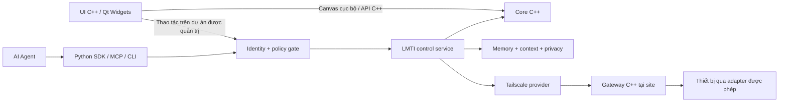

> Historical snapshot, 2026-10-13, before product-plan consolidation.
> The [current master plan](../LMTI_MASTER_PLAN.md) replaces its priorities,
> milestone order and immediate backlog. This file preserves earlier decisions
> and evidence; it does not authorize implementation. Relative links were rebased.

# LMTI — Kế hoạch tổng thể

Ngày: 2026-10-11; cập nhật 2026-10-13. Trạng thái: kế hoạch triển khai local alpha.

**Chỉ đạo mới nhất 2026-10-13: lập kế hoạch rõ ràng trước khi thực hiện tiếp.**
[Kế hoạch trải nghiệm đang đề xuất](../plans/2026-10-13-experience-plan.md) xác định
ba luồng chính, lựa chọn cách bắt đầu, wireframe/prototype và tiêu chí nghiệm thu.
Tạm dừng sửa mã giao diện trong bước lập kế hoạch; bố cục và prototype cần được
người dùng duyệt trước đợt triển khai tiếp theo. Bản đơn giản hiện có là mốc tham
chiếu kỹ thuật, chưa được coi là trải nghiệm cuối cùng đã nghiệm thu.

Cập nhật giao diện 2026-10-13: người dùng chọn giản lược **toàn bộ LMTI**.
[Đợt giao diện đơn giản](../plans/2026-10-13-simple-studio.md) đưa năm mục hằng ngày
ra ngoài, công cụ chuyên sâu mở khi cần, Drive theo từng bước và shell trắng/xám.
Package mới `build/studio-simple-20261013`; phiên đang sửa được giữ nguyên.
Đây là thay đổi trình bày, không bổ sung chat/model giả hay nới quyền Agent.

Google Drive 2026-10-13: [kết nối nhanh và đọc tài liệu từ thư mục được chọn](../google-drive.md)
dùng adapter riêng. OAuth thuộc cấu hình phát hành; người dùng đăng nhập bằng
trình duyệt. Nội dung chỉ xem cục bộ trong phiên, chưa nhập vào memory/AI.
Đăng nhập Google thật và xác minh phát hành vẫn là gate chưa hoàn tất;
không mở quyền mạng cho Agent hay thiết bị.

**Ưu tiên được người dùng cho phép ngày 2026-10-13:** chứng minh giá trị trước trên
dự án phần mềm–phần cứng/IoT. [Đợt native impact review](../plans/2026-10-13-native-impact-review.md)
nối snapshot đã lưu từ owner C++ với impact owner TypeScript, review trong Qt và
lịch sử xác minh có bằng chứng. Package mới `build/studio-impact-20261013`;
ghi review cần launcher `-AllowImpactReview`. [ADR](../adr/2026-10-13-native-impact-review.md)
giữ boundary riêng, nguồn declared-only và kiểm tra freshness. Nghiệm thu người dùng,
Windows sạch, pilot thật và hiệu quả kinh doanh vẫn là gate riêng.

**Đợt giao diện trước đó:** người dùng yêu cầu sửa giao diện desktop trước.
[Bản sửa quản trị](../plans/2026-10-12-management-ui-fix.md) tập trung Dự án,
Phần mềm, Phiên bản và Công việc; package `build/studio-ui-fix-20261012`.
Hướng impact bên dưới vẫn giữ mục tiêu sản phẩm, không thay thế yêu cầu UI này.

**Ưu tiên mới do người dùng chốt ngày 2026-10-12:** LMTI hỗ trợ review thay đổi:
ảnh hưởng tới đâu, bằng chứng nào, còn gì phải xác minh. Xem
[kế hoạch sản phẩm và pilot 6 tuần](../plans/2026-10-12-evidence-backed-change-impact.md).
Pilot dùng dữ liệu giả lập, nối code–service–triển khai/thiết bị–bước nghiệp vụ,
đo cả công duy trì mapping; chưa mở thực thi thiết bị hoặc pilot mạng.
TypeScript + SQLite đã được triển khai cho slice impact/evidence giả lập, giữ ownership
C++/Qt/Python hiện có. Xem [cách chạy và trạng thái thực tế](../impact-review.md).
Tích hợp Qt/native được triển khai tiếp trong đợt 2026-10-13; gate SME và hiệu quả
kinh doanh chưa hoàn tất.
Các mục nền tảng IoT, gateway, Tailscale và nhiều site bên dưới được giữ làm
tham chiếu dài hạn; không phải backlog đồng thời của đợt sáu tuần này.

Cập nhật UI 2026-10-12: người dùng chưa chấp nhận bố cục U1–U4 đầu tiên.
[Đợt chỉnh lại giao diện quản trị](../plans/2026-10-12-ui-refinement.md) tổ chức Library,
sidebar, header, danh sách/chi tiết và luồng dự án–phần mềm–phiên bản–công việc;
package `build/studio-ui-v2` vẫn là local alpha, chờ nghiệm thu sử dụng.

Theo hướng thiết kế Image AI, [bộ 26 màn hình](../design/2026-10-12-ai-ui/index.html)
và [prompt/giới hạn triển khai](../design/2026-10-12-ai-ui/README.md) là tham chiếu
cho mục tiêu triển khai giống thiết kế. [Ma trận triển khai và nghiệm thu](../plans/2026-10-12-design-implementation.md)
theo dõi từng trang. Package phát triển `build/studio-design` tách khỏi bản cũ;
các trang vẫn cần đối chiếu và xác minh, chưa được coi là hoàn tất. Boundary
và năng lực thực tế của local alpha vẫn là nguồn sự thật.

Đây là tài liệu điều phối chính cho hướng phát triển đã trao đổi. [Bản khảo sát repository](../plans/2026-10-11-iot-agent-platform.md) lưu bằng chứng baseline trước triển khai và các điểm cần migration. Theo cập nhật của người dùng, giao diện dùng **C++/Qt Widgets**, domain core C++ và SDK/MCP Python.

Bản MVP cục bộ đầu tiên đã được triển khai trong `native/`, `apps/desktop/` và `python/`: vẽ/sửa/nối thiết bị, lưu SQLite có revision, context theo site/quyền public và đề xuất cấu hình có kiểm tra xung đột. Qt Base 6.12.0 đã được cài riêng trong `.tools/` để build trên Windows. [Hướng dẫn và phạm vi MVP](../topology-studio.md) mô tả năng lực đã có; Tailscale, gateway, telemetry, RBAC nhiều người dùng, mã hóa và thực thi thiết bị vẫn thuộc các giai đoạn tiếp theo. Các mục baseline bên dưới ghi lại hiện trạng trước thay đổi.

Ưu tiên tiếp theo được người dùng chọn là **quản lý dự án phần mềm gắn với
phần cứng, kết hợp công việc và milestone**. [Kế hoạch chi tiết S0–S5](../plans/2026-10-11-software-hardware-projects.md)
đặt Projects làm điểm vào chính và liên kết component/repo/release với thiết
bị, target, work item và knowledge. Lát cắt MVP đã được triển khai; xem
[hướng dẫn Projects](../project-studio.md) và [báo cáo](../plans/2026-10-11-project-execution.md).
Memory bridge cục bộ có kiểm tra policy nguồn đã có trong U4; các gate
operator/product-client/Windows sạch còn thiếu. Pilot mạng P4 chưa mở.

Cập nhật 2026-10-12: người dùng yêu cầu quản lý thư mục dạng **Project library**
và giao diện dễ sử dụng hơn. [Kế hoạch L0–L3](../plans/2026-10-12-project-library.md)
đã được triển khai: tạo thư mục mới/liên kết thư mục có sẵn, tìm kiếm/ghim/mở
nhanh, sidebar và breadcrumb. **English mặc định, tiếng Việt phụ**, đổi ngay
trong ứng dụng mà giữ thay đổi chưa lưu. Thư viện chỉ lưu tham chiếu cục bộ,
không gộp repo/memory hoặc cấp thêm quyền Agent. [Báo cáo thư viện](../plans/2026-10-12-library-execution.md)
phân biệt bằng chứng tự động/render với nghiệm thu người dùng/Windows sạch.

[Kế hoạch tối ưu giao diện](../plans/2026-10-12-ui-optimization.md) đã được triển
khai U1–U4: validation giữ bản nhập, inspector/Back, Library Card/List, Work
List/Board, graph và Agent summary; Knowledge có adapter TS riêng, snapshot
theo policy, task context và lesson review có grant/fingerprint/transaction.
[Báo cáo UI](../plans/2026-10-12-ui-execution.md) ghi bằng chứng U5 và giới hạn
nghiệm thu. English mặc định, tiếng Việt phụ; gate operator/product-client và
Windows sạch vẫn tách khỏi kiểm tra trên máy phát triển.

## 1. Sản phẩm muốn xây

**LMTI là nền tảng vẽ và quản trị kiến trúc hệ thống IoT, kết nối tài sản theo quyền và cung cấp hiểu biết có kiểm chứng cho AI Agent.**

Ở local alpha, Architecture Studio là ứng dụng cho domain topology/IoT; memory,
context, privacy, verification và lesson có review tiếp tục là nền tảng độc lập.
[Bản đồ support/ownership](../component-support.md) ghi rõ năng lực hiện có và các
đường TS/Go tương thích. Không coi tầm nhìn quản trị là năng lực đã triển khai.

Người vận hành có thể tổ chức nhà máy, vẽ quan hệ thiết bị/dịch vụ, cấu hình machine, kiểm tra trạng thái, xem tác động của thay đổi và xét duyệt đề xuất. Agent đọc cùng mô hình với người vận hành để giải thích phụ thuộc, phát hiện sai lệch và đề xuất hành động trong phạm vi được cấp.

Tầm nhìn dài hạn là quản trị nhiều nhà máy và hàng nghìn thiết bị. Tích hợp Tailscale cung cấp lớp kết nối cho pilot; LMTI phát triển lớp kiến trúc, context, policy và workflow quản trị dựa trên nó. Không coi khả năng kết nối mạng là quyền điều khiển thiết bị.

## 2. Điểm xuất phát thực tế

Repository đã tải: `vuthuanphat6-byte/lmti-atlas`, baseline `0b6e089` trên `main`.

- Có CLI TypeScript, memory/context/privacy, lesson flow và Go core thử nghiệm.
- Apps hiện là terminal demo; chưa có GUI hoặc mô hình inventory/topology công nghiệp.
- MCP hiện là stub; adapter ID chưa chứng minh có tích hợp Agent hoàn chỉnh.
- Có nhiều đường lưu trữ TS/Go/JSON/InMemory cần kiểm kê trước migration.
- `go test ./...` thất bại vì thiếu `internal/secrets`; ba package config/storage/contract có test pass. Build/test TS chưa chạy vì clone chưa có dependency và pnpm đã pin chưa sẵn trong cache offline.

Tái sử dụng semantics privacy, context, provenance, lessons và các test tương ứng. UI C++, domain IoT, gateway, network provider và service cho Agent là phần bổ sung. Các file thử nghiệm ở thư mục cha repository chưa được nhập vào dự án.

## 3. Kiến trúc và công nghệ

| Khối | Công nghệ đích | Trách nhiệm |
| --- | --- | --- |
| Desktop | **C++ / Qt Widgets**, Windows cho bản đầu | Canvas bằng Graphics View, danh sách tài sản, inspector, diff và xét duyệt |
| Domain core | **C++** | Mô hình có kiểu, validator, truy vấn đồ thị, snapshot/revision, interface lưu trữ |
| Interface UI/core | API C++ nội bộ | Ownership và lỗi rõ ràng; core độc lập Qt. C ABI chỉ bổ sung khi có nhu cầu tương tác ngôn ngữ/binary cụ thể |
| Control service | **Python** kết hợp core C++ | API, danh tính, policy, điều phối context, proposal và audit |
| Agent integration | **Python SDK, MCP, CLI adapter** | Cung cấp capability thống nhất cho Agent; không phụ thuộc một nhà cung cấp model |
| Edge gateway | **C++** | Adapter thiết bị, telemetry, lưu đệm offline, kiểm tra tác vụ tại site |
| Connectivity | Network-provider interface; **Tailscale** ở pilot | Enrollment, trạng thái kết nối và thu hồi quyền qua provider |
| Storage | **SQLite** cục bộ; backend server qua interface ở giai đoạn nhiều site | Tách topology/configuration, memory và telemetry |

UI và Agent dùng cùng mô hình và policy đối với tài sản được quản trị. Core nhúng trong desktop chỉ xử lý tài liệu/canvas cục bộ; không tạo đường vượt quyền tới gateway. API thư viện trong cùng tiến trình không phải sandbox. Giữ domain core độc lập với Qt để gateway/service có thể dùng lại.

[Qt Widgets](https://doc.qt.io/qt-6/qtwidgets-index.html) cung cấp UI desktop và model/view cho bảng/cây; [Graphics View](https://doc.qt.io/qt-6/graphicsview.html) cung cấp scene/item, chọn, kéo thả và zoom cho canvas 2D. Cần benchmark sơ đồ thực tế trước khi cam kết quy mô. Chọn phiên bản Qt và kiểm tra advisory, giấy phép, đóng gói ở P0/P2; chỉ nhận theme/layout state từ nguồn do ứng dụng kiểm soát.

Bản đầu ưu tiên chạy cục bộ hoặc tự lưu trữ theo site; API truy cập từ xa chỉ mở khi đã có identity, phân quyền và audit. Triển khai Linux/macOS cho desktop sẽ được chọn riêng nếu có nhu cầu; core/gateway cần tránh phụ thuộc UI Windows.

## 4. Trải nghiệm người dùng

| Màn hình | Chức năng chính | Mốc |
| --- | --- | --- |
| Workspace / Sites | Chọn dự án, nhà máy, khu vực và dây chuyền | MVP |
| Project library | Tạo/liên kết thư mục, tìm kiếm, ghim, chọn lại file; English/tiếng Việt | Local alpha L0–L3 đã có, còn gate nghiệm thu |
| Projects / Overview | Tạo/mở dự án, mục tiêu, phần mềm–thiết bị, milestone và blocker | MVP S1/S3 đã có, còn gate nghiệm thu |
| Software / Hardware bindings | Repo/component/target/release và phần mềm mong muốn trên từng thiết bị | MVP S2 đã có |
| Work / Releases | Công việc gắn component/thiết bị, milestone/checklist và evidence phiên bản | MVP S2/S3 đã có, không có deploy |
| Architecture Canvas | Kéo thả, nối quan hệ có loại, pan/zoom, nhóm, tìm kiếm, undo/redo | MVP |
| Asset Inventory | Machine, thiết bị, gateway, broker, service; lọc theo site/loại | MVP |
| Inspector | Thuộc tính, cấu hình mong muốn, vai trò, tham chiếu tài liệu; kiểm tra lỗi | MVP |
| Agent Context / Proposals | Xem context đã cấp, nguồn, revision, giải thích và diff đề xuất | MVP |
| State / Drift | Trạng thái quan sát, thời gian thu thập, stale/unknown, sai lệch cấu hình | Pilot |
| Access / Audit / Jobs | Danh tính, quyền, lịch sử tác vụ và kết quả | Quyền đọc từ MVP; vận hành mở rộng sau pilot |

Không hiển thị trạng thái online chỉ vì tài sản tồn tại trên canvas. Thiết bị chưa có telemetry phải hiện unknown; dữ liệu quá hạn phải hiện stale.

Luồng Projects → Overview → Software/Hardware → Work/Releases → Agent được
cụ thể hóa trong kế hoạch S0–S5. Project không đồng nghĩa site hoặc repository;
desired release không chứng minh phần mềm đã được cài lên thiết bị. Các dòng
MVP trong bảng là mục tiêu trải nghiệm; hướng dẫn Studio ghi năng lực hiện có.

## 5. Một mô hình dùng chung cho người và Agent

Domain gồm tổ chức, site, khu vực/dây chuyền, asset, machine, device, gateway, service, interface, zone, relationship, observation, policy và proposal.

Phần mở rộng quản lý dự án bổ sung Project, RepositoryRef, SoftwareComponent,
HardwareTarget, SoftwareRelease, SoftwareBinding, VerificationRecord,
WorkItem, Milestone và KnowledgeRef. Các mô hình/quan hệ và quy tắc revision,
scope, import được đề xuất trong kế hoạch S; không biến component phần mềm
thành một node service để thay cho domain riêng, không gộp store memory.

- ID ổn định; IP, hostname hoặc MAC là thuộc tính có nguồn, không tự chứng minh danh tính.
- Quan hệ phân loại rõ: chứa, nối vật lý, có thể kết nối mạng, luồng dữ liệu, phụ thuộc, được điều khiển bởi. Policy truy cập là dữ liệu riêng.
- Tách cấu hình mong muốn (**desired**), trạng thái quan sát (**observed**), đề xuất (**proposed**) và vị trí hiển thị (**layout**).
- Observation có nguồn, thời điểm đo/nhận, chất lượng, TTL và evidence reference. Phân biệt dữ kiện khai báo, đo được và suy luận của Agent.
- Mỗi snapshot có revision; cập nhật dùng expected revision và transaction, trả xung đột khi dữ liệu đã đổi.
- Secret chỉ có tham chiếu. Dữ liệu nhạy cảm cần mã hóa khi lưu/truyền và kiểm soát khóa; topology nội bộ không mặc định được gửi tới model bên ngoài.

JSON tiếp tục được phép ở biên CLI/API/MCP để tương thích. Mô hình và thuật toán lõi dùng C++; dữ liệu bền vững nằm trong database. Việc đổi ngôn ngữ không yêu cầu xóa các contract giao tiếp đang được dùng.

## 6. Agent hoạt động như thế nào

Mọi entry point dùng chung chuỗi: xác thực → xác định phạm vi → lọc metadata theo quyền → truy vấn dữ liệu được phép → dựng context theo nhiệm vụ → kiểm tra đầu ra → ghi audit.

Capability của bản đầu:

1. Liệt kê tài sản và đọc subgraph có phân trang/giới hạn.
2. Đọc cấu hình, trạng thái, freshness và revision của machine.
3. Giải thích quan hệ phụ thuộc bằng evidence.
4. Lấy context theo nhiệm vụ và giới hạn token.
5. Tạo proposal có diff và phân tích ảnh hưởng.
6. Đề xuất lesson có nguồn, chờ review trước khi trở thành kiến thức tin cậy.

MVP phải kiểm chứng ít nhất một Agent bên ngoài, bắt đầu với Codex hoặc một MCP client phù hợp. Python SDK và MCP phải gọi service có policy; không trao SQLite connection hoặc memory-store object cho Agent. Muốn cưỡng chế điều này cần service identity và quyền filesystem riêng; stdio không tự tạo sandbox.

Ví dụ xuyên suốt: operator vẽ **Machine A → Gateway B → Broker C**. Agent trả lời “Gateway B ảnh hưởng tới những tài sản nào?” từ đúng snapshot, chỉ ra thiếu telemetry nếu có, rồi tạo diff đề xuất. Operator xem được lý do, nguồn và revision của đề xuất.

## 7. Lộ trình phát triển

| Giai đoạn | Đầu ra cụ thể | Điều kiện để đi tiếp |
| --- | --- | --- |
| **P0. Củng cố baseline** | Khảo sát dependency/store; xử lý source Go thiếu hoặc phân loại đường Go chưa hỗ trợ; chạy TS baseline; ghi quyết định C++/Python | Có build/test tái lập cho đường hỗ trợ, danh sách blocker và contract privacy tham chiếu |
| **P1. Domain và core** | Topology v1, validator/query và API C++, SQLite repository, snapshot/revision | CRUD và save/open không mất dữ liệu; chặn dữ liệu sai; kiểm tra xung đột revision và migration |
| **P2. Giao diện C++** | Qt Widgets/Graphics View, canvas, inventory, inspector, save/open, dirty-state, undo/redo | Người dùng hoàn thành tạo → nối → sửa → kiểm tra → lưu → mở lại; UI đáp ứng khi xử lý nền |
| **P3. Agent integration** | Python SDK, MCP server thật, policy/context chung, proposal diff | Agent đọc đúng scope, có nguồn/freshness/revision; giả role không tăng quyền; proposal không tự thực thi |
| **S0–S5. Quản lý dự án phần mềm–phần cứng** | Projects, component/repo/release/target/binding, work/milestone, project context và review | MVP và UI/bridge U1–U4 đã triển khai; lookup/schema recovery và manual/product-client/clean Windows còn gate |
| **P4. Pilot IoT** | Một site, Tailscale provider, gateway C++, một adapter chỉ đọc, telemetry/offline buffer | 50–100 thiết bị được phép; stale/revoke/reconnect hoạt động; mất WAN không phá vận hành cục bộ |
| **P5. Quy mô nhiều site** | Backend trung tâm, isolation, subscriptions/delta, bounded queues, retention | Mô phỏng 1.000 rồi 10.000 tài sản với workload công bố; có báo cáo tải và phục hồi; không rò dữ liệu chéo site |
| **P6. Quản trị có kiểm soát** | Một số thao tác allowlist, approve/dispatch/verify, audit, stop/revoke | Chặn tác vụ trùng/hết hạn/revision cũ; kiểm tra lại tại gateway; diễn tập lỗi trước thiết bị sản xuất |

Thứ tự phụ thuộc cập nhật: **P0 → P1 → P2/P3 → S0–S5 → P4 → P5/P6 theo gate tương ứng**.
S là phần mở rộng dự án trên nền local topology hiện có, không mở quyền kết
nối/thực thi thiết bị. Các gate operator/Agent của P2/P3 còn thiếu tiếp tục
được hoàn tất trong quá trình nghiệm thu, không được bỏ qua. P6 chỉ mở sau
pilot và sau khi các kiểm tra quyền, cách ly, thu hồi và recovery liên quan
đã đạt; không cần đợi mọi tối ưu hiệu năng của P5.

**Bản phát hành đầu là P0–P3:** công cụ kiến trúc dùng được và Agent kết hợp thực sự trên cùng dữ liệu. **Pilot vận hành là P4.** **Quản trị diện rộng là P5–P6.** Chưa ấn định lịch khi chưa có baseline, nhân lực và yêu cầu pilot thực tế.

P0–P3 vẫn mô tả lát cắt topology ban đầu; bản local alpha tiếp theo ưu tiên
quản lý dự án qua S0–S5. Kế hoạch mới không thay đổi kết quả cleanup đã đạt
hoặc thay các gate còn thiếu bằng kết quả build. Chức năng Projects/Work/Releases
hiện đã có trong bản local alpha; phạm vi chính xác nằm trong hướng dẫn/báo cáo mới.

## 8. Chiến lược chuyển đổi từ repo hiện tại

[Kế hoạch dọn dẹp và thống nhất](../plans/2026-10-11-consolidation-cleanup.md) cụ thể hóa phần chuyển tiếp này. [Báo cáo thực thi](../plans/2026-10-11-cleanup-execution.md) ghi các đợt đã hoàn thành và gate còn thiếu; import JSON ghi bị chặn trong lúc chưa có mapping policy/provenance/lifecycle đầy đủ. Không có migration dữ liệu người dùng trong đợt cleanup này.

1. Dùng TypeScript CLI/privacy/context hiện tại làm implementation tham chiếu; trích contract tests trước khi port.
2. Bổ sung domain IoT tách khỏi Project Atlas và memory của coding project. Liên kết bằng ID và evidence, không gộp schema theo tên gọi giống nhau.
3. Xây core C++ mới theo lát cắt; giữ adapter tương thích TS có command allowlist, giới hạn I/O và timeout trong thời gian chuyển đổi.
4. Kiểm kê store TS SQLite, Go SQLite và JSON legacy; migration có dry-run, backup, kiểm tra privacy/provenance, phiên bản và kế hoạch rollback.
5. Chỉ một writer được sở hữu một schema/version. Chỉ ngừng đường TS/Go tương ứng sau khi có parity và dữ liệu đã chuyển được kiểm chứng.
6. Cập nhật AGENTS.md, README, architecture và development để ghi rõ hướng ngôn ngữ mới. Các điều khoản bảo mật và host-project boundary vẫn được giữ.

Không nhập tự động prototype ở thư mục cha vào code chính. Mọi module native mới phải được đặt trong repository và đi qua build, test và review theo kiến trúc này.

## 9. An toàn vận hành và quy mô

**[CẢNH BÁO BẢO MẬT]** AI có quyền ghi vào thiết bị OT có thể gây dừng sản xuất hoặc tác động vật lý. Vì vậy pilot bắt đầu chỉ đọc; quyền đề xuất, duyệt và thực thi được tách riêng. PLC, interlock và vòng điều khiển tiếp tục hoạt động độc lập với AI, LMTI và Internet.

- Workflow ghi: **đề xuất → validate → đánh giá ảnh hưởng → duyệt → dispatch → xác minh**. Kiểm tra lại principal, đích, tham số, deadline, revision và idempotency tại gateway.
- Danh tính riêng cho gateway/Agent; quyền theo tổ chức/site/tài sản/thao tác, có thu hồi. Nội dung nhãn/mô tả không thể cấp quyền hoặc trở thành lệnh shell.
- Subnet router phục vụ thiết bị không cài client; vẫn phải bảo vệ đoạn mạng legacy phía sau bằng phân vùng và quyền theo đích/giao thức.
- Canvas dựng phần đang xem; context chỉ chứa subgraph liên quan; telemetry tách khỏi memory. Queue có giới hạn, backpressure và quy tắc xử lý mất dữ liệu rõ ràng.
- Đo p95/p99 query/context, frame time UI, CPU/RAM, throughput, backlog và thời gian đồng bộ lại. Ghi số cạnh, site, telemetry Hz, kích thước event và concurrency cùng với số thiết bị.
- Test cross-site denial, role giả, dữ liệu stale, prompt injection trong metadata, file hỏng/quá lớn, thu hồi quyền, mất WAN, tác vụ trùng và proposal lỗi thời.
- Trước push: kiểm tra `.gitignore` cho `.env`, key/certificate, database và topology riêng; chạy publish preflight theo quy tắc repo. Không cam kết bảo mật hoặc mức tải chỉ từ lựa chọn C++.

## 10. Backlog bắt đầu ngay sau kế hoạch

| Ưu tiên | Đầu việc | Sản phẩm kiểm tra được |
| --- | --- | --- |
| 1 | BASE-01: khôi phục baseline và điều tra `internal/secrets`/ignore rule | Báo cáo build/test, đường hỗ trợ rõ ràng |
| 2 | ARCH-01: đồng bộ quyết định C++/Python và ranh giới dịch vụ | ADR cùng các tài liệu kiến trúc nhất quán |
| 3 | MODEL-01: topology v1 và dữ liệu mẫu một dây chuyền | Schema/contract và fixtures không chứa dữ liệu nhạy cảm |
| 4 | CORE-01: C++ model/validator/repository và API nội bộ | Test round-trip, validation và revision conflict |
| 5a | UI-01: Qt Widgets canvas + inspector + save/open | Luồng thao tác desktop C++ hoàn chỉnh |
| 5b | AGENT-01: scoped Python SDK + MCP chỉ đọc | Agent truy vấn/explain cùng topology với UI |
| 6 | PROPOSAL-01: đề xuất thay đổi có diff | Người vận hành xem được nguồn, tác động và revision |

Các thông tin cần chốt trước P4: hệ điều hành gateway, loại thiết bị/giao thức pilot, địa điểm triển khai, yêu cầu mất mạng và mức dữ liệu dự kiến. Những thông tin này không chặn việc hoàn thành P0–P3 với dữ liệu mô phỏng.

**Backlog ưu tiên tiếp theo:** S0 contract/wireframe → S1 Project foundation
→ S2 software/hardware → S3 work/milestone → S4 knowledge/Agent → S5 nghiệm
thu. Bảng đầu việc phía trên lưu thứ tự khởi đầu topology; trạng thái thực
tế nằm trong support map/cleanup report và phạm vi Studio. Xem kế hoạch chi
tiết S để biết đầu ra và điều kiện hoàn thành từng đợt mới.

Các điểm bàn giao đầu tiên là bản desktop C++ dùng được, workspace có schema/version, Agent API được kiểm soát, test contract và tài liệu build. Bằng chứng chi tiết và nguồn tham khảo nằm trong [bản khảo sát kỹ thuật](../plans/2026-10-11-iot-agent-platform.md).

