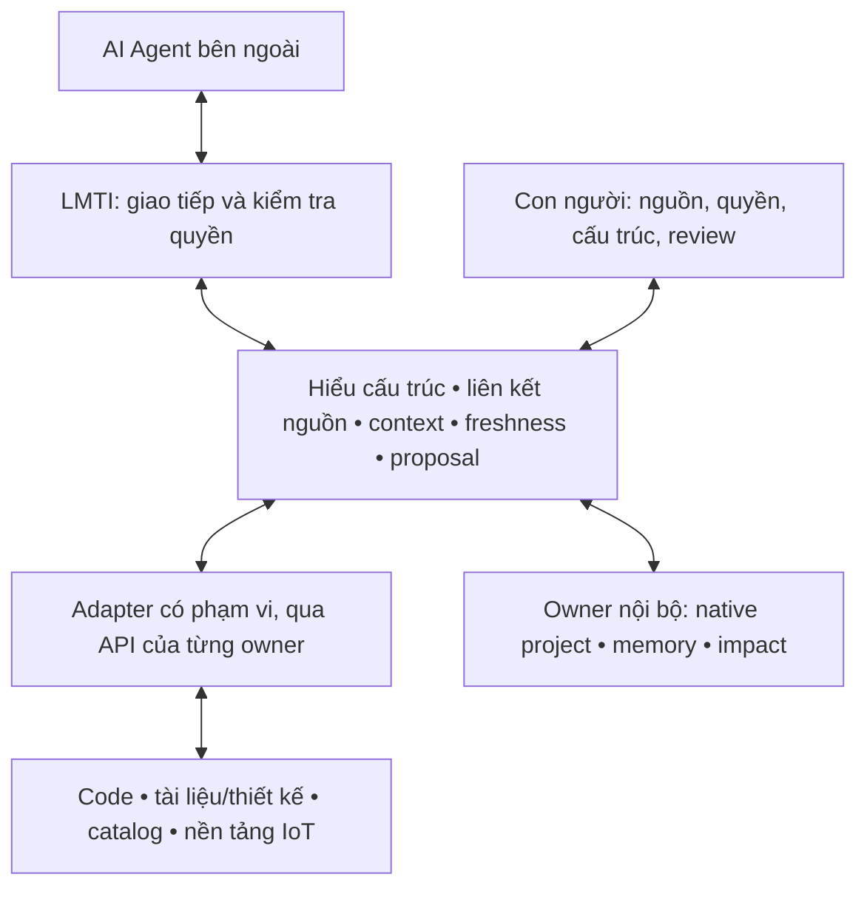

> Historical r3 priority snapshot. Superseded by [master r4](../LMTI_MASTER_PLAN.md).
> Preserves earlier scope/evidence; local links relocated for the archive.

# LMTI — Kế hoạch tổng thể: lớp kết nối AI Agent với dự án

Ngày cập nhật: 2026-10-13. Phiên bản **r3**.
Trạng thái: **M2 native read slice đã triển khai; M1 pilot/UX và M2–M4 còn gate mở**.
Tài liệu này là nơi duy nhất quyết định ưu tiên và thứ tự công việc.

## 1. Định nghĩa và mục tiêu

**LMTI là lớp hiểu biết và tương tác có kiểm soát giữa AI Agent với dự án.**

Agent dùng LMTI để biết dự án gồm những gì, các phần liên quan ra sao, thông tin
đến từ đâu, còn đúng ở thời điểm nào và mình được phép đọc hoặc đề xuất điều gì.
Con người quản lý cấu trúc, nguồn, quyền và xét duyệt qua giao diện LMTI.

Hướng đã được chủ sản phẩm xác nhận:

- Bao phủ kết cấu dự án lớn, gồm phần mềm, thiết kế/tài liệu, hạ tầng và thiết bị IoT.
- Bản đầu có cấu trúc dự án và **trạng thái thiết bị thật**, trong phạm vi chỉ đọc.
- Agent là bên sử dụng lớp này; không phụ thuộc một hãng model.
- Trải nghiệm đơn giản; hoạch định rõ trước khi tiếp tục xây.

Chủ sản phẩm đã yêu cầu thực hiện r3. [Gói M1](../plans/2026-10-13-agent-layer-m1.md)
chốt thiết kế local và kiểm tra client; pilot thật/ngưỡng và nghiệm thu còn mở.
Chủ sản phẩm đã nhận phương án adapter dùng chung để thực hiện. Native M2 đã có
[API đọc và envelope](../agent-layer.md), [bằng chứng](../plans/2026-10-13-agent-layer-m2-execution.md);
đây chưa là hoàn tất M2 hoặc đường IoT thật.
Các lựa chọn dưới đây không phải năng lực đã nghiệm thu toàn release.
Master r3 thay định vị ở [r2](../archive/2026-10-13-master-plan-r2.md);
giữ yêu cầu cấu trúc lớn và IoT thật. Không chạy thêm roadmap sản phẩm song song.

Đích dài hạn là áp dụng được cho nhiều loại dự án. Bước chứng minh đầu tiên là
**một dự án phần mềm–phần cứng/IoT đại diện**, có chủ nguồn và người kiểm chứng.
Chưa hứa tự hiểu mọi dự án, mọi ngôn ngữ hoặc thiết bị mà không có mapping.

## 2. Giá trị phải chứng minh

Một Agent đã có thể đọc repository, tài liệu và gọi công cụ. LMTI cần giảm công
tự ghép và kiểm tra lại thông tin giữa các nguồn, đồng thời giữ đúng quyền.

Tình huống nghiệm thu xuyên suốt:

> “Nếu thay đổi cấu trúc dữ liệu của firmware này, những service và thiết bị nào
> có thể liên quan? Thiết bị nào đang chạy phiên bản đó, nguồn nào đã cũ, cần
> kiểm chứng gì và tôi được phép đề xuất thay đổi ở đâu?”

LMTI cung cấp các liên kết và bằng chứng đủ để Agent trả lời:

**Yêu cầu/thiết kế → code → component/service → release → triển khai/thiết bị →
quan sát thực tế → kết quả kiểm chứng.**

Không đủ bằng chứng phải trả phần chưa biết hoặc mâu thuẫn. Quan hệ liên quan
không tự chứng minh quan hệ nhân quả; bản khai báo triển khai không chứng minh
phiên bản đang chạy. Agent tự trình bày câu trả lời, LMTI chịu trách nhiệm dữ liệu,
ngữ nghĩa, giới hạn và quyền của kết quả cung cấp.

## 3. Rút ra từ các dự án tương đồng

Đối chiếu tài liệu chính thức ngày 2026-10-13; bảng là quyết định định hướng,
không phải benchmark hoặc quyết định cài đặt/mua sản phẩm.

| Nhóm tham chiếu | Khả năng đã có ở hệ sinh thái | Hệ quả đối với LMTI |
| --- | --- | --- |
| [Port](https://docs.port.io/context-lake/consuming-the-lake/port-mcp-server/) | Agent ngoài truy catalog, ownership, dependency và chạy action theo quyền | Catalog + MCP + quyền đã có đối thủ gần; cần chứng minh lợi ích của liên kết xuyên nguồn trên bài toán pilot |
| [Backstage](https://backstage.io/docs/features/software-catalog/system-model/) | Mô hình component/API/resource/system/domain | Tái dùng catalog hiện hữu nếu dự án có; tránh buộc nhập lại danh mục |
| [Serena](https://github.com/oraios/serena), [Augment Context Engine](https://docs.augmentcode.com/context-services/mcp/overview) | Truy cập code có ngữ nghĩa và cung cấp context code cho Agent | Dùng adapter tới công cụ phân tích code phù hợp; không tự xây lại language server |
| [Graphiti](https://github.com/getzep/graphiti), [OpenViking](https://github.com/volcengine/OpenViking) | Graph theo thời gian hoặc tổ chức context/memory/resources cho Agent | Memory/graph không tự tạo khác biệt; giữ owner memory hiện có, đánh giá thay thế chỉ khi có nhu cầu đo được |
| [NetBox MCP](https://github.com/netboxlabs/netbox-mcp-server), [ThingsBoard MCP](https://thingsboard.io/docs/user-guide/mcp-server/) | Truy cập hạ tầng hoặc thiết bị/telemetry qua công cụ cho Agent | Ưu tiên lấy inventory/observation từ hệ đang vận hành; chỉ cho phép tập công cụ đọc cần thiết |
| [MCP](https://modelcontextprotocol.io/docs/learn/architecture) | Giao thức trao đổi công cụ/context | Dùng làm đường giao tiếp; LMTI vẫn phải định nghĩa identity, ý nghĩa quan hệ, quyền và độ mới |

**Phần LMTI cần tự làm:** liên kết identity xuyên nguồn; mô hình quan hệ có kiểu;
truy xuất context có nguồn, phiên bản, phạm vi và độ mới; kiểm tra quyền; đề xuất
thay đổi gắn revision và review; cách con người duy trì những liên kết đó.

**Phần ưu tiên tích hợp:** phân tích code, nguồn tài liệu, catalog hạ tầng, nền tảng
quan sát thiết bị và Agent/model. Chỉ chọn adapter phục vụ pilot; danh sách trên
không trở thành danh sách dependency bắt buộc.

Giả thuyết khác biệt là Agent hiểu liên hệ giữa code–thiết kế–thiết bị–trạng thái
với công duy trì thấp và có thể triển khai cục bộ. Chưa có bằng chứng LMTI vượt
các nền tảng này. Nếu kết nối nguồn trực tiếp đã giải quyết tương đương với ít
công hơn, cần thu hẹp phần LMTI tự xây.

## 4. Kiến trúc sản phẩm đích

LMTI gắn vào dự án bằng context, không được import vào business runtime của dự án.
Nguồn gốc vẫn sở hữu dữ liệu gốc. LMTI giữ phần hiểu biết đã biên dịch, tham chiếu,
mapping và memory có chủ đích; không sao chép toàn bộ repository/telemetry.

| Năng lực | Trách nhiệm |
| --- | --- |
| Kết nối nguồn | Khai báo nguồn, phạm vi, quyền, revision/cursor, trạng thái đồng bộ và thu hồi |
| Hiểu cấu trúc | Nhận diện đối tượng, quan hệ, owner, nguồn có thẩm quyền và xung đột |
| Cung cấp context | Truy đúng phần liên quan, phân trang, ngân sách dữ liệu/token, evidence và độ mới |
| Tương tác có kiểm soát | Hợp đồng đọc/đề xuất rõ; kiểm tra quyền tại boundary và owner thực thi |
| Ghi nhớ và kiểm chứng | Quyết định/lesson đã review, kết quả kiểm chứng gắn phiên bản; không học raw chat |
| Giao diện con người | Cấu hình, kiểm tra mapping, duyệt cấu trúc/observation và review proposal |

UI dùng chung dữ liệu và quyền với đường Agent. Không cần mở desktop hoặc xây
hội thoại AI nhúng để thực hiện truy vấn Agent trong bản đầu.

## 5. Phạm vi bản đầu: một luồng chạy thật

**Một Agent thật → LMTI → cấu trúc/code/tài liệu có liên kết + một nguồn IoT thật
→ câu trả lời có bằng chứng → một đề xuất được người review.**

| Bắt buộc để nghiệm thu | Giới hạn bản đầu |
| --- | --- |
| Một Agent client thật dùng giao tiếp được hỗ trợ | Đề xuất MCP stdio qua Python boundary hiện có; chốt contract ở M1. Kiểm tra tính độc lập bằng contract test, chưa hứa tương thích mọi client |
| Một dự án đại diện có logic và vật lý/triển khai | Phân hệ, component/service, repository, release, site/environment, gateway/device và liên kết cần cho tình huống thử |
| Ba nhóm nguồn | Code/tài liệu thiết kế được phép; cấu trúc native hoặc catalog owner; nguồn observation IoT thật |
| Mapping và cập nhật | Nhập qua owner, xem diff, identity ổn định, idempotency, phát hiện nguồn cũ/xóa/mâu thuẫn; không bắt vẽ lại hàng nghìn node |
| Context và truy vấn xuyên nguồn | Scope, evidence, phiên bản/thời gian, completeness và unknown; không chỉ tìm từ khóa trong từng nguồn rời rạc |
| Observation thật | Một site/phạm vi, một adapter, một tập chỉ số và quy tắc freshness được khóa; ưu tiên nền tảng quan sát sẵn có |
| Đề xuất có review | Tái dùng một loại proposal metadata/desired configuration đã có owner; Agent không tự ghi DB; người review mới lưu revision |
| UI hỗ trợ và vận hành | Kết nối Agent/nguồn, xem quyền/mapping/lỗi, tìm thành phần, kiểm tra observation và review; cài đặt/recovery có hướng dẫn |

Google Drive là lựa chọn cho nguồn tài liệu, không bắt buộc nếu pilot dùng tài
liệu cục bộ. Nếu chọn Drive, phải hoàn tất OAuth thật và chính sách đưa nội dung
sang Agent; quyền xem preview cục bộ không tự cho phép gửi cho model ngoài.

Sau bản đầu mới cân nhắc nhiều adapter/site/client, chia sẻ nhiều người dùng,
nguồn CAD chuyên sâu và hành động rộng hơn theo nhu cầu đo được. Device actuation,
deploy/OTA, scan mạng tự động, Agent runtime, training, marketplace và CAD/mô phỏng
riêng nằm ngoài bản đầu. Work/board/chat và trang trí UI không phải gate release.

## 6. Mô hình dự án và hợp đồng Agent

Hai chiều **logic** (project → subsystem → component) và **vật lý/triển khai**
(site → area → host/gateway/device, kèm environment) dùng cùng identity.
Cây phân cấp không có vòng; đồ thị dependency có thể có chu trình.

Identity ổn định, tách khỏi tên/IP/địa chỉ. Mapping ngoài gồm source namespace,
external ID và quy tắc đổi tên/thay thiết bị; không tự gộp chỉ vì tên giống nhau.
Quan hệ có kiểu, hướng, phạm vi, nguồn và phiên bản. Quyền phải áp dụng cả đầu mút
và đường dẫn quan hệ; không lộ đối tượng ẩn qua ID, số lượng hoặc thông báo lỗi.

Tách rõ **khai báo/thiết kế**, **mong muốn**, **quan sát**, **suy luận/đề xuất** và
**kết quả kiểm chứng**. Mỗi assertion biết nguồn có thẩm quyền. Hai nguồn bất đồng
được giữ thành conflict có thể giải quyết, không âm thầm chọn bản nhập sau.
Kiểu miền có schema/migration; không thay bằng một túi JSON tùy ý.

Nhóm thao tác dự kiến, tên dưới đây **chưa phải API đã phát hành**:

| Nhóm | Đầu ra tối thiểu |
| --- | --- |
| Resolve/query entity | Đúng project/scope/identity, thuộc tính được phép, source references |
| Query relationships / impact context | Subgraph/path có giới hạn, loại quan hệ, bằng chứng, mapping gaps |
| Build task context | Context tối thiểu theo nhiệm vụ, quyền, ngân sách và yêu cầu freshness |
| Read observations | Giá trị/đơn vị, nguồn, sample/receive time, chất lượng, TTL và trạng thái nguồn |
| Propose change / read review outcome | Diff, expected revision, lý do/evidence, trạng thái review; không thực thi thiết bị |

M1 phải chốt response envelope chung: schema version, effective scope, source
revisions/timestamps, evidence references, freshness, completeness/cursor/budget,
conflicts/unknowns và lỗi có kiểu. Không trả raw token, private path hoặc thông tin
ngoài scope. Không ép mọi nguồn vào một “global revision” giả.

Ngữ cảnh xuất cho Agent được kiểm tra quyền trước chọn/xếp hạng và trước trả.
Scope có thẩm quyền đến từ cấu hình launcher/service tin cậy; tham số Agent chỉ
được thu hẹp phạm vi, không cấp thêm quyền hoặc chọn binary/credential tùy ý.
Thu hồi quyền phải chặn lần đọc tiếp theo, kể cả cache/report đã lưu. Đổi revision
làm proposal cũ thất hiệu lực hoặc yêu cầu review lại. Lời khẳng định “verified”
gắn bằng chứng và revision, không phải một cờ tồn tại vĩnh viễn.

Nguồn/tài liệu/tool output là dữ liệu không tin cậy: nội dung trong đó không
được cấp quyền, đổi policy hoặc trở thành lệnh thực thi. Chỉ dùng adapter và thao
tác nằm trong allowlist; không proxy công cụ bất kỳ hoặc shell tổng quát.

## 7. IoT: quan sát thật qua nguồn có trách nhiệm

Ưu tiên adapter chỉ đọc từ nền tảng IoT/monitoring hiện hữu. Nguồn đó giữ telemetry
và lịch sử gốc; LMTI chuẩn hóa identity/ý nghĩa/trạng thái, truy vấn có giới hạn
và chỉ cache phần cần thiết với retention rõ.

Chỉ xây collector trực tiếp khi pilot không có nguồn phù hợp. Đây là nhánh có
điều kiện cần ADR về protocol, endpoint, identity, giới hạn tải, lưu trữ và recovery;
không mặc định xây thêm monitoring platform hay chọn giao thức khi chưa biết thiết bị.

Observation gồm device/source identity, site/environment, metric/unit, thời điểm
đo và nhận, chất lượng, TTL; có cursor/sequence nếu nguồn cung cấp. Tách:

- Nguồn/collector có kết nối và còn quyền hay không.
- Endpoint/device có phản hồi theo phép kiểm tra đã định nghĩa hay không.
- Health chức năng hoặc chỉ số nào thực sự được đo.
- Chưa có dữ liệu, stale, unavailable, invalid hoặc revoked.

Mất collector không có nghĩa mọi thiết bị hỏng. Heartbeat không chứng minh
chức năng đúng. Xử lý duplicate/out-of-order, reset, clock skew, reconnect và gaps;
nêu giới hạn của nguồn nếu không thể bảo đảm thứ tự hoặc độ chính xác.

Observation không làm tăng topology revision ở mỗi mẫu, không vào undo/UI hoặc
memory dài hạn. Query/cache/ingest đều có timeout, giới hạn, retry/backoff và
backpressure khi cần; không giả lịch sử liên tục khi mất dữ liệu.
Agent và UI nhìn cùng source/freshness semantics.

## 8. Tái sử dụng nền hiện có và các giới hạn

| Thành phần hiện có | Dùng trong r3 | Khoảng trống |
| --- | --- | --- |
| Typed C++ core, Qt/SQLite project/topology owners | Cấu trúc, validation, revision và proposal | Phân cấp/identity/lookup/delta theo workload lớn, migration/recovery |
| Python SDK/MCP stdio | Điểm tích hợp Agent được đề xuất | Envelope chung, nối owner context và nguồn observation, nghiệm thu Agent thật |
| TS compile/context/privacy/memory | Project Atlas, context có quyền, memory/lesson | Tích hợp xuyên owner qua API; không biến TS MCP handler stub thành transport bằng tuyên bố |
| TS impact + native snapshot/review | Quan hệ, bằng chứng và review | Mapping code/triển khai/observation, freshness và giá trị trên dự án thật |
| Qt desktop/library | Mặt quản trị nguồn và review cho người dùng | Prototype theo hành trình Agent, cải thiện theo bằng chứng |
| Drive session reader | Nguồn tài liệu tùy chọn | OAuth thật, publisher acceptance, egress contract nếu dùng cho Agent |
| Go memory | Giữ compatibility hiện có | Không mở thêm topology/telemetry domain trong Go |

Các [ADR đã nhận](../plans/README.md#architecture-decisions) tiếp tục giữ hiệu lực;
mở rộng phải có ADR bổ sung, không sửa lịch sử thành lời khẳng định đã triển khai.
Native, TS memory, impact và observation giữ owner riêng. Python gọi API/binary
tin cậy với tham số cố định; không nhận raw store handle. JSON chỉ là boundary,
không trở thành domain model hoặc durable topology. Không thêm Protobuf/gRPC
hay graph database mới nếu chưa có nhu cầu được đo.

Hiện có bằng chứng local alpha và test từng slice; **chưa nghiệm thu toàn bộ
luồng Agent–dự án–IoT thật, chưa có bằng chứng quy mô lớn hoặc lợi ích kinh doanh**.
Xem [support map](../component-support.md) và [execution evidence](../plans/README.md#execution-evidence).

**[CẢNH BÁO BẢO MẬT]** SQLite topology hiện chưa mã hóa; launcher cùng user không
phải OS sandbox hoặc RBAC nhiều người dùng. Không lưu secret/dữ liệu nhạy cảm
chưa được hỗ trợ vào kho này. Credential dùng kho bí mật phù hợp hoặc cấu hình
cục bộ được bảo vệ, không vào graph/log/context. Dữ liệu nhạy cảm cần mã hóa và
quản lý khóa trước khi lưu. Kiểm tra .gitignore trước push và chạy
`lmti publish preflight` trước push/PR/release/đổi remote.

Đề xuất pilot ban đầu một operator local, Agent qua stdio, nguồn mạng có account
chỉ đọc và endpoint được phép. Thiết kế phải xác thực nguồn, bảo vệ đường truyền,
giới hạn tải và thử thu hồi quyền trước live access. Nếu chọn chia sẻ nhiều người
dùng, phải có service xác thực/phân quyền trước pilot; mọi ghi đi qua service →
owner, không có đường sửa trực tiếp SQLite vượt quyền. Không coi một MCP client
local là dịch vụ mạng đã được bảo vệ.

LMTI chỉ kiểm soát thao tác đi qua boundary của mình. Agent có shell hoặc công cụ
khác vẫn chịu quyền của host/source tương ứng; muốn cô lập phải thực thi tại
OS/service thật. Không hứa một lớp context có thể chặn mọi hành động bên ngoài.
Thu hồi quyền cũng không xóa được context đã gửi trước đó cho một client/model.

## 9. Roadmap và backlog duy nhất

Mỗi mốc có đầu ra, owner theo vai trò và điều kiện hoàn tất. Chưa gán tên người
hoặc lịch tuần khi chưa biết pilot/nhân lực. M0 đã được nhận qua yêu cầu thực hiện
của chủ sản phẩm; M1 đang làm theo [gói thiết kế](../plans/2026-10-13-agent-layer-m1.md).
Không đánh dấu M1–M4 hoàn tất bằng test cũ hoặc fixture.

Tiến độ 2026-10-13: phần contract/native read được chủ sản phẩm cho triển khai
độc lập nguồn IoT. NativeProjectSource + SDK/MCP trả common envelope, lookup,
pagination và scoped relations đã chạy. M2 còn mapping code/docs/TS, hierarchy,
reviewed proposal và pilot/scale/model acceptance; M1 UX/pilot vẫn mở.

| Mốc / phụ thuộc | Đầu việc và người chịu trách nhiệm | Đầu ra / điều kiện hoàn tất |
| --- | --- | --- |
| **M0 — Hợp nhất định hướng** | PLAN-03; chủ sản phẩm + kiến trúc | Master r3, build-vs-integrate, phạm vi và backlog thống nhất; chủ sản phẩm review kế hoạch |
| **M1 — Chốt contract và pilot**; sau M0 | CONTRACT-01, MODEL-01, SOURCE-01, UX-01; kiến trúc + chủ nguồn + kiểm chứng | Ví dụ request/response xuyên nguồn; ownership/identity/freshness/policy ADR; chọn Agent client/nguồn thật và thử client đọc qua boundary sẵn có; wireframe; workload và ngưỡng nghiệm thu khóa trước code mới |
| **M2 — Agent hiểu cấu trúc dự án**; sau M1 | AGENT-01, STRUCT-01; core/boundary + người kiểm chứng | Một Agent thật tra cấu trúc–code/tài liệu, nhận evidence/unknowns, xử lý update/revoke/conflict; proposal được review và lưu qua owner; đo query/tải sớm |
| **M3 — Agent thấy trạng thái IoT thật**; sau M2 | OBS-01; adapter + chủ nguồn | Một adapter live read-only liên kết đúng thiết bị; Agent/UI trả đúng nguồn/thời gian; thử mất kết nối, stale/reconnect/revoke; câu hỏi xuyên code–cấu trúc–thiết bị chạy với dữ liệu thật |
| **M4 — Chứng minh giá trị và phát hành giới hạn**; sau M3 | EVAL-01, SCALE-01, PACK-01; kiểm chứng độc lập + đóng gói | Đối chứng cùng Agent, người thứ hai duy trì được, đạt workload và recovery, cài Windows sạch; công bố giới hạn và bằng chứng của đúng bản build |

M2 là điểm chứng minh đầu tiên, **không phải bản đầu hoàn chỉnh**. Bản đầu chỉ đạt
khi M3 có observation thật và M4 có nghiệm thu. Có thể chuẩn bị fixture, đo nguồn
và đánh giá adapter trong M1; không dùng fixture để thay gate live.

Thử client ở M1 chỉ đọc bản project mẫu qua SDK/MCP sẵn có, xác nhận launch,
scope và dữ liệu từ đúng document. Đây là kiểm tra khả thi trước code mới,
không phải nghiệm thu envelope xuyên owner hoặc observation chưa được xây.

Đầu ra đang thực hiện là **gói thiết kế M1**: một sơ đồ kiến trúc, bảng identity
và authority theo trường/nguồn, hợp đồng Agent/adapter mẫu, threat model ngắn,
ba hành trình UX, bộ ca nghiệm thu và bảng workload. Tập trung một gói review,
không tạo thêm một master plan hay bắt đầu chỉnh màn hình rời rạc.

## 10. Cách nghiệm thu và quyết định tiếp tục

So sánh **cùng Agent/model và cùng nguồn được phép**:
(A) truy nguồn/công cụ/MCP trực tiếp theo cách dùng tốt thông thường;
(B) truy qua LMTI. Baseline được cập nhật đúng, không cố tình làm yếu.

Khóa câu hỏi, đáp án/evidence, revision, nguồn observation/replay và ngân sách
trước lượt đo; dùng phiên riêng, đổi thứ tự chạy và người kiểm chứng độc lập với
người triển khai. Thiếu người kiểm chứng chỉ có bằng chứng kỹ thuật/demo;
gate giá trị và vận hành M4 chưa hoàn tất. Báo riêng cold start và phiên tiếp tục.
Live connectivity được kiểm tra thật; so chất lượng dùng cùng cửa sổ dữ liệu hoặc
trace bất biến để hai nhánh không bị khác trạng thái thực tế.

| Gate | Bằng chứng phải có |
| --- | --- |
| Đúng và đủ | Liên kết/identity đúng, evidence hỗ trợ kết luận; phân biệt mapping gap với không ảnh hưởng, desired với observed; không hạ chất lượng so baseline theo ngưỡng khóa trước |
| An toàn | Không disclosure trong bộ thử, không vượt scope/thu hồi quyền, không tác động thiết bị; thử prompt injection từ nguồn và rò thông tin qua graph/cache |
| Độ mới và lỗi | Source cũ/xóa/mất kết nối, duplicate/conflict, cache revoked, timeout/truncation trả trạng thái đúng |
| Lợi ích thực tế | Đo tổng công setup + mapping + cập nhật + review + sửa lỗi; thời gian trả lời, token/cost báo riêng; nêu rõ trường hợp LMTI không có lợi |
| Duy trì được | Người thứ hai thêm/sửa nguồn và mapping qua hướng dẫn; không cần tác giả sửa code riêng cho từng thay đổi |
| Quy mô và vận hành | Kết quả trên workload/thiết bị đo đã công bố, migration/backup/recovery, cài sạch và compatibility TS/Go/native |

Đề xuất bậc thử cấu trúc **1.000 rồi 10.000 entity**, chưa chốt hoặc đo đạt.
Số device đang quan sát đồng thời là thông số riêng. M1 ghi số project/site,
node/edge và phân bố, reader đồng thời, metric/device, tần suất/burst/payload,
retention/downtime và cấu hình máy. Khóa p95 query, latency nguồn→Agent/UI,
CPU/RAM, storage growth, retry/recovery; đo cả truy vấn phân quyền.

Không tải toàn graph/telemetry vào UI/context. Giới hạn 4 MiB snapshot và các
giới hạn import hiện có là ranh giới bảo vệ, không phải bằng chứng hỗ trợ 10.000
entity. M1/M2 phải thiết kế phân trang hoặc chia scope có tính nhất quán nếu cần.

Ngưỡng giảm công mục tiêu sẽ được khóa trong M1 sau khảo sát baseline.
Mức 20% trong [impact evaluation](../impact-evaluation.md) chỉ thuộc phép thử tính
năng impact, không tự áp cho toàn release. Không đặt số đạt khi chưa có dữ liệu.

Quyết định ở M4: mở rộng khi lợi ích lặp lại được và đạt các gate; thu hẹp/tích
hợp sâu hơn khi công mapping triệt tiêu lợi ích; sửa và kiểm chứng lại nếu có
lỗi nghiêm trọng. Không tuyên bố “cần thiết cho mọi dự án” từ một pilot.

## 11. Trải nghiệm và nguyên tắc chống lan man

Ba hành trình sản phẩm:

1. **Kết nối:** chọn dự án/nguồn và phạm vi → kiểm tra mapping → kết nối Agent →
   thử một truy vấn có evidence.
2. **Sử dụng:** Agent hỏi trong công cụ quen thuộc → nhận context/quan hệ/trạng
   thái; người dùng mở đúng đối tượng/nguồn trong LMTI khi cần kiểm tra.
3. **Kiểm soát:** xem diff/proposal, quyền và freshness → review → lưu qua owner →
   truy lại kết quả theo revision.

[Phụ lục UX](../plans/2026-10-13-experience-plan.md) cụ thể hóa các trạng thái này.
Cây, inventory và sơ đồ là các view cùng dữ liệu, tải theo phạm vi; không phải
ba ứng dụng cần quản lý riêng. Memory/Drive/impact xuất hiện đúng ngữ cảnh.

Một tính năng chỉ vào backlog nếu phục vụ một hành trình trên, có owner và nguồn
có thẩm quyền, có ca nghiệm thu, và giải thích được vì sao adapter hiện có chưa
đủ. Giữ một hạng mục triển khai chính tại một thời điểm; review/kiểm chứng có thể
song song. Việc mới phải thay đổi ưu tiên minh bạch, không tự cộng vào release.

## 12. Những dữ kiện còn phải chốt ở M1

| Dữ kiện | Cách giải quyết |
| --- | --- |
| Dự án/site và người kiểm chứng đại diện | Chủ sản phẩm chọn pilot; dùng nguồn nonsecret được phép, người hiểu hệ thống xác nhận mapping |
| Agent client đầu tiên | Chọn từ công cụ người dùng thực sự sử dụng; kiểm tra khả năng MCP/launch/scope, không mặc định mọi client hỗ trợ |
| Nguồn IoT có sẵn, thiết bị và chỉ số | Chủ nguồn cung cấp loại nền tảng/protocol và mẫu schema không nhạy cảm; credential cấu hình ngoài tài liệu/chat |
| Nguồn code/tài liệu/catalog nào là authority | Lập bảng mapping và quyền đọc; xác định adapter tối thiểu, không bắt buộc mua/cài sản phẩm được so sánh |
| Local một operator hay chia sẻ | Mặc định đề xuất local; chia sẻ cần điều chỉnh service/auth và effort trước triển khai |
| Quy mô, ngưỡng lợi ích/độ trễ và nhân lực | Khóa workload và baseline, rồi ước lượng từng đầu việc; chưa công bố deadline thiếu căn cứ |

Thiếu dữ kiện live không chặn việc soạn schema, ví dụ contract và prototype M1.
Nhưng không tự bịa nguồn/quyền hoặc đánh dấu live acceptance hoàn tất.

## 13. Tài liệu điều phối

- [ROADMAP](../../ROADMAP.md): điểm vào ngắn, không có backlog riêng.
- [Support map](../component-support.md), [architecture](../architecture.md): phân biệt hiện trạng và đích.
- [M1 packet](../plans/2026-10-13-agent-layer-m1.md), [execution](../plans/2026-10-13-agent-layer-m1-execution.md): thiết kế và bằng chứng client cục bộ; gate pilot còn mở.
- [Native Agent layer](../agent-layer.md), [M2 execution](../plans/2026-10-13-agent-layer-m2-execution.md): slice đã triển khai, giới hạn và công việc còn lại.
- [Plan/evidence index](../plans/README.md): bằng chứng theo slice/build, ADR và lịch sử.
- [Host-project boundary](../host-project-boundary.md), [naming](../naming.md): ranh giới và tên sản phẩm.
