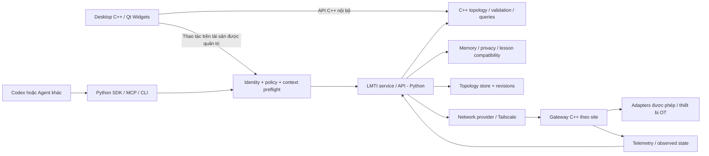

# Kế hoạch LMTI: kiến trúc IoT, giao diện C++ và tích hợp Agent

> Planning status, 2026-10-13: this is a dated scope/evidence record.
> The [consolidated master plan](../LMTI_MASTER_PLAN.md) owns current priorities
> and M0–M4 milestones. Earlier stage orders and unfinished work below are
> reference material, not a separate active backlog. Accepted architecture and
> recorded evidence remain valid within their stated scope.

Ngày khảo sát: 2026-10-11. Repository: `vuthuanphat6-byte/lmti-atlas`. Baseline: `main`, commit `0b6e08989e16ca3257991aa0bd13886bddbe569a`.

Trạng thái: kế hoạch phát triển dựa trên mã nguồn đã đọc, chưa phải tính năng đã triển khai. Phạm vi công việc hiện tại là tải repository, khảo sát và lập kế hoạch; không chuyển runtime hoặc kết nối thiết bị trong lượt này.

[Kế hoạch tổng thể LMTI](../LMTI_MASTER_PLAN.md) là tài liệu điều phối chính. Tài liệu này giữ khảo sát baseline, bằng chứng mã nguồn và các chi tiết kỹ thuật hỗ trợ.

## 1. Định hướng và quyết định

LMTI mở rộng từ lớp memory/context cho coding agent thành nền tảng mô hình hóa kiến trúc và quản trị tài sản IoT, cung cấp context có kiểm soát cho Agent. Năng lực memory/privacy hiện có tiếp tục là nền tảng; topology và trạng thái vận hành là domain mới.

- Giao diện desktop viết bằng **C++**, thay yêu cầu C thuần trước đó. Đề xuất Qt Widgets và Graphics View, ưu tiên Windows ở bản đầu; chưa cài toolkit hoặc chốt phiên bản Qt.
- **C++** sở hữu mô hình topology có kiểu, validator, truy vấn đồ thị và gateway tại nhà máy. UI dùng API C++ nội bộ; giữ core độc lập Qt. C ABI chỉ cần khi một đường tích hợp cụ thể yêu cầu.
- **Python** cung cấp SDK Agent và lớp dịch vụ/tích hợp. Agent dùng API được kiểm soát; không được đọc trực tiếp database hoặc nhận handle tới memory store.
- Dùng **Tailscale qua adapter** cho pilot kết nối. LMTI sở hữu inventory, quan hệ kiến trúc và workflow quản trị; chưa tự xây VPN, relay hoặc NAT traversal.
- Tương thích nhiều Agent là yêu cầu thiết kế. Codex là đường tích hợp đầu tiên có bằng chứng trong repo; tên manifest của một Agent chưa đồng nghĩa đã tích hợp runtime đó.
- SQLite dùng cho dữ liệu cục bộ. Topology, memory và telemetry có vòng đời riêng; không đổ mọi sự kiện vào memory hay prompt.
- Giữ JSON ở CLI/API/MCP khi cần tương thích. Model nội bộ có kiểu và dữ liệu bền vững nằm trong database; đổi ngôn ngữ không bắt buộc phá bỏ định dạng giao tiếp hiện hữu.

Yêu cầu C++/Python mới của người dùng thay thế hướng Go cho phần nền tảng mới trong kế hoạch này. [AGENTS.md](../../AGENTS.md) hiện vẫn ghi Go là core tương lai; khi triển khai bước đầu phải cập nhật quyết định này đồng bộ với README, architecture và development. Các quy tắc privacy, host-project boundary và cấm direct Agent storage access vẫn áp dụng. Không cần viết lại ngay các đường CLI TypeScript hoặc Go đang được khảo sát.

## 2. Hiện trạng có bằng chứng

| Phần | Mã nguồn tham chiếu | Kết luận và cách sử dụng |
| --- | --- | --- |
| CLI và ứng dụng mẫu | `packages/cli/src/index.ts`; `apps/playground/src/index.ts:3,54`; `apps/codex-assistant/src/index.ts:3,87` | CLI TypeScript và vòng lặp terminal. Chưa có canvas/GUI để chuyển sang C++; UI C++ là phần xây mới. |
| Đồ thị | `packages/graph/src/index.ts:3`; `packages/types/src/index.ts:135,199,216` | Quan hệ import/module và Project Atlas cho repository. Cần domain Site/Machine/Gateway/Link riêng. |
| World model | `packages/world-model/src/types.ts:27,115` | Belief, evidence và action của coding workflow; tái dùng khái niệm nguồn/độ tin cậy, không coi là inventory thiết bị. |
| Privacy/context | `packages/privacy/src/index.ts:104,215`; `packages/kernel/src/index.ts:192`; `packages/cli/src/index.ts:1134` | Tái dùng semantics hard gate, giới hạn context, egress và test fixtures; port từng phần sau kiểm thử tương thích. |
| Memory SQLite TS | `packages/memory/src/sqlite-store.ts:40,1310,1362,2383` | `.lmti/memory/project-memory.sqlite`, bảng `memory_items`, `memory_links`; cần kiểm kê migration trước khi hợp nhất. |
| Go core | `internal/app/app.go:16`; `internal/storage/storage.go:20,122,144`; `internal/storage/schema.sql` | CLI thử nghiệm, SQLite qua Node subprocess, database `.lmti/memory.sqlite` với schema khác TS; chưa phải binary độc lập Node. |
| Các store khác | `packages/memory/src/index.ts:1612,1617`; `packages/runtime/src/index.ts:78` | Còn đường JSON legacy và InMemoryStore mẫu. Không cho các runtime cùng ghi vào một schema bằng các quy tắc khác nhau. |
| MCP | `packages/mcp/src/server.ts:36` | `createLmtiMcpStub` chỉ trả tool handlers; thiếu transport/server/session. Cần triển khai server thật và kiểm thử giao thức. |
| Agent adapters | `packages/cli/src/index.ts:183,2568`; `docs/adapter-contract.md` | Các adapter ID dùng manifest chung; chưa có tích hợp đầy đủ mọi Agent. |
| Agent demo | `packages/agents/src/index.ts`; `packages/agents/src/types.ts:11`; `packages/runtime/src/index.ts:156` | Response mẫu và memory objects trong process. Không đưa nguyên đường này thành API cho Agent bên ngoài. |
| RFC cũ | `rfcs/README.md`; `rfcs/RFC-0010_LMTI_SYSTEM_ARCHITECTURE.md` | Tài liệu nghiên cứu, không dùng làm bằng chứng rằng chức năng production đã tồn tại. |

## 3. Kiểm chứng baseline

- Đã clone vào `C:\path\to\lmti-atlas`; mã thử nghiệm ở thư mục cha không được nhập vào repository này.
- Công cụ tìm thấy: Node `v24.13.0`, Go `go1.26.4 windows/amd64`; lệnh `pnpm` có sẵn báo `11.25.0`, trong khi repo pin `10.13.1`.
- Chạy `go test ./...` với `GOPROXY=off`, `GOSUMDB=off`, `GOTOOLCHAIN=local` và build cache trong `.cache/`: **FAIL** vì thiếu package nội bộ `internal/secrets` được các module khác import. Các package `internal/config`, `internal/storage`, `pkg/contract` có test **PASS** trong cùng lần chạy; điều này không chứng minh toàn bộ CLI build được.
- `git ls-files internal/secrets` không trả file; `git check-ignore -v --no-index internal/secrets/example.go` khớp `.gitignore:12:secrets/`. Đây là bằng chứng pattern đang che cả đường dẫn source; chưa chứng minh nguyên nhân lịch sử package bị thiếu. Phải khôi phục đúng source hoặc thay phụ thuộc có kiểm thử, không chạy `go get` để tìm một package nội bộ bị thất lạc.
- Chưa chạy build/test TypeScript: clone chưa có `node_modules`; thử Corepack với mạng tắt không tìm được bản pnpm đã pin trong cache. Không cài dependency, sửa lockfile hoặc tự đổi phiên bản để che sai lệch baseline.
- CI hiện có ở `.github/workflows/ci.yml` chạy TS trên Ubuntu/Node 24; chưa có job Go hoặc native C/C++.

## 4. Kiến trúc đích và ranh giới



API C++ trong cùng tiến trình **không phải sandbox bảo mật**; C ABI chỉ được thêm nếu cần interop cụ thể. Core nhúng trong UI chỉ xử lý tài liệu/canvas cục bộ; thao tác trên dự án hoặc tài sản được quản trị phải đi qua service và cùng policy gate. Server suy ra principal/role từ danh tính đã xác thực, không tin role hoặc model target do client tự khai.

Giai đoạn đầu, TS CLI/privacy là implementation tham chiếu qua compatibility adapter với working directory cố định, command allowlist, input/output có giới hạn và timeout. Đây không phải một shell tổng quát. Đích dài hạn là C++/Python; chỉ loại TS/Go khi có parity cho chức năng tương ứng và migration kiểm chứng, tránh duy trì nhiều core cùng sở hữu dữ liệu.

LMTI vẫn là công cụ độc lập khi gắn với host repository. Dữ liệu memory `.lmti/` không được biến thành module runtime của ứng dụng chủ. Dịch vụ quản trị IoT là sản phẩm LMTI được triển khai riêng; vòng điều khiển nhà máy và safety interlock không phụ thuộc dịch vụ này.

## 5. Mô hình kiến trúc và lưu trữ

Domain mới gồm `Organization`, `Site`, `Area`, `Line`, `Asset`, `Machine`, `Device`, `Gateway`, `Service`, `Interface`, `Zone`, `Relationship`, `Observation`, `Policy`, `ChangeProposal`.

- Asset ID ổn định, không lấy IP làm danh tính. Thiết bị phía sau gateway vẫn có ID riêng; ghi rõ danh tính nào được xác thực và danh tính nào do inventory khai báo.
- Relationship có loại: contains, physical_connection, network_reachability, data_flow, depends_on, controlled_by. Quyền truy cập là policy riêng; vẽ một đường không tự cấp quyền mạng.
- Tách `desired`, `observed`, `proposed` và `layout`. Observation có nguồn, thời điểm đo/nhận, TTL, chất lượng và trạng thái unknown/stale.
- Snapshot/revision có phiên bản; ghi bằng transaction với `expected_revision`. Từ chối cập nhật trên revision cũ và trả diff xung đột.
- Cấu hình thiết bị có schema theo adapter và validate phạm vi tham số. Credential chỉ có `secret_ref`, không xuất giá trị thật vào canvas/context/log.
- SQLite tại desktop/gateway; dữ liệu trung tâm nhiều writer được đặt sau repository interface. PostgreSQL là ứng viên cần benchmark ở bước nhiều site, không ép backend mới vào MVP cục bộ.
- Memory chỉ giữ kiến thức/lesson đã kiểm tra; topology lưu tài sản và quan hệ; telemetry có retention và tổng hợp riêng. Liên kết các kho bằng ID và evidence reference.
- Migration kiểm kê tất cả store TS/Go/JSON hiện có, sao lưu, dry-run, kiểm tra số bản ghi/privacy/provenance và mở thử bằng bản mới. Một writer có thẩm quyền cho mỗi phiên bản schema; rollback phải có kế hoạch với dữ liệu ghi sau chuyển đổi.

## 6. Tích hợp Agent là API của nền tảng

CLI, Python SDK và MCP phải dùng cùng chuỗi: **xác thực → phạm vi tài nguyên → metadata gate → lấy nội dung được phép → context có giới hạn → egress → audit**. Ban đầu MCP chạy cục bộ qua stdio, được ứng dụng chủ khởi chạy với quyền tối thiểu; API mạng chỉ mở ở giai đoạn có xác thực và phân quyền theo site.

Quy tắc Agent không đọc DB phải được cưỡng chế bằng quyền sở hữu/ACL và danh tính tiến trình dịch vụ riêng khi triển khai. Nếu Agent dùng cùng tài khoản hệ điều hành và có quyền đọc file, API contract không ngăn được truy cập ngoài API; stdio tự nó không phải filesystem sandbox.

Các capability dự kiến, chưa phải lệnh đã có trong repo:

| Capability | Đầu ra / quyền |
| --- | --- |
| `topology.list_assets` | Danh sách phân trang theo tổ chức/site và quyền đọc |
| `topology.get_subgraph` | Node/edge có giới hạn độ sâu, số lượng, thời gian truy vấn |
| `machine.get_state` | Desired/observed, freshness, nguồn và revision |
| `architecture.explain_dependencies` | Quan hệ có evidence; phân biệt khai báo, quan sát và suy luận |
| `context.for_task` | Context tối thiểu theo nhiệm vụ, snapshot revision, policy revision và giới hạn token |
| `change.propose` | Diff, điều kiện trước khi chạy, phân tích phạm vi ảnh hưởng; không tự thực thi |
| `change.get_status` | Trạng thái xét duyệt/thực thi và kết quả đã lọc theo quyền |
| `lesson.propose` | Observation/lesson candidate với nguồn; không tự trở thành kiến thức đã tin cậy |

Thao tác triển khai sau pilot đi qua `propose → validate → impact analysis → approve → dispatch → verify`. Dispatch yêu cầu ID tác vụ, deadline, idempotency key, revision, principal và tham số trong allowlist. Gateway kiểm tra lại quyền, độ mới và điều kiện thiết bị ngay trước khi chạy. Không mặc định có tool shell hoặc lệnh điều khiển PLC cho Agent.

Agent có thể dùng model cục bộ hoặc bên ngoài. Payload cho model ngoài phải được giảm thiểu; mô tả/nhãn thiết bị luôn là dữ liệu không tin cậy, không thể đổi policy hoặc yêu cầu Agent bỏ qua quyền.

## 7. Khoảng trống cần xử lý trước khi mở API ngoài

**[CẢNH BÁO BẢO MẬT]** Đường demo Agent và MCP hiện tại không tương đương một control plane đã cưỡng chế quyền. Không đưa các handler đó trực tiếp ra mạng hoặc trao quyền điều khiển thiết bị. Những phát hiện dưới đây là kiểm tra tĩnh, không phải báo cáo đã khai thác lỗ hổng.

- `runAdapterSandbox` trong `packages/cli/src/index.ts:2618` kiểm tra manifest; chưa tạo sandbox process. Thực thi adapter cần isolation và timeout thật.
- `packages/agents/src/types.ts:11` và runtime trao memory object trực tiếp cho agent demo. Thay bằng scoped client trước khi nhận Agent/plugin bên ngoài.
- `packages/mcp/src/server.ts:56,59` dùng generic search/createMemory; không có cùng full preflight và lesson review như CLI. Generic search vẫn có sanitation, vì vậy không kết luận mọi dữ liệu đều bị lộ.
- `packages/memory/src/index.ts:562,575` đọc toàn bộ records để lấy metadata/nội dung được phép. Chuyển thành indexed metadata query, gate rồi fetch theo ID đã được cấp quyền.
- `packages/privacy/src/index.ts:257` đọc toàn bộ audit trước mỗi append; `packages/security/src/index.ts:23` giữ audit trong RAM. Cần audit bền vững, có transaction/sequence và retention khi nhiều writer.
- Role local trong CLI và permission loại tool chưa thay thế tenant/site/device authorization. Thêm kiểm tra chống truy cập chéo phạm vi ở server và gateway.
- Redaction regex là lớp bổ sung; phân loại tài sản, policy và tối thiểu hóa context mới là cơ sở kiểm soát xuất dữ liệu.

## 8. Các giai đoạn và tiêu chí nghiệm thu

| Mốc | Công việc cụ thể | Phụ thuộc | Điều kiện hoàn thành |
| --- | --- | --- | --- |
| **P0 — baseline và quyết định** | Khắc phục package Go thiếu hoặc đóng băng đường Go rõ ràng; kiểm tra `.gitignore`; chạy TS với pnpm pin sau rà dependency; lưu báo cáo; đồng bộ quyết định C++/Python | Không | Build/test của đường hỗ trợ có kết quả; blocker có owner; contract privacy được chọn làm baseline; không claim Go/MCP đã hoàn chỉnh |
| **P1 — domain và storage** | Thêm contract tài sản/quan hệ/revision; C++ validator/query và API nội bộ; topology SQLite; migration inventory | P0 | CRUD và round-trip Unicode; từ chối ID trùng/link mồ côi/config sai; conflict revision; schema version và rollback migration được kiểm tra |
| **P2 — UI C++** | Qt Widgets shell / Graphics View; canvas phân cấp, kéo thả, pan/zoom; inventory; inspector; link types; save/open; diff view | P1 | Tạo → nối → sửa → validate → lưu → mở lại; dirty-state/undo; lỗi gắn với tài sản; xử lý nền không khóa UI; DPI/bàn phím và lỗi file được kiểm tra |
| **P3 — Agent đọc và đề xuất** | Scoped Python SDK; MCP transport thật; tái dùng preflight; context topology; lesson candidate | P1, phần policy P0; song song P2 | Một Agent bên ngoài đọc được subgraph đúng quyền, nguồn/freshness/revision; role giả bị từ chối; secret không vào context; đề xuất tạo diff mà không thực thi |
| **P4 — pilot một site** | Tailscale provider; enrollment/revocation; gateway C++; một adapter chỉ đọc; bounded telemetry/offline buffer | P2, P3 | Pilot 50–100 thiết bị được phép; xác định stale; thu hồi gateway có hiệu lực; mất WAN không làm dừng vòng điều khiển; quan sát được backlog và mất dữ liệu |
| **P5 — nhiều site và tải** | Server storage; cách ly site/tenant; delta/subscriptions; pagination; retention; gateway recovery | P4 | Báo cáo mô phỏng 1.000 rồi 10.000 tài sản với rate/edge/churn ghi rõ; không rò dữ liệu chéo site; backlog không tăng vô hạn; phục hồi kết nối có số đo |
| **P6 — tác vụ quản trị có kiểm soát** | Một số thao tác allowlist; approve/dispatch/verify; maintenance window; audit; stop/revoke | P4 và các gate an toàn P5 | Không thực thi lặp; approval cũ bị từ chối; kiểm tra điều kiện tại gateway; operator xem được tác động và kết quả; diễn tập lỗi trên môi trường mô phỏng trước OT thật |

P2 và P3 có thể phát triển song song khi P1 ổn định. Mốc phát hành đầu tiên nên là **P0–P3**: người dùng vẽ kiến trúc và Agent đọc/đề xuất trên cùng dữ liệu. Tích hợp mạng/thiết bị thật đi sau qua P4. Chưa có cơ sở ước lượng lịch hoặc cam kết chịu tải trước baseline.

## 9. Bố cục code dự kiến

Đây là đường dẫn đề xuất, chưa được tạo trong repository:

```text
native/core/          C++ domain, validator, query, storage interfaces
native/core/include/ API C++ nội bộ, ownership/error contract; interop bổ sung khi cần
apps/desktop/         C++ Qt Widgets UI, canvas, inspector, command history
services/control/    Python service, identity/policy orchestration, API
sdk/python/          typed scoped client cho Agent
adapters/mcp/        MCP transport và mapping tới cùng service
adapters/network/    network-provider interface và Tailscale adapter
edge/gateway/        C++ gateway, buffer, adapter registry, task verifier
tests/contracts/     privacy/context parity và schema compatibility
tests/scenarios/     migration, offline/reconnect, tenant/site isolation
benchmarks/iot/      đồ thị/thiết bị mô phỏng và workload có thể lặp lại
```

Giữ packages TS hiện hữu trong giai đoạn chuyển đổi, với phạm vi tương thích được ghi rõ. Không sao chép các file `core/`, `include/`, `CMakeLists.txt` ở thư mục cha vào repo như một implementation đã kiểm chứng: chúng là thử nghiệm chưa hoàn tất trước khi tải repo.

## 10. Đo tải, kiểm thử và vận hành

- Đo riêng p95/p99 query topology/context, thời gian mở/lưu, frame time UI, RAM/CPU gateway, event throughput, queue depth và thời gian đồng bộ lại. C++ không tự chứng minh hệ thống nhanh hơn.
- Workload ghi rõ số node/edge/site, telemetry Hz, kích thước event, số Agent/người dùng đồng thời, churn và thời gian mất WAN. SLO định lượng được chốt từ pilot.
- Canvas chỉ dựng vùng/nhóm đang xem. Agent chỉ nhận subgraph liên quan. Telemetry dùng batch/delta, backpressure, giới hạn dung lượng và retry có jitter; ghi nhận khi bị rút gọn/mất dữ liệu.
- Cần test quyền chéo site, giả role, label chứa prompt injection, stale observation, tác vụ trùng/hết hạn, thu hồi quyền, schema sai, input quá lớn, migration hỏng và approval dựa trên revision cũ.
- Native CI: build C++ với cảnh báo nghiêm ngặt, kiểm tra API/UI và lỗi bộ nhớ; Python SDK contract tests; giữ TS parity tests trong giai đoạn chuyển đổi. Go chỉ tiếp tục là đường hỗ trợ nếu baseline được khôi phục rõ ràng.
- Gateway chỉ thực thi giao thức/thao tác đã cấu hình. Thiết bị legacy không cài được client có thể qua subnet router; mã hóa đến router không tự bảo vệ đoạn mạng legacy phía sau.
- Cập nhật phụ thuộc bằng nguồn chính thức sau kiểm tra advisory; chưa chọn/cài thêm package trong lượt lập kế hoạch. Trước push, kiểm tra `.gitignore` cho `.env`, key/certificate, topology riêng, database và telemetry; chạy `lmti publish preflight` theo quy tắc repo. Lượt này không push, publish hoặc mở PR.

## 11. Backlog khởi động

1. **BASE-01:** phục hồi baseline có thể lặp lại, điều tra `internal/secrets`, lưu kết quả TS/Go chính xác.
2. **ARCH-01:** quyết định C UI/C++ domain/Python service, ranh giới host và thời hạn tương thích TS/Go.
3. **MODEL-01:** contract topology v1 và fixtures cho một dây chuyền, không có secret hoặc topology khách hàng.
4. **CORE-01:** C++ validator/query, storage interface và API nội bộ; kiểm thử round-trip/conflict.
5. **UI-01:** lát cắt hoàn chỉnh cho canvas + inspector + save/open trên contract MODEL-01.
6. **AGENT-01:** Python client + MCP chỉ đọc qua policy chung, lấy subgraph và giải thích phụ thuộc.
7. **PROPOSAL-01:** Agent đề xuất đổi cấu hình → operator thấy diff và revision; chưa có dispatch.

Ví dụ nghiệm thu đầu tiên: operator vẽ `Machine A → Gateway B → Broker C`; Agent trả lời các thành phần phụ thuộc Gateway B bằng đúng snapshot và nguồn dữ liệu, nêu unknown khi thiếu telemetry, và tạo đề xuất cấu hình có diff. Quyền quản trị mạng hay điều khiển thiết bị không được sinh ra từ đường nối trên canvas.

## 12. Nguồn thiết kế bổ sung

- [Kiến trúc hiện tại](../architecture.md), [adapter contract](../adapter-contract.md), [agent usage](../agent-usage.md), [JSON boundary](../json-boundary.md), [host boundary](../host-project-boundary.md).
- [Tailscale control/data planes](https://tailscale.com/docs/concepts/control-data-planes) và [subnet routers](https://tailscale.com/docs/features/subnet-routers): cơ sở phân chia lớp kết nối và gateway.
- [NIST SP 800-82 Rev. 3](https://csrc.nist.gov/pubs/sp/800/82/r3/final): bảo mật OT với yêu cầu an toàn/độ tin cậy riêng.
- [Qt Widgets](https://doc.qt.io/qt-6/qtwidgets-index.html) và [Graphics View](https://doc.qt.io/qt-6/graphicsview.html): cơ sở UI C++ và canvas 2D đề xuất. Kiểm tra phiên bản, advisory và giấy phép trước khi cài/đóng gói.

Các nguồn ngoài hỗ trợ lựa chọn thiết kế, không chứng minh LMTI hiện đã có các khả năng đó.
