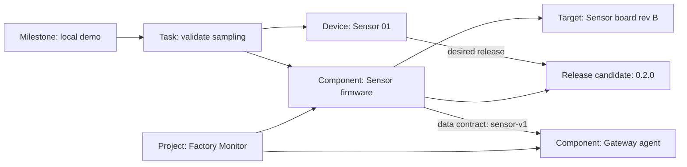

# Quản lý dự án phần mềm gắn với phần cứng

> Planning status, 2026-10-13: this is a dated scope/evidence record.
> The [consolidated master plan](../LMTI_MASTER_PLAN.md) owns current priorities
> and M0–M4 milestones. Earlier stage orders and unfinished work below are
> reference material, not a separate active backlog. Accepted architecture and
> recorded evidence remain valid within their stated scope.

Ngày: 2026-10-11. Trạng thái: **đã triển khai lát cắt MVP; chưa hoàn tất mọi gate S0–S5**.
Xem [báo cáo thực thi](2026-10-11-project-execution.md) và
[hướng dẫn Projects](../project-studio.md) cho phạm vi thực tế. Nội dung bên
dưới giữ yêu cầu/điều kiện nghiệm thu; không coi toàn bộ backlog là đã hoàn thành.

Cập nhật 2026-10-12: điểm vào Projects được mở rộng thành **Project library**,
quản lý thư mục mới/có sẵn và dùng sidebar. English mặc định, tiếng Việt phụ.
Xem [kế hoạch thư viện](2026-10-12-project-library.md) và
[bằng chứng](2026-10-12-library-execution.md); wireframe bên dưới giữ lịch sử S0.

Người dùng chọn kết hợp quản lý phần mềm/firmware gắn với thiết bị và quản lý
công việc/milestone, ưu tiên quan hệ phần mềm–phần cứng. Tài liệu này cụ thể hóa
một phần mở rộng local alpha trong [master plan](../LMTI_MASTER_PLAN.md), sau
topology MVP hiện có và trước pilot mạng P4. Đây không phải roadmap độc lập.

## 1. Vấn đề cần giải quyết

Studio hiện có inventory, canvas, cấu hình thiết bị, SQLite và Agent context.
`Asset`/`Link`/`Topology` trong [core](../../native/include/lmti/topology.hpp)
chưa biểu diễn dự án phần mềm, repository, component, release, milestone hoặc
work item. Chọn site và mở file topology chưa tương đương quản lý một dự án.
Compiler/Project Atlas và memory TypeScript đã có hiểu biết về repository,
nhưng desktop chưa liên kết hiểu biết đó với phần mềm và phần cứng.

Người dùng cần trả lời từ một màn hình dự án:

- Đang phát triển hệ thống gì, phần mềm gồm những component nào và ở repo nào?
- Component nào dành cho thiết bị/board nào, phiên bản mong muốn là gì?
- Phiên bản thực tế có bằng chứng hay vẫn chưa biết?
- Công việc, lỗi và mốc nghiệm thu nào đang ảnh hưởng tới component/thiết bị đó?
- Đổi firmware hoặc API sẽ ảnh hưởng tới những phần nào của hệ thống?

Giá trị cốt lõi được giữ bằng ID/nguồn có thể truy vết, context có giới hạn,
policy theo quyền, phân biệt khai báo với kiểm chứng và lesson có review.
Không port toàn bộ memory sang C++ hoặc biến LMTI thành hệ thống quản lý doanh
nghiệp chỉ để thêm màn hình Projects.

## 2. Phạm vi bản đầu

| Có trong đợt này | Để sau |
| --- | --- |
| Danh sách dự án, tạo/mở/lưu/đóng dự án cục bộ | Tài khoản, cộng tác nhiều người, đồng bộ cloud |
| Repository metadata và component firmware/phần mềm | Git clone/push, CI runner, terminal hoặc build command do Agent điều khiển |
| Hardware target/board và liên kết component–thiết bị | Provisioning, flash firmware, deploy, chạy lệnh trên thiết bị |
| Release metadata, phiên bản mong muốn, bằng chứng kiểm tra tương thích | Tự phát hiện firmware đang chạy, telemetry thực tế, rollout và rollback thiết bị |
| Work items, milestone, checklist nghiệm thu và tiến độ có công thức | Sprint planning, chấm công, billing, quản lý nhân sự |
| Context theo dự án, quan hệ phụ thuộc và proposal có diff | Agent tự duyệt, tự đánh dấu kiểm chứng hoặc tự thực thi |

Đợt đầu chỉ quản lý metadata không bí mật và kế hoạch phát triển. Với dự án
chưa có phần cứng, vẫn tạo được component/work item; không ép thêm thiết bị giả.

## 3. Giao diện theo dự án

**Projects là điểm vào chính.** Khi chưa mở dự án, không tự hiển thị sơ đồ nhà
máy mẫu như thể đó là dữ liệu thật. Demo có mục riêng, ghi rõ dữ liệu tổng hợp.

```text
Projects
  New project | Open project | Recent projects | Open demo

Project: Factory Monitor                         Saved revision / Unsaved
  Overview | Software | Hardware | Architecture | Work | Releases | Agent
```

| Màn hình | Nội dung và thao tác cụ thể | Kết quả người dùng nhìn thấy |
| --- | --- | --- |
| Projects | Tên, mô tả ngắn, ngày mở gần nhất; tạo/mở dự án; trạng thái file thiếu | Chọn đúng dự án trước khi sửa kiến trúc |
| Overview | Mục tiêu, component/thiết bị đã khai báo, milestone tiếp theo, công việc blocked và binding thiếu | Tổng quan phần mềm–phần cứng và việc còn phải làm |
| Software | Danh sách component; loại, repo reference, dependencies, hardware targets; inspector theo component | Biết firmware/backend/gateway/desktop thuộc repo nào và phụ thuộc gì |
| Hardware | Inventory hiện có, bổ sung board/model/revision và danh sách component gắn với asset | Chọn thiết bị thấy phần mềm, phiên bản mong muốn và bằng chứng liên quan |
| Architecture | Canvas hiện có; lớp phần cứng/phần mềm và quan hệ có loại, bộ lọc theo component/site | Thấy component nào dự kiến chạy trên thiết bị nào; không suy ra online |
| Work | Board Todo / In progress / Review / Done / Blocked, lọc milestone/component/device; inspector và checklist | Công việc liên quan trực tiếp tới đối tượng đang phát triển |
| Releases | Version label, repo revision, target, trạng thái review, compatibility evidence và desired bindings | Phân biệt release đã khai báo với phiên bản đã xác minh trên thiết bị |
| Agent | Context đã lọc, nguồn/revision, diff đề xuất, review thủ công | Agent giải thích ảnh hưởng hoặc đề xuất metadata; người dùng giữ quyền quyết định |

Phần mềm và thiết bị có icon/kiểu khác nhau; quan hệ `targets`, `depends on`,
`desired on` phải có legend. Chọn một đối tượng hiển thị công việc, release và
nguồn liên quan trong inspector. Mỗi trang có empty state hướng dẫn thao tác
tiếp theo. Kiểm tra thao tác bằng bàn phím, tab order, cửa sổ nhỏ và scaling của
Windows; không chỉ đánh giá từ một ảnh ở kích thước lớn.

Overview chỉ hiển thị số liệu có căn cứ. Nếu dùng tỷ lệ hoàn thành công việc,
công thức bản đầu là **Done / tổng work item chưa archive**; hiển thị cả tử/mẫu,
không có work item thì hiện “Chưa có công việc”. Review/Blocked không tính là
Done. Tỷ lệ này không phải phần trăm hoàn thiện sản phẩm hay mức sẵn sàng vận
hành; không sinh tiến độ từ số node trên canvas.

## 4. Mô hình dữ liệu và quan hệ

| Đối tượng có ID ổn định | Nội dung chính | Quy tắc |
| --- | --- | --- |
| Project | Tên, mục tiêu, trạng thái development/maintenance/archived, classification | Project khác site; một project có thể chứa nhiều site |
| RepositoryRef | Alias, locator cục bộ hoặc URL không credentials, revision reference | Chỉ metadata; không tự đọc repo, chạy Git hoặc gửi đường dẫn máy cho Agent |
| SoftwareComponent | Project ID, tên, loại firmware/gateway/backend/desktop/driver/library, repository refs | Một project có nhiều repo; một monorepo có nhiều component |
| HardwareTarget | Board/model, hardware revision, kiến trúc/OS nếu biết, ràng buộc interface | Target mô tả lớp phần cứng; Asset là thiết bị cụ thể |
| SoftwareRelease | Component ID, version label, repo revision refs, target refs, draft/candidate/approved/archived | Version label không chứng minh binary được build/deploy; metadata approved giữ bất biến, thay đổi tạo bản mới |
| SoftwareBinding | Asset ID, component ID, desired release ID, target ID, cấu hình tham chiếu không bí mật | Một thiết bị có nhiều component; một component có thể gắn nhiều thiết bị |
| Dependency / InterfaceContract | Component nguồn/đích, kiểu quan hệ, tên giao thức/API/schema và version đã khai báo | Dùng enum/struct có kiểu; không mã hóa mọi quan hệ vào một field JSON |
| VerificationRecord | Đối tượng được kiểm tra, nguồn, thời điểm, kết quả, evidence reference | Release observed trên thiết bị cần record; chưa có evidence hiện unknown, nhập tay hiện operator-declared |
| WorkItem | Loại task/bug/integration/validation, trạng thái, priority, checklist, linked component/asset/release refs | Link phải thuộc project; Done có checklist/kết quả, task validation cần evidence |
| Milestone | Mục tiêu, ngày dự kiến nếu có, work item refs, tiêu chí nghiệm thu | Đạt milestone cần review tiêu chí; không tự kết luận từ ngày hoặc % task |
| KnowledgeRef | Tham chiếu compiled Project Atlas/decision/lesson, nguồn và fingerprint | Không sao chép raw repo/chat hoặc coi memory là sự thật |

Ví dụ xuyên suốt:



Liên kết release với thiết bị là **desired**, không phải đã cài. Thiếu hoặc
không đủ bằng chứng tương thích hiện “Unverified”; kết quả kiểm tra thất bại
hiện “Incompatible”. Không đổi hai trạng thái đó thành “Ready to deploy”.
Quan hệ của project không tự cấp quyền truy cập site hoặc thiết bị.

## 5. Kiến trúc, lưu trữ và tương thích

- Giữ [ADR đã chấp nhận](../adr/2026-10-11-native-topology.md): C++20 domain
  core độc lập Qt; Qt Widgets UI; SQLite adapter; Python SDK/MCP có scope.
  `ProjectDocument` mới compose topology và các domain phần mềm/công việc;
  `SoftwareComponent` không phải một `Asset::Service` đổi tên.
- Đề xuất module C++ riêng cho project, software, work và query; topology giữ
  trách nhiệm hiện tại. Domain không nhập UI, không phụ thuộc một model AI.
  JSON chỉ ở CLI/API/proposal boundary; SQLite dùng bảng có kiểu và foreign key.
- Một file SQLite mới sở hữu một project/document; project-level revision và
  transaction bao trùm topology + software + work. Trong adapter mới, revision
  topology lấy từ revision document, không có hai bộ đếm cạnh tranh. Project
  ID không đổi khi rename hoặc di chuyển file; ID không suy ra từ tên/site/path.
- Projects có catalog SQLite cục bộ riêng chỉ lưu ID, tên và locator file đã
  được người dùng chọn. Catalog không sở hữu domain và không được xuất cho
  model; file dự án vẫn có thể mở độc lập. MVP không đọc file ngoài dự án để
  resolve component/binding; liên kết chéo project để sau.
- Chốt schema/application ID mới trong S0. Adapter v1 và các CLI/SDK topology
  cũ tiếp tục đọc/ghi file v1. Chúng phải từ chối file mới rõ ràng; không giả
  vờ hỗ trợ, bỏ bảng mới hoặc ghi xuống phiên bản cũ. Scope/schema mới dùng
  entry point/version riêng trước khi xem xét thay thế.
- Mở topology v1 vẫn được; chuyển sang project document bằng **Import as new
  project** có preview và file đích mới. Giữ ID/site/privacy/config/link/layout,
  ghi provenance của import và revision mới; không sửa/xóa file nguồn. Chặn
  nếu không giữ được dữ liệu hoặc policy. File v1 không bị chuyển tại chỗ.
- Save as tạo bản sao cùng identity, không đăng ký thành project thứ hai trong
  catalog; chỉ một locator được chọn là bản đang quản lý. Duplicate project
  nếu bổ sung phải cấp ID mới và remap quan hệ, không dùng Save as thay thế.
  Schema nâng cấp cần backup nhất quán, dry-run và recovery; schema quá mới
  bị chặn ghi. Hành vi này cần ADR/contract trước khi viết migration.
- Project Atlas và `.lmti` memory giữ store và owner hiện tại. KnowledgeRef
  kết nối theo ID/fingerprint đã đối chiếu; không gộp store hoặc import LMTI
  vào runtime phần mềm của dự án được quản lý.

## 6. Agent và quyền riêng tư

**[CẢNH BÁO BẢO MẬT]** URL repository, locator máy, task text và tài liệu kỹ
thuật có thể chứa bí mật. SQLite MVP chưa mã hóa; bản đầu chỉ nhận metadata
không bí mật. Không lưu credentials/token/keys, connection strings hoặc raw
build logs vào project; default classification là internal, public cần chọn
có chủ đích. Ignore database, WAL/SHM, secrets và artifact riêng trước push;
chạy publish preflight theo quy tắc repository khi chuẩn bị phát hành.

Grant mới lấy `project_id`, capability, model target và site scope từ launcher
tin cậy. Tool arguments không được chọn project khác, sửa locator hoặc mở rộng
quyền. Quyền đọc project metadata không cho phép đọc toàn bộ thiết bị/site;
binding/query chỉ trả đối tượng trong scope. Các endpoint/count cũng phải lọc
trước khi trả, không tiết lộ tên/số thiết bị ở project hoặc site bị chặn.

Capabilities đề xuất: project summary; đọc component và binding; đọc work item
liên quan; giải thích dependency/ảnh hưởng; tạo proposal metadata có diff,
expected revision/old values. Chưa mở proposal cho toàn bộ trường: S0 chốt
allowlist từng loại, bắt đầu từ work item và desired binding không bí mật.
Tạo proposal không ghi database; operator review → apply document → save.

Mỗi bản trả có schema/revision/source và giới hạn record/byte. Giới hạn hiện
có 200 assets/400 links vẫn giữ ở endpoint topology v1; limits mới cần chốt
theo loại trong S0 và đo ở S5. Context ưu tiên compiled understanding; bridge
memory dùng đường privacy/preflight hiện có, không đọc raw AMF rồi mặc định
cho phép export. Quyền hiệu lực là giao của quyền project và policy nguồn.

Repo reference và metadata là dữ liệu, không phải lệnh. Không nhận shell,
build scripts, Git hook, URL fetch hoặc tùy chọn plugin từ Agent. Locator phải
được người dùng chọn/validate, xử lý path traversal/symlink/reparse boundary
trước khi mở dữ liệu. Không tự clone, quét source hoặc tải remote resource.
Same-user launcher vẫn không phải OS sandbox/RBAC nhiều người dùng.

## 7. Thứ tự triển khai và điều kiện hoàn thành

| Đợt | Đầu việc | Đầu ra có thể nghiệm thu |
| --- | --- | --- |
| **S0 — Contract và UX** | Chốt vocabulary, quan hệ, fields/limits, scope, revision/schema, import/Save as; ADR draft và wireframe Projects/Overview/Software/Hardware/Work | Một fixture tổng hợp cho luồng mục 8, các trạng thái empty/unknown/blocked, consumer matrix v1/v2 và checklist validation |
| **S1 — Project foundation** | Typed ProjectDocument, SQLite/catalog, Projects landing; tạo/mở/lưu/dirty-state/recent project; import v1 ra file mới | Hai project mở độc lập, không trộn dữ liệu; round-trip/revision conflict; nguồn import byte-unchanged; legacy v1 vẫn qua tests |
| **S2 — Software gắn hardware** | Component/repo/target/release/binding/dependency; Software/Hardware pages và lớp quan hệ trên canvas | Từ thiết bị tra được phần mềm/release/target và ngược lại; chặn cross-project/dangling refs; desired không thành observed |
| **S3 — Work và milestone** | Work board, linked work items, milestone/checklist và Overview | Lọc việc theo component/device; số Done/total đúng; blocker hiện rõ; validation không Done khi thiếu evidence |
| **S4 — Knowledge và Agent** | KnowledgeRef bridge chỉ đọc, versioned project SDK/MCP, context/impact query và proposal allowlist | Agent giải thích ảnh hưởng trong scope; deny cross-project/site/private; proposal không ghi; stale revision bị chặn khi review |
| **S5 — Nghiệm thu** | Luồng operator + product MCP client, save/reopen, clean Windows package, benchmark UI/query/context | Bằng chứng thao tác thực, test bốn stack liên quan, không regression memory/lesson/privacy và danh sách giới hạn còn lại |

Thứ tự: **S0 → S1 → S2 → S3 → S4 → S5**, trước P4. S1–S2 làm rõ chức năng
quản lý phần mềm gắn thiết bị; S3 bổ sung quản lý tiến độ trên cùng mô hình,
không dựng một task board độc lập rồi mới tìm cách nối với hardware.

Đây là thứ tự ưu tiên, chưa phải lịch ngày hoặc cam kết nhân lực. Chỉ ước
lượng thời gian sau S0 và lát cắt S1. Đợt cleanup C0–C3 đã hoàn thành không
đồng nghĩa các đợt S đã được triển khai; không dùng lại tỷ lệ cleanup làm tỷ
lệ hoàn thiện quản lý dự án.

## 8. Kịch bản nghiệm thu xuyên suốt

1. Tạo Factory Monitor; thêm repo aliases và component Sensor firmware,
   Gateway agent, Monitor backend. Dùng dữ liệu tổng hợp, không credentials.
2. Khai báo Sensor board rev B, Sensor 01, Gateway 01 và site demo. Chọn Sensor
   01 thấy firmware/target; chọn firmware thấy thiết bị sử dụng trong scope.
3. Tạo release candidate 0.2.0, repo revision refs và compatibility checklist;
   chọn làm desired release. Phiên bản đang chạy vẫn unknown.
4. Tạo milestone Local demo, task sampling và task gateway data contract; link
   đúng component/asset/release. Move task tới Review không tự thành Done.
5. Lưu/mở lại: ID, quan hệ, classification, checklist và revision còn nguyên;
   file cũ khác schema vẫn mở được bằng đường hỗ trợ tương ứng.
6. Agent hỏi “Đổi sensor-v1 ảnh hưởng phần mềm/thiết bị/công việc nào?”; trả
   quan hệ, nguồn và revision đã lưu. Đối tượng ngoài scope không xuất hiện.
7. Agent đề xuất cập nhật metadata trong allowlist; database hash không đổi.
   Operator thấy diff, apply/save; proposal cũ hoặc sai project bị từ chối.
8. Đo fixture 100 components, 200 assets, 500 bindings và 500 work items:
   thời gian mở/lưu, lọc, UI frame time, RAM và context/query p95. Đây là mục
   tiêu kiểm tra, chưa phải mức tải đã đạt; báo cáo cả relations và payload.

Kiểm thử cần nhắm vào invariants: foreign key/cross-project denial, import
parity, transaction/revision, policy/egress, bounded input/output, malformed
file, stale proposal và trạng thái unknown. Test offscreen không thay cho
nghiệm thu người dùng; benchmark dữ liệu không thay cho benchmark canvas.

Rủi ro cần đo: document snapshot/Undo và dựng lại scene hiện tại có thể tốn
RAM/frame time khi thêm software/work; query bindings/dependencies dễ tăng
chi phí nếu chỉ giới hạn output mà không giới hạn traversal. Truy vấn đồ thị
cần visited set/depth/record budgets và báo truncated, không lặp vô hạn khi
dependency có chu trình; UI hiển thị cảnh báo chu trình thay vì tự xóa quan hệ.
Lập index theo project/component/asset/milestone và kiểm tra query plan. Chỉ
đổi cơ chế snapshot/model-view khi benchmark chứng minh bottleneck; không
tạo service/background worker/network stack chỉ để có vẻ mở rộng được.

## 9. Quyết định và điểm còn phải chốt ở S0

Hướng ưu tiên đã được người dùng chọn: **phần mềm–phần cứng trước, công việc
và milestone đi cùng dự án**. Công nghệ C++/Qt/SQLite/Python và compatibility
memory không đổi. Các chi tiết schema, placement/catalog, scope/versioned
entry points, limits, allowed proposals và import/recovery là đề xuất thiết
kế của tài liệu này, cần được đối chiếu bằng fixture và ADR trước implementation.

Các thông tin thực tế có thể bổ sung khi bắt đầu S0: một dự án mẫu, loại board
và phần mềm, repo đơn hay nhiều repo, người vận hành và tiêu chí Local demo.
Thiếu dữ liệu thực không chặn wireframe/contract với fixture tổng hợp.

Lesson candidate để review sau khi có bằng chứng triển khai: project/site/repo
là các identity khác nhau; desired binding không chứng minh deployed software;
tiến độ task không chứng minh readiness của hệ thống. Chưa lưu vào memory.
