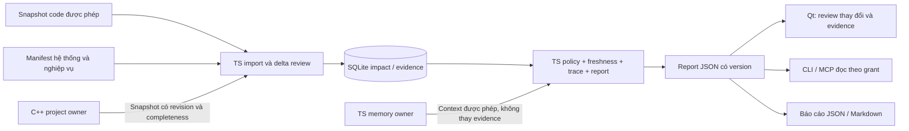

# LMTI — Kế hoạch sản phẩm phân tích tác động có bằng chứng

> Cập nhật điều phối 2026-10-13: [master hợp nhất](../LMTI_MASTER_PLAN.md) thay thế
> thứ tự W1–W6 và ước lượng lịch trong tài liệu này. Nội dung dưới giữ thiết kế
> theo thời điểm; các câu “chưa triển khai” không mô tả hiện trạng mới nhất.
> Xem [native impact](2026-10-13-native-impact-review.md) và
> [support map](../component-support.md) cho bằng chứng/ownership hiện có.

Ngày: 2026-10-12. Hướng sản phẩm do người dùng chọn; thiết kế kỹ thuật và ước lượng dưới đây là đề xuất triển khai.
Trạng thái: đã bắt đầu triển khai sau khi người dùng duyệt. [Lát cắt kỹ thuật và hướng dẫn chạy](../impact-review.md) ghi rõ năng lực đã có, kiểm thử và các gate còn mở. Kế hoạch sáu tuần dưới đây chưa được đánh dấu hoàn tất; chưa có nghiệm thu SME hoặc bằng chứng giảm công review.

## 1. Quyết định sản phẩm

**LMTI giúp người phụ trách và Agent review một thay đổi: có thể ảnh hưởng tới đâu, căn cứ vào nguồn nào, nguồn còn đáng tin đến mức nào và cần xác minh gì tiếp.**

Đơn vị giá trị là một báo cáo review thay đổi có thể kiểm tra lại. Memory, graph, Studio và model là phương tiện phục vụ công việc đó. Không lấy số node, số màn hình hoặc số token tiết kiệm làm tiêu chí thành công chính.

Khách hàng giả thuyết đầu tiên: đội tích hợp/triển khai phần mềm có trách nhiệm với một quy trình kho hoặc IoT, phải phối hợp giữa người viết phần mềm và người hiểu máy/thiết bị. Người dùng trực tiếp là kỹ sư triển khai, tech lead và người vận hành xác minh quy trình; người có thể tài trợ thử nghiệm là người chịu chi phí review và sự cố. Chưa khẳng định nhóm này đã có nhu cầu trả tiền.

Việc cần làm: trước khi đổi service, hợp đồng dữ liệu, cấu hình hoặc phiên bản, biết phải review thành phần nào và hỏi ai, đồng thời tránh coi tài liệu cũ là trạng thái thực tế.

Giả thuyết khác biệt cần chứng minh:

1. Nối được code → service/deployment → máy/thiết bị/dữ liệu → bước nghiệp vụ bằng liên kết có nguồn.
2. Nguồn thay đổi thì liên kết và báo cáo phụ thuộc được đánh dấu, kiểm tra lại và cập nhật có lịch sử.
3. Người và Agent nhận cùng kết quả từ cùng snapshot và quyền đọc.
4. Công review giảm sau khi tính cả công nhập và duy trì bản đồ.

Sáu tuần chỉ nhằm chứng minh hoặc bác bỏ bốn giả thuyết này trên một lát cắt. Chưa phải thời hạn giao một sản phẩm thương mại hoàn chỉnh.

## 2. Vị trí so với các sản phẩm liên quan

Đối chiếu tài liệu chính thức ngày 2026-10-12; đây là mô tả phạm vi, không phải benchmark trực tiếp.

| Sản phẩm | Năng lực đã được mô tả | Hệ quả cho LMTI |
| --- | --- | --- |
| [Serena](https://github.com/oraios/serena) | Tra cứu/chỉnh sửa code theo symbol, references và tích hợp Agent qua MCP | Không xây lại IDE hoặc bộ sửa code. Sau pilot có thể nhận symbol/reference làm nguồn, vẫn phải kiểm chứng mapping tới vận hành. |
| [Graphiti](https://github.com/getzep/graphiti) | Graph theo thời gian, provenance, cập nhật tăng dần và truy vấn lịch sử | Có lịch sử và đồ thị chưa tạo khác biệt. Pilot dùng schema nhỏ, rules rõ; chưa thêm một hạ tầng graph/model khác trước khi đo nhu cầu. |
| [NetBox Assurance](https://netboxlabs.com/products/netbox-assurance/) | So sánh thiết kế dự kiến với hạ tầng thực tế để phát hiện operational drift | Không cạnh tranh bằng inventory hoặc drift chung. Nguồn quan sát đã được phép có thể trở thành evidence trong tương lai. |

Kết luận chiến lược là giả thuyết của kế hoạch: LMTI nên tập trung vào review thay đổi xuyên qua code, triển khai và nghiệp vụ, cộng với chi phí giữ mapping đúng. Không tuyên bố đối thủ không thể mở rộng vào cùng bài toán. Khả năng triển khai thực tế, bộ tình huống được duyệt và vòng duy trì dữ liệu mới tạo lợi thế có thể đo.

## 3. Baseline checkout và các khoảng trống

Checkout khi khảo sát: nhánh `main`, HEAD `0b6e089`, có nhiều file sửa và file chưa được theo dõi. HEAD không đại diện toàn bộ nội dung đang làm việc. Không reset, stash, checkout đè, commit hoặc gộp các thay đổi đó trong lượt này. Không có `.lmti/project.amf.json` ở workspace hiện tại.

Framework detector hiện nhận pnpm/JavaScript và chưa xác định framework. Mã nguồn/build files cho thấy monorepo TypeScript, native C++/Qt/CMake và Python SDK; không dùng kết quả detector hạn chế để bỏ qua native checks.

| Đã có / khoảng trống | Bằng chứng hiện tại | Quyết định |
| --- | --- | --- |
| Studio, project/component/release/binding/work, 26 trang theo thiết kế | `docs/project-studio.md`, `native/include/lmti/project.hpp`, `docs/plans/2026-10-12-design-implementation.md` | Tái sử dụng shell, tables, inspector, graph và dữ liệu; đóng băng mở rộng CRUD trong pilot. |
| Context kiểm tra AMF đã compile nhưng chưa đối chiếu toàn bộ nguồn hiện tại | `readCompiledAmf`, `contextCommand`, `preflightCommand` trong `packages/cli/src/index.ts`; hashes trong `packages/compiler/src/index.ts` | Tuần 1 bổ sung hợp đồng freshness chung và hồi quy. |
| SQLite memory mặc định và JSON reader legacy cùng tồn tại | `packages/memory/src/index.ts`, `sqlite-store.ts`, `packages/cli/src/index.ts`, `docs/component-support.md` | Thống nhất hợp đồng đọc qua owner; không gộp/xóa/migrate kho một cách ngầm định. |
| Preflight lấy tối đa 16 ứng viên trước task ranking | `fetchAllowedMemoryContent` và caller trong `preflightCommand` | Policy trước rank, top-k sau rank; budget thiếu phải báo incomplete. Kiểm tra cả cơ chế SQLite oversampling 3× trước final score. |
| Impact native hiện tại là neighborhood hai chiều của context bị giới hạn | `native/storage/project_boundary.cpp`, hàm `project_impact`; context giới hạn 200 bản ghi mỗi nhóm | Giữ contract cũ; không gọi đây là engine tác động đầy đủ. Xây contract mới có hướng, paths/evidence và completeness. |
| Chưa có provenance/thời hạn/conflict cho mọi dependency, chưa có business-step model | `ComponentDependency`, `SoftwareBinding` trong native domain | Bổ sung ở slice impact; desired binding không chứng minh phiên bản đang chạy. |
| Desktop có owner bridge đọc SQLite và review có kiểm soát | `packages/cli/src/desktop-bridge.ts`, `readProjectMemorySnapshot`, bridge tests | Tái sử dụng boundary; không thay bằng reader có side effect rồi gọi là read-only. |

Ba lỗi do người dùng báo đã tái hiện ở bản local. Audit lượt này xác nhận cơ sở từ mã nguồn, **chưa chạy lại tái hiện runtime**. Không suy rộng thành lỗi của mọi bản public. Test hiện có bao phủ context JSON, policy và SQLite retrieval nhỏ; chưa đủ chứng minh freshness hoặc ứng viên ngoài ngưỡng.

Tuần 1 phải lưu baseline code được phép, SHA, manifest/hash các thay đổi liên quan và lệnh tái hiện trong thư mục evidence cục bộ được ignore. Không sao chép secrets, `.env`, raw customer data hay toàn bộ `.lmti`. Mỗi lỗi cần fixture riêng chứng minh fail trước/pass sau.

## 4. Lát cắt xuyên suốt và giới hạn

Demo giả lập: **xác nhận xuất kho**. Một code unit xử lý nhãn → service nhãn → deployment tại một site → máy tính gateway, máy quét và máy in; service đọc/ghi kho dữ liệu và hỗ trợ bước xác nhận xuất kho.

Thay đổi mẫu: đổi trường mã kiện hàng mà service và thiết bị đọc mã đang sử dụng. Mapping dependency phải được khai báo có evidence; không suy luận rằng mọi máy trong cùng site đều bị ảnh hưởng.

- Một workflow, một site và một môi trường chính; thêm fixture môi trường khác để kiểm tra cách ly.
- Khoảng 30–80 entity, 60–150 assertions ở demo; fixture lớn riêng kiểm tra giới hạn.
- Hai họ nguồn: snapshot repository được cho phép, và manifest hệ thống/nghiệp vụ đã được người hiểu hệ thống duyệt. Manifest chứa deployment mapping và workflow; không mặc định lấy dữ liệu thực từ NOIR.
- Import JSON theo schema version; source/digest rõ. Một adapter code tối thiểu cho fixture đã chọn, không quét nhiều ngôn ngữ hoặc xây lại LSP.
- Source revision A/B/C: nguồn ban đầu; đổi code/manifest; review cập nhật. Chứng minh cả vòng duy trì, không chỉ graph ban đầu.
- Đọc/xuất báo cáo, checklist và ghi nhận review cục bộ. Checklist hoàn tất chỉ khi có evidence và người xác minh; model không tự hoàn tất.
- Không SSH, tự sửa cấu hình, deploy, điều khiển máy, scan mạng, telemetry sống, CAD, mô phỏng, IoT platform tổng quát hoặc huấn luyện model.

## 5. Kiến trúc đề xuất và ranh giới với Studio

Theo lựa chọn TypeScript + SQLite mới, bổ sung một domain **impact/evidence**. Không port desktop hoặc typed native domain sang TS. ADR native hiện tại tiếp tục áp dụng cho topology/project; ADR bổ sung phải mô tả owner của slice mới trước khi viết schema.

Phương án tổ chức tối thiểu: một package mới dự kiến `packages/impact`, các module `model`, `store`, `ingest`, `policy`, `trace`, `report`; entrypoint trong CLI. Đây là tên đề xuất, chưa có implementation. Không tạo microservices hoặc nhiều package nhỏ trước nhu cầu.

| Owner | Dữ liệu và trách nhiệm |
| --- | --- |
| C++ native owner | Project/topology LMPR và các identity hiện có; tiếp tục validate, version và save. |
| TS memory owner | SQLite memory v4 và adapter legacy; giữ privacy/provenance/lesson lifecycle. Go store vẫn độc lập. |
| TS impact owner | Assertions, evidence, import batches, revision, review history, report contracts; một writer có transaction. SQLite riêng trong vùng dữ liệu ứng dụng, không mượn schema memory. |
| Qt | Xem graph/report/source details và form review; không cài engine suy luận thứ hai hoặc đọc bảng riêng của impact DB. |
| CLI/MCP adapter | Gọi engine với fixed operations, kiểm tra schema/bounds; grant đến từ launcher đáng tin, không nhận quyền do Agent tự khai. |

Native → TS là projection đọc qua owner export/API, tham chiếu `sourceSystem + projectId + entityId`. Dữ liệu projection có thể dựng lại, không thành authority thứ hai. Không lấy context đã cắt 200 mục làm export toàn bộ: pilot chỉ nhận snapshot nhỏ có xác nhận complete; pagination nhất quán revision là gate khi mở rộng.

Tái sử dụng Python MCP stdio boundary nếu tiết kiệm công: thêm adapter riêng gọi TS CLI bằng executable đã cấu hình và fixed argv; vẫn validate grant ở TS. Không coi TS MCP stub hiện có là transport hoàn chỉnh. Không để Agent nhận SQLite handle hoặc shell command tùy ý. Nếu transport tiêu tốn buffer, giữ CLI + một MCP adapter tối thiểu; bỏ local-model integration trước.

Lõi phải chạy và tạo cùng paths/checklist khi không có LLM. Model chỉ giúp diễn giải report đã kiểm tra; mọi khẳng định tác động phải tham chiếu path/evidence ID, không tự tạo cạnh mới. Structured result là nguồn để review khi phần diễn giải mâu thuẫn.

## 6. Hợp đồng dữ liệu tối thiểu

| Record | Trường cần có / quy tắc |
| --- | --- |
| Entity | ID ổn định, project/site/environment, kind, tên hiển thị, owner/source reference. Kinds pilot: code unit, service, deployment, machine, device, datastore, business step. |
| Identity mapping | Source-local key ↔ entity ID, aliases, nguồn và review đổi tên. IP/hostname/path/label là thuộc tính, không phải identity. Rename code cần mapping rõ; không tự gộp hai symbol vì giống tên. |
| Assertion | ID, subject, typed predicate, object, scope, `desired/observed/inferred`, evidence references, review state, supersedes. Một quan hệ có thể có nhiều assertion từ các nguồn khác nhau. |
| Evidence | ID, source ID, revision hoặc content digest, locator/span được phép, captured/observed time, verified time và reviewer nếu đã xác minh. Không điền verified time từ thời gian import. |
| Validity | `fresh/stale/unknown`; conflict là trạng thái riêng. Fresh chỉ nghĩa nguồn khớp quy tắc freshness, không chứng minh nguồn nói đúng. Superseded/retracted giữ lịch sử. |
| Source policy | Allowed roots/types/scope, update mode, thời hạn quan sát theo loại nguồn, schema/parser version và grant version. Tuổi dữ liệu chỉ là một tín hiệu; Git commit không bao phủ checkout bẩn. |
| Verification task | Assertion/path liên quan, lý do, kiểm tra cần làm, owner role, evidence yêu cầu, trạng thái và người review. Không cấp quyền chạy kiểm tra trên máy thật. |
| Change request | Entity ID, baseline revision, proposed revision hoặc diff digest nếu có, category, chế độ `prospective/current-observed`, deployment/site/environment đích trong grant. Thiếu diff/rollout mapping thì ghi unknown; không tự giả định triển khai tới mọi instance. |
| Impact report | Input change, source revisions, graph revision, rules version, policy/scope, paths, affected candidates, context-only relations, stale/conflicts/unknowns, coverage/truncation, `freshnessCheckedAt`, phạm vi nguồn đã kiểm tra và checklist. |

Lịch sử assertion + `observed_at/recorded_at/verified_at` là đủ cho pilot; chưa cần một temporal graph engine tổng quát. Nguồn mâu thuẫn được giữ cạnh nhau; không dùng last-write-wins để biến mâu thuẫn thành sự thật.

### Vòng giữ mapping đúng — bắt buộc từ tuần 2

1. Import có schema, root/size validation, deterministic source identity và digest. Import lặp lại không nhân đôi dữ liệu.
2. So sánh nguồn A/B; tìm assertions phụ thuộc bằng reverse index source→evidence→assertion.
3. Đánh stale các assertion chịu thay đổi; nguồn bị xóa có tombstone. Nguồn không đọc được cho trạng thái unknown/unavailable, không giả thành không thay đổi.
4. Sinh diff đề nghị, nêu assertion thêm/đổi/rút lại và lý do. Người duyệt xác nhận hoặc giữ unresolved.
5. Transaction tạo revision mới và supersede đúng assertion. Import hỏng không thay snapshot tốt gần nhất; UI vẫn cảnh báo tuổi nguồn.
6. Báo cáo đang dùng các revision cũ bị đánh dấu cần tạo lại. Report lịch sử được xem như lịch sử; không được xuất lại dưới nhãn hiện hành.

Đối với file, fingerprint theo đúng compile boundary, gồm nội dung, danh mục file thêm/xóa, boundary/parser version; mtime/size chỉ tối ưu, không thay hash. Không tự compile/ghi đè artifact khi người dùng chỉ yêu cầu đọc. Không xác minh được phải trả unknown.

Kiểm tra freshness khi tạo, mở hoặc xuất report hiện hành, không chỉ lúc import: nguồn có thể đổi sau lần nhập cuối. Ghi thời điểm và phạm vi đã kiểm tra; không truy cập được hoặc không đủ budget thì unknown/stale, không trả nhãn fresh từ cache. Pilot không cần watcher luôn chạy. Report lịch sử giữ nguyên snapshot và nhãn as-of, không bị diễn giải thành trạng thái hiện tại.

## 7. Logic truy tác động có thể kiểm thử

Không coi graph là một tập cạnh đồng nghĩa. Khai báo semantics và hướng propagation cho từng predicate trong rule table có version:

| Quan hệ | Cách dùng trong impact |
| --- | --- |
| Consumer `depends_on/calls/reads_from` dependency | Thay đổi dependency đi ngược tới consumer, theo loại thay đổi và scope. Không mặc định đi cả hai chiều. |
| Service `implemented_by` code unit | Code change có thể ảnh hưởng service khi mapping được hỗ trợ bởi nguồn; chưa biết mapping thì thêm gap/checklist. |
| Deployment `instance_of` service; deployment `runs_on` machine | Phân biệt logical service, phiên bản/deployment và môi trường. Máy host có thể chỉ là tài sản nằm trong phạm vi triển khai, không mặc định hỏng vì code change. |
| Service/deployment `uses` device/datastore | Chỉ lan tác động theo rule đã duyệt cho contract/config/availability change. Co-location không phải dependency. |
| Business step `depends_on` service/deployment | Truy tới bước nghiệp vụ có nguồn xác nhận. Không có workflow link thì báo mapping thiếu. |
| `inferred` relation | Có thể đưa vào nhánh cần xác minh, tách khỏi đường bằng chứng đã review; không nâng thành observed/verified tự động. |

Quy trình engine:

1. Validate entity ID, mô tả, baseline/proposed revision hoặc diff digest, report mode, rollout target và category (`code/contract/config/version/unknown`). Agent có thể gợi ý category, không được tự khai grant. Chỉ tin nhận định “chỉ đổi comment” khi có diff/bằng chứng hỗ trợ. Khi category hoặc rollout chưa rõ, dùng policy thận trọng, chỉ rõ giả định và unresolved.
2. Xác định principal/project/site/environment từ boundary tin cậy; lọc quyền entity/assertion/evidence **trước** lookup, traversal, ranking và trả lỗi.
3. Đọc snapshot nhất quán; gắn source/graph/policy/rules revisions. Kiểm tra lại revision và quyền khi mở report/evidence hoặc xuất cache.
4. Duyệt edges theo rule, lưu path và evidence từng bước; chống cycle; không dùng kết quả context/top-k làm tập graph đầu vào.
5. Cạnh stale/conflict không bị âm thầm bỏ: trả các nhánh cần xác minh, không dùng làm kết luận chắc chắn. Giới hạn depth/nodes/time/output thì `incomplete` và lý do; không trả câu “không ảnh hưởng”.
6. Tách `potentially_affected`, `associated_context`, `unresolved`. Tạo checklist từ gaps/rules; không tạo confidence phần trăm chưa hiệu chuẩn.
7. Xếp thứ tự rồi giới hạn phần trình bày. Với retrieval lớn chưa bảo đảm exact top-k thì công bố candidate coverage; tăng hệ số oversampling không giải quyết correctness.

Cache phải gồm input digest, snapshot/source versions, policy scope/version và rules version. Đổi nguồn/quyền/rule phải làm mất hiệu lực cache liên quan. Snapshot nhiều nguồn chỉ là “as-of” của từng nguồn; không tự gọi đó là ảnh chụp đồng thời của hệ thống sống.

Không có path chỉ được diễn đạt: **“Chưa tìm thấy đường tác động trong dữ liệu, quyền và giới hạn đã kiểm tra; chưa đủ cơ sở kết luận không ảnh hưởng.”** Completeness của phép duyệt khác completeness của hiểu biết về hệ thống.

Ví dụ báo cáo demo phải chỉ rõ: code unit → label service theo manifest revision B; deployment tại site S theo nguồn A đã stale; bước xác nhận xuất kho theo workflow C đã review; observed version của gateway unknown; cần xác minh contract với máy quét và deployment thực tế. Không kết luận phải dừng kho hoặc đã an toàn để deploy.

Trong chế độ prospective, kết quả có điều kiện: “có thể ảnh hưởng nếu triển khai thay đổi này tới deployment X”. Máy host nằm trong associated context; máy quét chỉ là potentially affected khi có evidence nó dùng contract bị đổi; service khác cùng host không tự thành affected. Schema change ưu tiên reader/writer dùng trường liên quan; chưa biết mức sử dụng thì trả potential kèm checklist, không khẳng định đã lỗi. Không suy ra current-observed impact từ desired release.

## 8. Trải nghiệm sản phẩm cần đổi

Chuyển điểm vào công việc sang **Review thay đổi**. Bốn view chính dùng lại Studio:

1. **Thay đổi dự kiến:** chọn thành phần/scope, mô tả, category, nguồn và revision đang dùng; tạo report.
2. **Tác động:** danh sách ưu tiên, graph của paths được chọn, bước nghiệp vụ; chọn cạnh để xem evidence, độ mới, xung đột. Danh sách và paths phải dùng được ngay cả khi graph layout đơn giản.
3. **Cần xác minh:** stale/unknown/conflict, owner role, kiểm tra và bằng chứng cần bổ sung; review từng mục, giữ lịch sử.
4. **Nguồn và cập nhật:** nguồn được cấp phép, lần nhập gần nhất, revision diff, assertions bị ảnh hưởng, accept/reject đề nghị.

Projects/Software/Hardware/Work/Releases hiện có trở thành vùng quản lý chi tiết liên kết tới report. Knowledge/Memory là phần hỗ trợ nguồn và tri thức đã review. Không mở thêm dashboard chỉ để tăng số màn hình; không tiếp tục tô lại 26 trang trong pilot.

Agent tools dự kiến, chưa tồn tại dưới các tên này: `component.lookup`, `dependency.trace`, `impact.report`, `evidence.get`. Tools đọc trả structured IDs/paths/revisions và coverage; không có tool sửa graph, thực thi checklist, SSH hoặc deploy. UI và tool phải trả cùng kết quả cho cùng scope/snapshot. Evidence có locator nhưng mở nguồn cần kiểm tra quyền lại.

## 9. Kế hoạch sáu tuần và backlog

Ước lượng: 30 ngày làm việc của một kỹ sư gần toàn thời gian, **24 ngày đã phân bổ + 6 ngày buffer**. Người hiểu hệ thống: khoảng hai phiên 90 phút/tuần, thêm phiên duyệt bộ đáp án và quyết định cuối. Đây là giả định nguồn lực, chưa phải cam kết nhân sự. Nếu không có người duyệt, chỉ hoàn thành synthetic technical demo; không tuyên bố đã kiểm chứng miền nghiệp vụ thực.

| Tuần / ngân sách | Ticket theo thứ tự | Đầu ra review và điều kiện đạt |
| --- | --- | --- |
| 1: 4 ngày + 1 buffer | W1.1 baseline + fixture; W1.2 freshness; W1.3 owner read contract; W1.4 policy-safe rank | Ba hồi quy fail trước/pass sau. Source thay đổi → updated hoặc stale/unknown rõ; SQLite write được context mới đọc; legacy adapter explicit; target ở cuối không bị bỏ do insertion order; không tự tạo/migrate store khi đọc. |
| 2: 5 ngày | W2.1 ADR + schema + identity; W2.2 importer/idempotency; W2.3 quyền và source delta; W2.4 assertion review/history | Dataset A/B nhập được, cạnh mở ra thấy evidence; desired/observed/inferred tách biệt; rename/xóa/conflict hiện rõ; nguồn đổi làm stale và review tạo revision mới. SME duyệt semantics. |
| 3: 4 ngày + 1 buffer | W3.1 directed traversal/rules; W3.2 report/coverage; W3.3 checklist; W3.4 invalidation/cache | Demo CLI từ change tới business step có đường evidence. Có stale/missing link/cycle/budget/permission fixtures. Không có model vẫn ra cùng kết quả; context output limit không cắt graph trước traversal. |
| 4: 4 ngày + 1 buffer | W4.1 bốn view tối thiểu; W4.2 evidence click + source diff review; W4.3 CLI/MCP contract; W4.4 UI/tool parity | Một người hoàn thành luồng change → report → mở evidence → xác minh → refresh report. Cùng snapshot/quyền cho cùng report. Local model chỉ spike tối đa nửa ngày trong buffer nếu core đã đạt. |
| 5: 4 ngày + 1 buffer | W5.1 khóa 20 tình huống/đáp án; W5.2 runner tái lập; W5.3 baseline đối chứng; W5.4 đo maintenance và lỗi | Run manifest đủ inputs/hash/version/model/budget/time. Có paired runs, failures và công nhập/cập nhật. Không sửa rule bằng đáp án held-out rồi giữ nguyên nhãn test độc lập. |
| 6: 3 ngày + 2 buffer | W6.1 xử lý lỗi có tác động lớn; W6.2 chạy lại bộ đã khóa; W6.3 demo, report và quyết định | Demo xuyên suốt + regression suite + benchmark artifacts + quyết định continue/narrow/stop. Không đổi mục tiêu 20% sau khi nhìn kết quả; lỗi nghiêm trọng khiến gate không đạt. |

Phụ thuộc cứng: W1 → W2 contract → W3 → W4 parity → W5 đo → W6 quyết định. Skeleton runner và sổ thời gian bắt đầu tuần 1; tình huống được bổ sung/duyệt từ tuần 2, không đợi tuần 5 mới nghĩ cách đo.

Cách cắt khi trễ: bỏ local-model spike, graph layout nâng cao, code auto-extraction ngoài fixture và export trang trí trước. Không cắt freshness, policy, evidence, unknown/conflict hoặc regression. Nếu W1 quá 5 ngày hoặc W2 không có source-delta loop, thu scope connector/UI hoặc kéo dài pilot; không gọi gate chưa đạt là hoàn tất.

### Hồi quy tuần 1 bắt buộc

- Đổi file cùng kích thước/mtime, thêm/xóa/rename file trong compile boundary; source unreadable; boundary/parser version đổi; metadata ngoài boundary không tự làm cả nguồn sai.
- SQLite add → context/Agent read parity; JSON + SQLite cùng tồn tại; lựa chọn nguồn rõ; secret/do_not_prompt/pending lesson không xuất; missing DB không bị reader tự tạo; không implicit migration.
- Ứng viên liên quan ở vị trí 17/100/ngoài oversampling; nhiều denied records đứng trước; permutation insertion order và deterministic tie-break; partial khi budget thật sự không đủ.
- Giữ hồi quy bridge read-only, native/SDK scope và TS/Go compatibility liên quan. Chỉ chạy fixture tạm; không dùng kho thật làm test.

### Definition of Done cho từng ticket

Contract/schema và owner rõ; test có hành vi fail/pass ý nghĩa; error/empty/partial states; policy trước read/export; source evidence dẫn lại được; history không mất; benchmark không giấu failure; tài liệu nêu năng lực thật. Source code/tests là bằng chứng, memory chỉ là tri thức tham khảo. Không có claim readiness từ ảnh chụp UI.

## 10. Bộ 20 tình huống và cách đo

SME duyệt expected affected set, paths/evidence bắt buộc, unknowns phải báo và forbidden outputs trước khi đo. Với fixture synthetic, đáp án đúng là theo mô hình được công bố, không giả thành sự thật về một kho thật.

| # | Tình huống | Bất biến cần chứng minh |
| --- | --- | --- |
| 1 | Code unit đổi contract | Truy đúng service và bước nghiệp vụ có evidence. |
| 2 | Thay đổi mô tả/comment không đổi contract | Không tự khẳng định ảnh hưởng vận hành; nêu phạm vi rule. |
| 3 | Service đổi version | Phân biệt desired release với observed deployment. |
| 4 | Đổi cấu hình device đã được khai báo | Consumer nào có dependency mới là candidate. |
| 5 | Schema datastore thay đổi | Truy đúng reader/writer theo rule có hướng. |
| 6 | Hai service chung host | Co-location không tự biến service kia thành affected. |
| 7 | Service khác site/environment hoặc ngoài rollout revision đích | Không gộp instance/scope; prospective impact có điều kiện triển khai. |
| 8 | Thiếu cạnh tới workflow | Báo mapping gap, không kết luận không ảnh hưởng. |
| 9 | Source revision đã cũ | Cạnh và report hiển thị stale; yêu cầu refresh/review. |
| 10 | Checkout bẩn, commit không đổi | Content change vẫn làm hết hiệu lực evidence liên quan. |
| 11 | Hai nguồn mâu thuẫn | Giữ conflict và checklist; không last-write-wins. |
| 12 | Nguồn bị xóa/không đọc được | Tombstone/unknown; không coi missing là unchanged. |
| 13 | Đổi tên code unit/device | Giữ stable ID khi có mapping; thiếu mapping thì review. |
| 14 | Cycle và diamond graph | Kết thúc hữu hạn, paths có ý nghĩa, không nhân đôi findings. |
| 15 | Target nằm cuối tập ứng viên | Không mất relevance chỉ vì thứ tự nhập. |
| 16 | Vượt node/depth/time/byte budget | Incomplete có lý do, không false negative chắc chắn. |
| 17 | Entity/evidence ngoài quyền | Không lộ tên/ID/đường dẫn/số lượng ẩn qua graph, lỗi hoặc report. |
| 18 | Quyền bị thu hồi sau tạo report | Cache/export/evidence lookup bị kiểm tra lại. |
| 19 | Link chỉ do suy luận hoặc model bịa | Tách inferred/unresolved, không trở thành verified. |
| 20 | Import update hỏng và import lại | Snapshot tốt/history còn nguyên; idempotent; đo công khôi phục/update. |

Chia trước 12 tình huống phát triển và 8 held-out cho người review. Khóa version đáp án; nếu dùng held-out để sửa thì kết quả đó thành development, cần bộ hold-out mới trước kết luận. Nhiều lần chạy có thể đo biến thiên nhưng không làm tăng số tình huống độc lập.

Đối chứng bắt buộc: file mô tả hệ thống đơn giản + cùng Agent. Hai nhánh nhận cùng thông tin được phép, cùng chuỗi thay đổi nguồn, model/version/prompt policy/tools chung/ngân sách/thời gian. File baseline phải được cập nhật như thực tế; không cố ý để baseline stale trong khi cập nhật graph. Không cho baseline dùng report LMTI hoặc đáp án; không cho LMTI nhận thông tin độc quyền từ SME mà không tính công và cung cấp tương đương.

- Counterbalance thứ tự hai nhánh, dùng phiên Agent riêng để giảm nhớ đáp án; người chấm được ẩn nhãn nhánh nếu khả thi.
- Chạy ba lần/case với model cố định nếu budget cho phép; nếu ít hơn ghi rõ. Core deterministic có fixture tests riêng. Ghi version, settings, seed nếu hỗ trợ, budget thực dùng, timeout/failure; không loại các lần lỗi khỏi thống kê.
- Đo recall tác động, missed critical impacts, precision/false alarms, correctness của evidence/path, nhận biết unknown/stale/conflict, unauthorized disclosure, thời gian người review và thời gian duy trì.
- Xác định mức nghiêm trọng trước: ví dụ lộ thông tin ngoài quyền, dùng nguồn hết hiệu lực mà khẳng định hiện hành, bỏ sót tác động critical đã nằm trong phạm vi bằng chứng, hoặc báo an toàn khi phép duyệt incomplete.

Chi phí cho một chuỗi thay đổi:

`T = nhập/chuẩn bị ban đầu + cập nhật nguồn/mapping + xử lý stale/conflict + review báo cáo + sửa sai/khôi phục`.

`Mức giảm công = (T_baseline − T_LMTI) / T_baseline`.

Tính tổng person-minutes của cả kỹ sư và SME: công của hai người vẫn cộng lại khi họ làm song song. Báo riêng wall-clock, token/model cost và chi phí kỹ thuật xây sản phẩm. Báo cả cold-start và vận hành; nếu phân bổ công nhập ban đầu theo số thay đổi, công bố số thay đổi quan sát và điểm hòa vốn, không chọn một chân trời giả định để tạo mức tiết kiệm.

Gate tuần 6, mục tiêu thử nghiệm chứ chưa có kết quả:

1. Khoảng 20% giảm tổng công trên workload đã khóa, kèm số tuyệt đối, trung vị và khoảng biến thiên; không chỉ latency của Agent.
2. Chất lượng không giảm theo tiêu chí đã khóa: không thêm missed critical case, recall/precision không thấp hơn baseline theo ngưỡng đã thống nhất từ tuần 1. Không đánh đổi precision vô hạn để tăng recall.
3. Không có lỗi nghiêm trọng hoặc unauthorized disclosure trong bộ thử. Zero trong 20 case không chứng minh an toàn tổng quát.
4. Demo source A→B→review→report mới chạy lại được bằng fixtures và lệnh cố định; report cũ bị nhận diện đúng.
5. Người khác theo runbook có thể duy trì fixture mà không cần tác giả giải thích từng cạnh. Nếu chưa có người thứ hai, điều kiện adoption chưa được kiểm chứng.

Đạt hết: mở một pilot read-only đã xác minh. Ngang baseline: thu gọn thành context/checklist/report engine hoặc file có schema, giữ phần có ích. Đúng hơn nhưng tốn công mapping: làm source adapter/delta review trước tính năng mới. Có lỗi nghiêm trọng: không dùng với workflow thật cho tới khi sửa và có hồi quy phù hợp. Thiếu dữ liệu/SME: kết luận chưa đủ bằng chứng, không đánh dấu thắng hoặc thua.

## 11. Bảo mật, hiệu năng và khả năng bảo trì

**[CẢNH BÁO BẢO MẬT]** SQLite local hiện chưa mã hóa; launcher grants không phải cách ly hệ điều hành hay RBAC nhiều người dùng. Pilot dùng dữ liệu giả lập/nonsecret. “Chỉ đọc” vẫn có thể làm lộ sơ đồ, source hoặc thông tin khách hàng. Dữ liệu thật cần người sở hữu cho phép, phân loại, phạm vi tối thiểu và cơ chế bảo vệ phù hợp trước khi nhập.

- Phân quyền trước lookup/traversal/ranking, cache và output. Không tiết lộ node/path/count bị cấm bằng thông báo “có N node ẩn”; chỉ báo coverage trong phạm vi được cấp, không suy ra toàn hệ thống.
- Source text, descriptions và evidence là dữ liệu không đáng tin, không phải instructions để Agent thực thi. Model không có quyền thêm tool hoặc thay policy từ nội dung nguồn.
- Parser theo schema, bounded size/depth/records, SQL parameter binding, path-root/symlink checks; mở evidence qua allowlisted locator. Không tự fetch URL, chạy command hoặc mở tùy ý path do source cung cấp.
- Không ghi raw secrets/chat/customer records vào memory, logs hoặc fixtures. Kiểm tra `.gitignore` cho DB/WAL/SHM, `.env` và evidence cục bộ trước push; chạy `lmti publish preflight` trước mọi publication. Lượt này không publish.
- SQLite transactions và revision check cho import/review; atomic report writes; schema migration có backup/restore trước dữ liệu thật. Không chỉnh chéo store.
- Index theo project/scope/endpoints/source ID/revision; work queue cho source deltas; không recompute toàn graph cho mỗi click. UI gọi async/cancellable, debounce input.
- Đo trên máy và dataset có thông số công bố. Ngân sách kỹ thuật đề xuất: report deterministic p95 ≤ 1 giây với fixture stress 1.000 entity/5.000 assertions; đây là mục tiêu phải đo, không claim hiện có. Vượt budget trả partial/timeout rõ, không treo UI.
- Tới khi profiling chỉ ra SQLite không đủ, không thêm graph database, distributed store, vector index hoặc service always-on. Adapter có interface và version để thay độc lập.

Local model ở tuần 4 chỉ được thử sau inventory CPU/RAM/VRAM và tiêu chí latency/privacy cho dữ liệu synthetic. Model off vẫn đạt mọi gate core. Không tải model lớn hoặc hứa khả năng phần cứng trong kế hoạch này; nếu spike không có ích rõ thì bỏ.

## 12. Từ pilot tới sản phẩm có thể bán

Các mốc dưới đây là có điều kiện; không gộp vào lời hứa sáu tuần.

| Giai đoạn | Năng lực thêm | Gate để đi tiếp |
| --- | --- | --- |
| Sau pilot: một workflow thật, dự kiến 4–6 tuần | Chọn NOIR **hoặc** IoT đã xác minh, import/export đọc được phép, chủ sở hữu nguồn rõ, quan sát nhiều lần thay đổi và công duy trì | Dữ liệu/quyền được duyệt; chi phí duy trì không triệt tiêu giá trị; kỹ sư khác dùng được. Không mở network scan/execution. |
| Private beta, dự kiến 6–10 tuần tiếp nếu gate trước đạt | Onboarding, adapter versioning, identity thật khi dùng nhiều người, isolation/encryption theo threat model, backup/restore/migration, signed packaging/update/rollback, audit, vận hành và hỗ trợ | Recovery drill đạt, package trên Windows sạch, authorization test độc lập, 2–3 đội dùng không phụ thuộc tác giả. Phạm vi/thời gian phải ước lượng lại theo nhân sự. |
| Commercial v1 | Quy trình cài đặt/support, quyền sở hữu và xóa/xuất dữ liệu, compatibility policy, đo chi phí triển khai và giá trị thực | Người mua xác nhận giá trị và sẵn sàng trả phí pilot; không phải chỉ thích demo. Có SLA/phạm vi hỗ trợ phù hợp năng lực thực. |

Đóng gói thương mại nên xoay quanh **review thay đổi cho một hệ thống/quy trình có phạm vi**, thay vì bán một graph editor hoặc token quota. Đơn vị tính phí theo workspace/site là giả thuyết để hỏi design partner; chưa chốt bảng giá. Không mở bán dựa trên bộ synthetic benchmark.

Trong hai tuần đầu nên có 3–5 cuộc phỏng vấn do chủ sản phẩm sắp xếp: một thay đổi gần đây phải review ra sao, dữ liệu nằm ở đâu, ai xác minh được, bao nhiêu công cập nhật, điểm nào họ không tin Agent, và bằng chứng nào đủ để thử read-only. Không yêu cầu khách gửi secrets/code thật trước khi thống nhất quyền. Kế hoạch này không tự liên hệ bên ngoài.

## 13. Quyết định và đầu ra bàn giao

Chốt hướng: review thay đổi có evidence; synthetic trước; TS+SQLite cho slice mới; không execution. Đề xuất kỹ thuật cần được đóng trong ADR W1/W2: identity, authority từng source, relation semantics, snapshot/completeness, policy/cache và migration boundary. Dùng lựa chọn nhỏ nhất đáp ứng fixture, không dựng framework.

Những điều còn chưa biết không được giả định thành đã chốt: workflow thật, nguồn nào được phép, người review theo tuần, tần suất thay đổi, criticality của hệ thử, quyền dùng model ngoài và cấu hình máy cho model local. Các điểm này không cản việc chuẩn bị synthetic fixtures; chúng chặn kết luận về khách hàng thật.

Đầu ra cuối tuần 6:

- Demo 10 phút: chọn change → path/evidence/workflow → nguồn B thay đổi → stale/conflict → người review cập nhật → report mới; dùng cùng input qua UI và Agent.
- Dataset A/B/C, 20 case và đáp án đã duyệt; runtime fixtures tạm, không dữ liệu người dùng.
- Regression suite và benchmark runner tái lập; manifests/version/hash/timing, gồm lỗi và giới hạn.
- Báo cáo so với baseline, net maintenance effort và quyết định continue/narrow/stop.
- Runbook cho người khác, kiến trúc/ownership rõ, danh sách deferred gates; không đổi demo thành tuyên bố production.

Thành công không phải “có thêm graph và AI”, mà là một người review nhanh hơn và vẫn truy được căn cứ, biết nơi thiếu hiểu biết, trong khi bản đồ tiếp tục đáng tin sau thay đổi.
