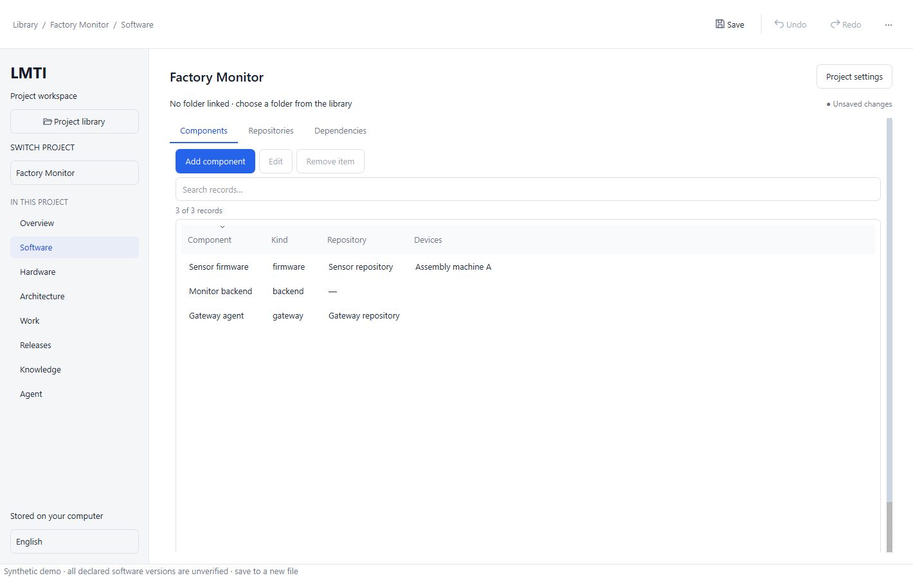
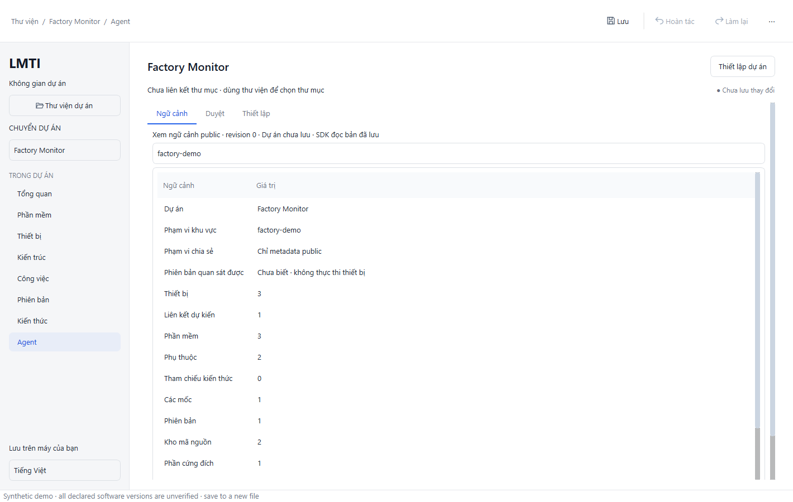

# UI optimization implementation evidence

Date: 2026-10-12. Scope: U1–U4 local-alpha implementation and U5 developer
verification under the [UI plan](2026-10-12-ui-optimization.md).
Manual operator/product-client and clean Windows acceptance remain separate.

The operator subsequently rejected this initial layout as confusing. Functional
test results below are not usability sign-off. The current presentation and
side-by-side package are documented in the [layout refinement](2026-10-12-ui-refinement.md).

## Delivered behavior

| Stage | Delivered slice |
| --- | --- |
| U1 | Draft-preserving forms, field errors/focus for metadata/date/evidence/relationships, selection-aware Edit/Remove, explicit desired/observed terminology, localized state/accessibility and visible keyboard focus |
| U2 | Stable page IDs, object inspector, related release/device/work/evidence actions, Back restores page/filter/selection/scroll/canvas; table search/sort; Library Cards/List, name/recent sorting, shortened folder display and localized date; Work List/Board shares selection and filters existing items without rebuilding rows per keystroke; actionable Needs attention |
| U3 | Graph legend/zoom/fit/displayed counts and node selection; separate Knowledge References; Agent Context/Review/Setup with structured saved/unsaved/public scope summary and collapsed JSON; clean revision required for proposals |
| U4a | Explicit trusted runtime/source connection, canonical AMF identity, public map summaries, existing schema-v4 TS memory summaries and actual lesson states; source timestamps, truncation, unsupported/missing/denied states |
| U4b | Nonsecret task context, bounded read-only skill recommendation, checked explicit Copy/Export; separate opt-in lesson review with evidence confirmation and atomic fingerprint/status/privacy/evidence validation |

Native typed documents, revision ownership and undo remain separate from TS/Go
memory. Library links and KnowledgeRef values do not grant source access. The
source connection is deliberately selected per native project and cleared when
switching projects; any document change invalidates pending/exported context.
Language changes retain the task and validated snapshot. No skill/test, device
operation, compilation, migration or Agent grant expansion runs from this UI.

Read-only memory snapshots do not initialize storage, apply schemas, mutate
logical records, update access/expiry fields or append retrieval logs. SQLite
reader locks/SHM can still be maintained by SQLite. Lesson writes require the
trusted launcher's explicit capability and operator review; pending/rejected
lessons never enter external context. The new writer commits candidate state,
approved memory and audit event together. See the
[knowledge boundary ADR](../adr/2026-10-12-desktop-knowledge.md).

## Verification

Verified on this Windows 11 x64 development machine with MSVC Release/Qt 6.12.0,
Node 24.13.0 and the installed Python runtime. These are local measurements, not
a clean-machine or production claim.

- Native Release build and side-by-side Qt packaging pass. **CTest 4/4** passes;
  QtTest reports **12 passed, zero failed/skipped** (including initialization and
  cleanup). Coverage includes retained invalid form input/focus/Cancel/Undo,
  inspector Back, filters/selection, shared Work modes, language, structured Agent
  preview, wrong/malformed/oversized process output, timeout/cancellation, project
  change invalidation and a real Qt→TS memory/context round trip.
- TS CLI build passes. Targeted bridge + memory tests: **38/38**; existing CLI
  regression tests: **40/40**. They verify read-only DB preservation, secret/
  do_not_prompt/unreviewed exclusion, identity/target/operation denial, escaping
  junctions, unsupported/oversized/malformed sources, explicit review capability,
  stale fingerprints, atomic approval, rejection and safe process error output.
- Packaged native CLIs pass **12/12 Python SDK/MCP tests, zero skips**. The first
  check against unpackaged build executables correctly failed because the SDK
  restricts DLL/plugin paths to its package. Verification uses the deployed
  package; no SDK grant or environment restriction was widened.
- Actual requested window sizes **1100×800, 1280×720 and 1440×900** are asserted.
  Forms scroll while keeping Save/Cancel visible; workspace contents can scroll
  vertically, with navigation scrolling at short heights. Keyboard focus remains
  visible. Form/navigation/language checks also pass at **125%, 150% and 200% DPI**
  with no skips; 100% is covered by the full desktop suite.
- Isolated synthetic windows render through the packaged Windows platform plugin.
  Software and Vietnamese Agent screenshots were inspected. Primary actions and
  scope remain visible; long content is accessible by scrolling. Main text/white
  palette contrast was computed: `#1f2937` 14.68:1, `#6b7280` 4.83:1,
  `#4b5563` 7.56:1, `#2563eb` 5.17:1. This does not certify every state or WCAG.
- Native formatter, PowerShell launcher parsing, `git diff --check` and local
  coordination-document links pass. Packaging retains the existing optional
  DX compiler/VCINSTALLDIR warnings; clean Windows acceptance remains open.

Synthetic UI measurements, 20 samples per dataset, including queued widget
layout/paint work during filtering/page switches:

| Fixture | Initial validate/materialize | Filter p95 | Loaded page switch p95 |
| --- | ---: | ---: | ---: |
| 100 components/releases, 200 devices, 500 bindings/work | 225.70 ms | 14.11 ms | 25.57 ms |
| 2,000 components/releases/bindings/work, 200 devices | 1,226.84 ms | 20.31 ms | 35.83 ms |

The proposed loaded-view budgets (<100 ms filter / <200 ms page switch) are met
for these fixtures. Initial materialization remains synchronous and approaches
1.23 seconds at the larger limit; this is an explicit remaining performance
limit, not an assertion of frame-time/RAM/history bounds. The 500-reference
Library fixture retains 24 visible cards/page and search works in List mode.





All tests use synthetic temporary sources/documents, never the user's project
library or memory. Screenshots use the application's isolated render fixtures.

## Package and repeatable checks

The side-by-side native package is `build/studio-ui`. It retains its own writable
data directory and preserves older open packages/documents. Open a known project
file explicitly to add it to this package's library; live indexes are not copied.

```powershell
node node_modules/typescript/bin/tsc -b packages/cli
& .\scripts\start-studio-ui.ps1
# Separate local capability, if operator lesson review is needed:
& .\scripts\start-studio-ui.ps1 -AllowLessonReview
```

The launcher selects the installed trusted Node 24+ executable and this repo's
built CLI, not a runtime supplied by project metadata. Child environment contains
only essential system paths/temp settings and the explicit review capability.
Copy/export is a user action. Do not put secrets into tasks or metadata.

To include the real Qt→TS process test, set `LMTI_STUDIO_TEST_CLI` to the absolute
built CLI path before CTest. Without Node/built CLI, only the optional Knowledge
process checks can skip; native domain/UI checks still run. Full local evidence
must report any skips. Desktop test text is retained under `build/native/`.

## Remaining acceptance and limits

Developer tests/rendering do not certify a clean Windows install, screen-reader
behavior or a user's usability sign-off. Those checks require their actual target
environment/operator. Product MCP-client acceptance remains an independent gate.
Current tests/measurements are synthetic, without slow network folders, live
telemetry or device execution. An already loaded view switching quickly does not
prove a bound for database I/O or every main-thread operation.

AMF must already exist with a matching root. Only explicitly public map entries
are displayed; records lacking classification are omitted. The adapter supports
existing TS schema 4 only; it does not import legacy JSON/Go memory or upgrade
stores. Node and the built TS CLI are an optional companion runtime and are not
bundled into the native Qt package. Source relocation/rename requires reconnection;
encrypted storage, OS isolation, recovery and multi-user RBAC need separate gates.
After a cancelled review write, reload to inspect actual state because a commit
may finish before cancellation. Clipboard belongs to the user's OS environment.

**[CẢNH BÁO BẢO MẬT]** SQLite remains unencrypted. Before pushing, verify `.gitignore`
for `.env`, keys/certificates, databases and WAL/SHM, then run
`lmti publish preflight`. No publish/push was performed for this UI work.

Lesson candidates for later privacy/evidence review, not automatically stored:
read commands can have write side effects; metadata length guards need a separate
bounded strategy for context; source identity and native project identity differ;
cancelled writes require rereading durable state; UI Back must restore context.
