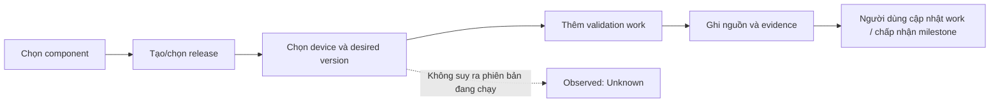

# Tối ưu giao diện LMTI theo luồng sử dụng

> Planning status, 2026-10-13: this is a dated scope/evidence record.
> The [consolidated master plan](../LMTI_MASTER_PLAN.md) owns current priorities
> and M0–M4 milestones. Earlier stage orders and unfinished work below are
> reference material, not a separate active backlog. Accepted architecture and
> recorded evidence remain valid within their stated scope.

Ngày: 2026-10-12. Trạng thái: **U1–U4 đã triển khai local alpha**; bằng chứng U5
và các gate nghiệm thu nằm trong [báo cáo thực thi](2026-10-12-ui-execution.md).
Audit bên dưới giữ baseline trước thay đổi. Tiếp nối [Project library](2026-10-12-project-library.md)
và [quản lý phần mềm–phần cứng](2026-10-11-software-hardware-projects.md), dưới
[master plan](../LMTI_MASTER_PLAN.md).

Người dùng chưa chấp nhận bố cục của bản U1–U4 đầu tiên. Đợt chỉnh lại khung
Library/workspace và luồng quản trị nằm trong [layout refinement](2026-10-12-ui-refinement.md).
Test chức năng không đồng nghĩa với nghiệm thu trải nghiệm sử dụng.

## 1. Kết luận thiết kế

Giao diện đã có thư viện, sidebar và các nghiệp vụ dự án. Vướng mắc lớn nhất là
người dùng phải tự nối các bảng để trả lời: **đang xây gì, phần mềm phục vụ thiết
bị nào, cần làm gì tiếp, điều gì đã có bằng chứng và Agent được biết những gì?**

Hướng tối ưu là một workspace theo dự án, với ba luồng liền mạch:

1. **Tìm và tiếp tục dự án:** Library → đúng dự án → đúng phần việc.
2. **Phát triển và kiểm chứng:** Software → Release → Device binding → Work → Evidence.
3. **Dùng hiểu biết của LMTI:** Knowledge → context theo nhiệm vụ/quyền → review → lesson.

Luồng 3 cần phân biệt rõ năng lực CLI đang có với phần desktop chưa tích hợp.
Giữ English mặc định, tiếng Việt phụ. Học cách tổ chức quen thuộc của các ứng
dụng quản lý: điều hướng ổn định, một hành động chính, nội dung dễ đọc và chi tiết
mở theo nhu cầu. Canvas và nghiệp vụ kỹ thuật vẫn có không gian riêng.

## 2. Phạm vi bằng chứng

Đã đối chiếu source Qt/C++ với ảnh Library, Overview, Software, Hardware,
Relationships, Work; render thêm Versions và Agent từ package hiện tại bằng
fixture tổng hợp riêng. Không đọc dự án thật hoặc thử thao tác trên cửa sổ đang
có dữ liệu chưa lưu. Đây là đánh giá mã nguồn và bố cục, chưa phải nghiên cứu
usability với người dùng hoặc benchmark tương tác.

Nguồn hiện trạng:

- [ProjectWindow](../../apps/desktop/project_window.cpp): `Form::accept_form`,
  `build_pages`, `edit_entity`, `refresh`, `refresh_agent`, `refresh_relationships`.
- [Library view](../../apps/desktop/project_library_view.cpp): `rebuild` và bộ lọc/phân trang.
- [Caption mapping](../../apps/desktop/project_captions.hpp) và
  [language application](../../apps/desktop/project_language.cpp).
- [Domain hiện có](../../native/include/lmti/project.hpp),
  [support map](../component-support.md), [hướng dẫn desktop](../project-studio.md).
- [Privacy](../privacy-model.md), [verification](../verification-model.md),
  [CLI contracts](../commands.md), [host-project boundary](../host-project-boundary.md).

## 3. Vấn đề cần giải quyết

P0: nguy cơ mất bản nhập hoặc hiểu sai trạng thái. P1: cản trở tác vụ chính.
P2: cải thiện mật độ, tính nhất quán và vận hành nhiều dữ liệu. Ưu tiên dưới đây
là đánh giá kỹ thuật, chưa phải tần suất lỗi được đo ở người dùng.

| Mức | Hiện trạng có bằng chứng | Tác động | Thay đổi đề xuất |
| --- | --- | --- | --- |
| P0 | Form đóng khi Save rồi `edit_entity` mới validate; exception chỉ báo MessageBox | Nhập sai ngày, thiếu evidence hoặc vi phạm ràng buộc có thể làm mất bản nhập | Validate trước khi đóng, báo cạnh trường, giữ tất cả giá trị và focus trường lỗi |
| P0 | Overview dùng cột `Verified` nhưng điền `unknown`; `Observed version` dịch thành `Phiên bản đã xác minh` | Lẫn phiên bản quan sát được với kết quả kiểm chứng | Chuẩn hóa Desired / Observed / Evidence / Approved; sửa bản dịch và chú giải đúng nguồn |
| P1 | Component, release, device binding và work nằm rời; sửa device chuyển sang Architecture | Người dùng phải nhớ quan hệ và đi qua nhiều trang | Inspector theo đối tượng, liên kết mở đúng bản ghi, thao tác liên quan ngay tại component/device |
| P1 | Bảng chung thiếu tìm/lọc/sort; Edit/Remove bật khi chưa chọn rồi không làm gì | Khó tìm và khó biết có thể thao tác gì | Thanh công cụ thống nhất, trạng thái nút theo selection, Enter mở chi tiết, tìm/lọc theo trang |
| P1 | Overview ưu tiên số lượng; danh sách cần chú ý lấy mọi work chưa Done, hàng chưa mở bản ghi | Chưa trả lời được việc tiếp theo | Next actions + Needs attention có lý do và hành động; số liệu là phần phụ |
| P1 | Board năm cột cắt tên work và đối tượng liên quan; chủ yếu sửa bằng double-click | Mất ngữ cảnh, thao tác khó khám phá | List / Board, tiêu đề tối đa hai dòng, chọn một lần mở inspector, nút Edit/change state rõ ràng |
| P1 | Agent là site selector + JSON; Knowledge refs nằm dưới Software | Giá trị context/knowledge của LMTI khó nhìn thấy | Context preview có cấu trúc, Review proposal dễ tìm; Knowledge refs có vị trí riêng với trạng thái nguồn rõ |
| P2 | Library ưu tiên absolute path, màu xanh cho file tồn tại; ngày giờ theo một format cố định | Khó quét nhiều dự án, dễ hiểu màu xanh là sức khỏe dự án | Tên + thư mục rút gọn, trạng thái trung tính Available locally, list mode và sort, ngày theo locale |
| P2 | Header lặp tên dự án/đường dẫn/settings trên mọi trang; graph và editor legacy khác theme | Nội dung chính bị đẩy xuống, cảm giác thiếu thống nhất | Thu gọn project context; tiêu đề trang và hành động chính nổi bật; dùng chung token màu/chữ |
| P2 | Caption dịch bằng reverse lookup; accessibleName/dynamic text còn trộn ngôn ngữ | Dễ sai nghĩa, hỗ trợ bàn phím/screen reader không đồng nhất | Khóa dịch ổn định, dịch accessibility/state; không dịch dữ liệu người dùng |

Lỗi ngôn ngữ cụ thể khác: Library truyền chuỗi `Chưa liên kết thư mục` vào label
`folderPath` được đánh dấu verbatim nên có thể còn tiếng Việt ở giao diện English.
Đổi ngôn ngữ hiện đã giữ document; cần mở rộng nghiệm thu sang selection, filter,
form đang nhập và vị trí canvas.

## 4. Bản đồ tính năng → giao diện

| Năng lực | Thực tế hiện nay | Bề mặt đề xuất và điều kiện |
| --- | --- | --- |
| Library / folder refs | Đã nối desktop, 500 refs, 24 card/trang | Home, Card/List, search/sort/pin/repair; folder linked không có nghĩa đã index knowledge |
| Software / repo / target / release / binding | Đã có domain và desktop | Trang chuyên biệt + inspector và thao tác theo đối tượng; repo vẫn là metadata |
| Work / milestone / evidence | Đã có, validation Done và acceptance có ràng buộc | Work List/Board, Milestones, Evidence trong chi tiết đối tượng |
| Topology / software–device graph | Đã có; graph tổng quan cắt ở 50 node mỗi loại | Architecture với legend, zoom/fit, chọn node mở inspector và chỉ báo số node đang hiển thị |
| Project Agent context / impact / proposal | CLI/SDK/MCP có; desktop preview JSON và import proposal | Agent: Context / Review / Setup; giải thích scope, revision, truncation; JSON ở Technical details |
| Knowledge references | Desktop chỉ lưu tham chiếu và fingerprint | Knowledge → References ngay trong đợt UI; luôn ghi Source not loaded khi chưa đọc nguồn |
| Project Atlas / compiled understanding | Có CLI TS; chưa có desktop bridge | Knowledge → Project map sau adapter; trạng thái nguồn thật; Compile là hành động có ghi riêng |
| Memory / reviewed lessons | Có CLI TS; chưa nối desktop | Memory/Lessons chỉ bật khi có adapter được kiểm tra policy; pending không thành approved |
| Task context / privacy preflight | Có CLI TS, chưa nối desktop | Prepare context: task → target được cấp → preview → kiểm tra đầu ra → copy/export có chủ ý |
| Skills / framework verification / health | Có CLI, một số phần experimental | Skill routing trong luồng context; health ở Settings; route/verification plan không phải thực thi |
| Live telemetry / deploy / device execution | Chưa có trong MVP | Không thêm trạng thái live hoặc nút vận hành thiết bị trong các đợt UI này |

Không gộp release verification, work evidence và lesson approval thành một trạng
thái chung. Bằng chứng do người vận hành nhập không tự chứng minh firmware đang
chạy. Một số trường freshness/verification của TS chưa hiện diện ở mọi item;
không có nguồn thì hiển thị Unknown hoặc Not checked.

## 5. Cấu trúc điều hướng đề xuất

```text
Project library                    phạm vi toàn cục
  Search · Pinned · Recent · Card/List
  Create project · Link folder
  Resume current project           khi có dự án đang mở, kèm unsaved state

Project workspace
  Project switcher                 luôn biết đang thao tác dự án nào
  PROJECT
    Overview
    Software
    Hardware
    Architecture
    Work
    Releases                       gồm Evidence
  KNOWLEDGE & AGENT
    Knowledge                      References trước; nguồn khác theo capability
    Agent                          Context · Review · Setup
  Settings / Language
```

Library home có điều hướng toàn cục; các mục theo dự án xuất hiện trong workspace.
Quay về Library không đóng document hoặc bỏ thay đổi chưa lưu. Resume mở lại
đúng trang; đổi dự án vẫn giữ Save / Discard / Cancel. Một tên **Releases** thống
nhất thay việc dùng Versions ở sidebar và Releases ở tab; tiếng Việt là Phiên bản.

Knowledge không mở hàng loạt tab chưa dùng được: References hoạt động trước;
nguồn memory chưa tích hợp chỉ có mô tả trạng thái Not connected, không số đếm
0 hoặc nút Search/Compile giả hoạt động. Setup Agent hiển thị khả năng cấu hình
CLI/MCP hiện có, không tuyên bố client đã kết nối khi chưa có phép kiểm tra thật.

Khung workspace:

```text
┌ Project switcher ┬ Project / Software          Search project   Saved r12  Save ┐
│ Library          │ Software                          + Add component            │
│                  │ Search · Kind · Repository · Device                          │
│ PROJECT          ├───────────────────────────────┬───────────────────────────────┤
│ Overview         │ Components / list             │ Sensor firmware               │
│ Software         │ selected row stays visible    │ Summary · Links · Work        │
│ Hardware         │                               │ Versions · Evidence           │
│ Architecture     │                               │                               │
│ Work             │                               │ Create version · Link device  │
│ Releases         │                               │ Add work · View evidence      │
│ KNOWLEDGE/AGENT   │                               │                               │
│ Settings / EN    │                               │                               │
└──────────────────┴───────────────────────────────┴───────────────────────────────┘
```

Đây là wireframe định hướng; màn hình triển khai thực tế nằm trong báo cáo. Inspector chỉ
mở khi cần; cửa sổ hẹp dùng panel mở phủ hoặc trang chi tiết có Back giữ filter/
selection. Không ép ba cột cùng tồn tại. Header giữ saved/unsaved/conflict rõ ràng;
Save tiếp tục là hành động có chủ ý, không đổi sang autosave trong đợt này.

## 6. Thiết kế từng luồng

**Library:** giữ pin/search/repair/remove; thêm List và sort Name/Last opened.
Card chỉ lấy dữ liệu hiện có trong index: tên, folder, file, pin, lần mở. Đường
dẫn đầy đủ nằm ở Details/tooltip có thể sao chép theo thao tác người dùng. Missing
file/folder có hành động khôi phục cụ thể. Không mở 500 document để lấy badge
tiến độ. Tags/collections hoặc summary cache là mở rộng schema riêng nếu cần sau.

**Overview:** ưu tiên Needs attention và Next actions: blocked work, validation
thiếu evidence, milestone chưa đủ điều kiện acceptance. Điều kiện được tính từ
domain, không do model suy đoán. Chưa có phần cứng không mặc định là lỗi: gợi ý
liên kết chỉ áp dụng khi người dùng đang thiết lập luồng có thiết bị. Mỗi dòng
mở đúng đối tượng. Done/total ghi rõ là Work progress; bỏ suy diễn readiness.

**Software ↔ Hardware:** một lần chọn component/device mở các release, binding,
work và evidence liên quan. Hành động Create version, Choose desired version,
Link device hoặc Add validation work giữ ngữ cảnh đối tượng. Thiếu prerequisite
được báo trước với nút đi tới bước cần thiết. Chỉnh thuộc tính device đơn giản
ở inspector; Edit topology dành cho bố cục/kết nối. Mọi thay đổi vẫn qua validator
và một lịch sử undo/revision chung.



**Work / Releases:** List thuận tiện tìm/lọc và cửa sổ hẹp; Board là lựa chọn cho
phân bố trạng thái. Cả hai dùng cùng dữ liệu và selection. Evidence hiển thị
source, thời điểm được ghi, result và đối tượng liên quan. Lỗi chuyển Done giữ
nguyên bản nhập và chỉ rõ evidence thiếu. Approved release có giải thích khóa
metadata và Create new version; không thêm Deploy/Flash. Drag/drop chỉ làm sau
khi có cách giữ nguyên state và giải thích lỗi khi validator từ chối.

**Architecture:** node có loại và nhãn; chọn node mở cùng inspector; liên kết
quay lại inventory. Legend giải thích dependency và desired binding. Có zoom/
fit; cắt dữ liệu phải hiện Showing X of Y và lối vào danh sách đầy đủ. Bộ lọc theo
đối tượng có scope rõ; đồ thị không tự kết luận online hoặc impact vận hành.

**Agent trong đợt UI:** Context summary → project/site/target/revision → các
đối tượng được phép → nguồn dữ liệu/saved status/truncation. Raw JSON là mục
Technical details. Nội dung bị loại chỉ hiển thị lý do hoặc thống kê khi boundary
cho phép; không tự truy vấn dữ liệu bị chặn để vẽ preview. Proposal review hiển
thị tên work, old → new, revision, điều kiện áp dụng; Apply vào document và Save
vẫn là hai bước rõ ràng. Import proposal là hành động chính tại Review, không
bắt tìm trong menu dấu ba chấm.

**Knowledge / context sau tích hợp:** chọn nguồn cục bộ được phép → adapter kiểm
tra capability/project/policy → đọc snapshot/context giới hạn → hiển thị nguồn
và độ mới thật. Chuẩn bị context theo task là luồng riêng, có target trong grant
được cấp và kiểm tra đầu ra trước copy/export. Lesson candidate review ghi rõ
pending/approved/rejected; giao diện không tự approve khi task hoàn tất.

## 7. Thứ tự triển khai và điều kiện hoàn thành

| Đợt | Phạm vi cụ thể | Phụ thuộc | Điều kiện xong |
| --- | --- | --- | --- |
| U0 — Phân tích | Audit, capability map, thuật ngữ, wireframe và tiêu chí bên trên | Baseline L0–L3 | Đã có; audit ghi baseline trước triển khai |
| U1 — Thao tác đáng tin cậy | Form giữ bản nhập, inline validation; Edit/Remove đúng selection; sửa observed/verified; dịch placeholder/state/accessibility; thu gọn header | Domain hiện tại | Form sai không mất dữ liệu; không nút bấm im lặng; save/cancel/undo/language vẫn đúng |
| U2 — Luồng dự án liền mạch | Inspector + mở bản ghi theo ID; search/filter bảng; Library Card/List; Software→Release→Device→Work; Work List/Board; Overview hành động | U1; contract điều hướng | Từ component/device mở release/work/evidence liên quan trong tối đa 2 thao tác điều hướng, không tính nhập form |
| U3 — Hiểu quan hệ và Agent | Graph chọn node/legend/count; Knowledge References riêng; context summary và proposal review; JSON chi tiết | U2; boundary native hiện có | Hiểu scope/revision/desired/observed bằng UI; review sai revision bị chặn; không cần đọc JSON cho tác vụ thông thường |
| U4a — Knowledge read-only | Contract adapter có version; runtime/source detection; project map/memory/approved lesson views theo policy | Kiểm chứng boundary TS và ánh xạ identity riêng | Wrong project/secret/pending/malformed/timeout bị xử lý đúng; chưa kết nối khác với không có dữ liệu |
| U4b — Context và lesson review | Task context, skill routing, copy/export có kiểm tra; thao tác lesson có review riêng | U4a; contract cho từng thao tác có ghi | Không mở rộng grant, không tự chạy skill/test, không tự duyệt lesson; policy từ nguồn được bảo toàn |
| U5 — Nghiệm thu mỗi đợt | English/Vi, bàn phím, DPI, responsive, data scale, đóng gói | Chạy sau từng đợt; không đợi U4 | Bằng chứng trên các luồng và tập dữ liệu bên dưới; nghiệm thu người dùng tách khỏi test tự động |

Ưu tiên phát hành lát cắt **U1 → U2 → U3**, rồi nối phần memory qua U4. Việc
U4 cần backend không chặn các cải tiến desktop đã có dữ liệu. Các ước lượng
ngày công chỉ nên lập sau khi chia ticket và đo baseline, không suy ra phần trăm
hoàn thành từ số màn hình.

## 8. Kiến trúc, hiệu năng và bảo mật

ProjectWindow đang sở hữu nhiều page, form, translation và full refresh; refresh
dựng lại bảng, graph, context và recent index kể cả khi sửa một phần. Tách page/
inspector/presentation model từng bước ở lớp desktop; giữ ProjectDocument, typed
core, SQLite adapter và revision owner hiện có. Dùng PageId/entity ID ổn định thay
vị trí tab để thêm Knowledge mà không làm sai điều hướng.

Search/filter chỉ cập nhật view liên quan, giữ selection/scroll/canvas. Dữ liệu
trình bày lấy từ typed document; không nối QSqlTableModel trực tiếp vào bảng
domain để vượt validator. Qt model/view phù hợp khi dùng chung dữ liệu cho List,
Board và inspector; áp dụng ở các trang cần thay đổi, không port lại toàn bộ
runtime. [Qt model/view](https://doc.qt.io/qt-6/model-view-programming.html).

Phân biệt Library search, Search in this project và Knowledge search. Search
toàn cục chỉ gồm metadata được phép đã nạp; command palette nếu bổ sung chỉ
định tuyến action allowlist, không nhận lệnh shell. Memory/context chỉ tải khi
người dùng yêu cầu. Tác vụ adapter chạy bất đồng bộ với timeout, cancellation,
output budget; kết quả cũ phải bị bỏ khi project/revision đổi.

**[CẢNH BÁO BẢO MẬT]** Nối desktop trực tiếp vào SQLite/.lmti hoặc tự mở nội dung
KnowledgeRef có thể bỏ qua policy nguồn. Adapter cần executable/runtime tin cậy,
argument vector cố định, operation allowlist và response schema/version được
kiểm chứng. Liên kết folder không tự cấp quyền đọc repo cho Agent. Model target
trong UI chỉ chọn trong grant hiện có. Không gộp memory vào project database.

Compile/init/framework detection và một số lệnh CLI có thể ghi state: phải kiểm
kê tác dụng phụ từng operation trước khi gọi từ UI, không đặt nhãn read-only dựa
trên tên lệnh. Read, compile, propose và approve có contract/action riêng. Đồng
bộ contract privacy của native và TS qua adapter, không đổi enum cho chúng giống
nhau. Error/log/clipboard/cache/tooltip cũng thuộc phạm vi kiểm soát đầu ra.

SQLite hiện chưa mã hóa nên màn hình vẫn chỉ hỗ trợ metadata không bí mật. Khi
push cần kiểm tra `.gitignore` cho database/WAL/SHM/secrets và chạy
`lmti publish preflight`. Backup/recovery, durable audit, đồng bộ cloud, OS
isolation và device execution là các gate riêng của dự án.

## 9. Ngôn ngữ, thiết kế thị giác và nghiệm thu

Dùng một bộ token nhỏ cho spacing, font, border, focus, selection và semantic
status. Màu xanh dành cho hành động/selection; trạng thái available/unknown dùng
trung tính, warning có nhãn và icon. Không chỉ dựa vào màu. Giữ theme dễ đọc cho
canvas và shell; dark mode đầy đủ không là điều kiện chặn U1–U3.

English là nguồn dịch ổn định; tiếng Việt giữ đúng nghĩa domain. Loại dần reverse
lookup caption, đưa chuỗi động/accessible name vào translation context. Có thể
dùng Qt Linguist/QTranslator trong toolchain hiện có; dữ liệu người dùng và ID
không phải khóa dịch. [Qt internationalization](https://doc.qt.io/qt-6/internationalization.html).

Mục tiêu tương phản chữ thường tối thiểu 4.5:1 được dùng làm tiêu chí thiết kế;
đo màu thực trước nghiệm thu. Đây là tham chiếu từ WCAG cho khả năng đọc, không
phải tuyên bố desktop đã được chứng nhận WCAG.
[W3C contrast guidance](https://www.w3.org/WAI/WCAG22/Understanding/contrast-minimum.html).
Ưu tiên Qt widgets có accessibility sẵn; kiểm tra name/role/focus khi tùy biến
inspector/graph. [Qt accessibility](https://doc.qt.io/qt-6/accessible.html).

Các điều kiện nghiệm thu; kết quả đo và điều kiện còn chờ nằm trong báo cáo thực thi:

- Form: sai tên/ngày/quan hệ/evidence → giữ input; Cancel → document/revision không đổi.
- Điều hướng: mở dự án → chọn component/device → related version/work/evidence → Back
  giữ filter/selection; Library/đổi ngôn ngữ không mất dirty data.
- Bàn phím: Tab/Shift+Tab/Enter/Escape và shortcut Save/Open/Undo hoạt động; focus
  thấy rõ; popup có label; nút disable giải thích prerequisite khi cần.
- Hiển thị: 1100×800, 1280×720, 1440×900 logical pixels; DPI 100/125/150/200%; tên
  tiếng Việt dài, path dài, empty/error/loading/missing/readonly/conflict states.
  Không cắt action chính; Board hẹp có List, bảng rộng cuộn trong vùng bảng.
- Library: fixture 500 refs, tối đa 24 card/trang; không scan cây thư mục hoặc mở
  tất cả document. Kiểm tra path mất/chậm; không suy ra tốc độ từ ảnh ba dự án.
- Workspace: tập tổng hợp 100 components/200 devices/500 bindings/500 work và tập
  tiến tới giới hạn 2.000 bản ghi theo category hợp lệ. Đo p95 lọc/chuyển trang,
  main-thread stalls, RAM/history và thời gian load; công bố máy và workload.
  Ngân sách đề xuất: phản hồi filter trên dữ liệu đã nạp <100 ms p95, chuyển
  page đã nạp <200 ms p95; I/O dài có trạng thái tiến hành/cancel. Đo rồi điều
  chỉnh kế hoạch, chưa cam kết các con số này đã đạt.
- Privacy/Agent: wrong project/site/parent, stale proposal, secret/do_not_prompt,
  pending lesson, missing runtime, output sai/quá lớn, timeout/cancel; các case
  TS chỉ áp dụng khi U4 được nối. Không coi saved document bằng unsaved preview.
- Nghiệm thu người dùng: hoàn thành Create/Link → software/device workflow →
  evidence → proposal review mà không cần hướng dẫn về schema hoặc đọc JSON.

Chỉ chạy test thay đổi phù hợp từng đợt. Kiểm tra native/UI, bridge/CLI/memory
và process integration theo thay đổi thực tế; không suy diễn nghiệm thu người
dùng hoặc Windows sạch từ test tự động.

## 10. Giá trị LMTI được giữ

Thiết kế này làm rõ đối tượng và nguồn bằng chứng, giảm tìm kiếm/điều hướng lặp,
tái sử dụng cùng quan hệ và context đã được phép, giữ knowledge trong boundary
gốc và tách presentation khỏi domain để thay đổi độc lập. Nó không cần thêm LLM
provider, cloud service hoặc framework mới.

Lesson candidates để review, chưa tự lưu: quan sát không đồng nghĩa xác minh;
validation thất bại phải giữ bản nhập; folder link không phải quyền Agent;
capability chưa nối khác với dữ liệu rỗng; presentation cache không được vượt
policy hoặc giả freshness.
