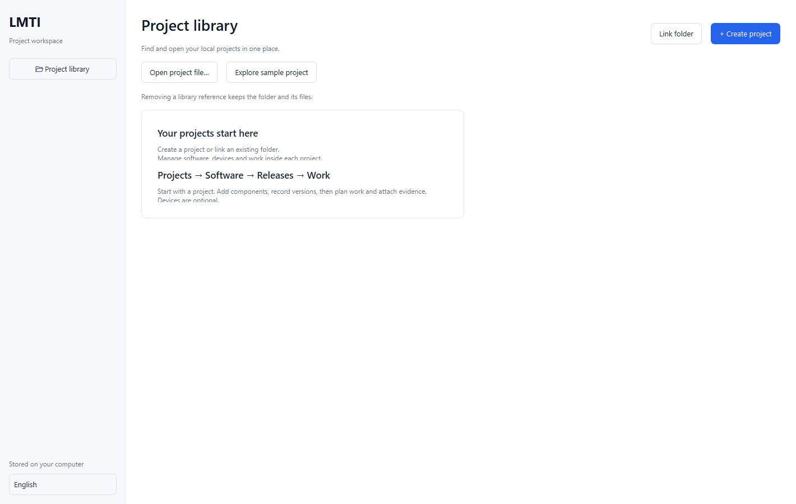
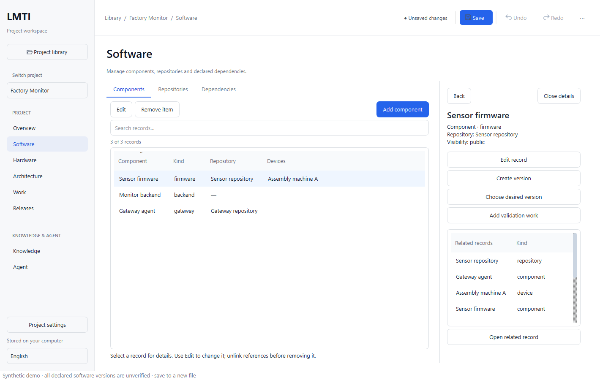
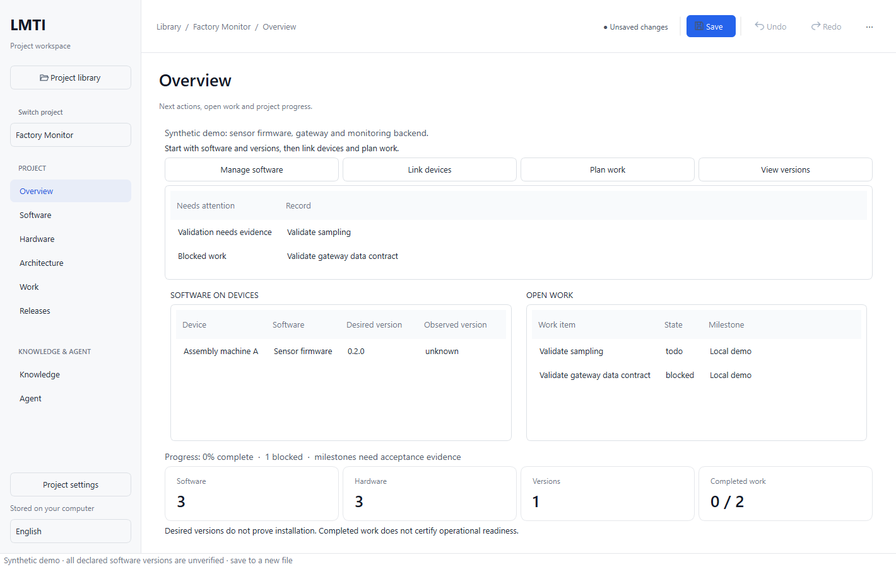

# Desktop layout refinement after operator review

> Planning status, 2026-10-13: this is a dated scope/evidence record.
> The [consolidated master plan](../LMTI_MASTER_PLAN.md) owns current priorities
> and M0–M4 milestones. Earlier stage orders and unfinished work below are
> reference material, not a separate active backlog. Accepted architecture and
> recorded evidence remain valid within their stated scope.

Date: 2026-10-12. The operator rejected the initial U1–U4 presentation as confusing.
The later [management UI correction](2026-10-12-management-ui-fix.md) supersedes
the action placement and narrow inspector layout described below.
Passing developer tests did not establish usability acceptance. This iteration
addresses project, software, release and work management using the existing typed
document, validators, revision history and storage adapters.

## Changes

- Sidebar content is aligned at the top, with separately labelled Project and
  Knowledge & Agent groups. Short windows scroll navigation; language and project
  settings remain in the footer. No project selector is shown for an empty library.
- Library defaults to List. Open file and sample actions sit beside the library
  controls rather than at the bottom of the window. Empty libraries hide search,
  filters and sort controls and display a bounded introductory panel.
- The workspace toolbar occupies the content column, leaving the sidebar intact.
  Breadcrumb, saved revision/unsaved state, Save and history actions share one bar.
  Each page has its own title and short purpose; project folder is in the breadcrumb
  tooltip rather than repeated across every page.
- Selection actions sit on the left and the primary Add action sits on the right
  for native inventory pages. Work uses the same action emphasis.
- Details reserve space beside the list at widths of 1280 logical pixels or more.
  Narrow windows retain the dismissible overlay. Back retains filters, selection
  and context. Workspace scroll sizing follows the visible page, avoiding scroll
  bars caused by a hidden topology or board page.
- Overview places next actions and actual Needs attention before inventory and
  progress counts. Counts retain their domain meaning; no operational readiness
  or observed device state is inferred.

## Management entry points

| Task | Location and supported action |
| --- | --- |
| Projects | Library create/link/open, search/pin/repair/remove reference; Project settings edits name, goal and visibility |
| Software | Components, repositories and dependencies; select a component for related versions/devices/work and create a version |
| Releases | Releases and Evidence; create/edit candidate metadata, record verification; approved metadata remains locked |
| Work | List/Board and Milestones; create/edit/remove work, set state with required checklist/evidence, review milestone acceptance |

These are the implemented local-alpha capabilities. User accounts, multi-user
roles, cloud synchronization, deployment and device execution are separate scope.
Project and release visibility is a data policy, not a substitute for OS-level
authorization. Knowledge and Agent retain their existing explicit boundaries.

## Package

The refined binaries are installed separately at `build/studio-ui-v2`. The launcher
prefers that package when present and uses the existing `build/studio-ui/data`
directory when available. No library index is copied, replaced or searched for in
other installations. Older running apps and their unsaved documents are preserved.

```powershell
& .\scripts\start-studio-ui.ps1
# Inspect the native management workflow with a synthetic, unsaved project:
& .\scripts\start-studio-ui.ps1 -Demo
# Explicit alternative data directory, which must already exist:
& .\scripts\start-studio-ui.ps1 -DataDirectory 'C:\path\to\local-studio-data'
```

`--data-directory` is a desktop operator option and does not change SDK/MCP grants.
The directory is validated using the native local-folder boundary. The trusted
launcher continues to select Node and the built TS bridge without shell commands
from project metadata. Lesson review remains disabled by default.

## Validation and acceptance

Native Release build and side-by-side packaging are checked locally. Desktop
regression checks cover both navigation groups, inspector transitions between
docked and overlay layouts, Back, unchanged documents, forms and shared history.
Window dimensions remain checked at 1100×800, 1280×720 and 1440×900 logical pixels.
Synthetic Windows renders are reviewed separately from operator acceptance.







Final local checks: **CTest 4/4**, desktop **12 passed / zero failed or skipped**
(including initialization/cleanup). The inspector/navigation and empty-library/
project-lifecycle checks also pass at **125%, 150% and 200% DPI** (four passes per
run including initialization/cleanup). Empty-state labels are checked against
their rendered font bounds to prevent text clipping. Release packaging, native
formatting, launcher parsing and whitespace checks pass.

No actual project data is used for fixtures or screenshots. Clean Windows, screen-reader and operator
usability acceptance remain pending. No push or publication was performed.

Before a push, verify `.gitignore` for secrets, databases and WAL/SHM, and run
`lmti publish preflight`. No chat or raw project data is stored as a lesson.
