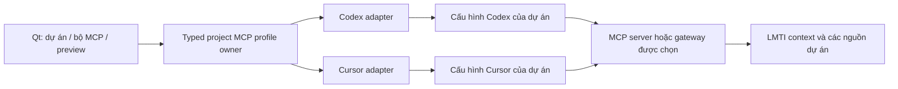

# LMTI — Bộ MCP theo dự án, dùng chung cho Codex và Cursor

Ngày: 2026-10-13. Trạng thái: **đã triển khai profile/UI/generator/apply local alpha;
Codex synthetic read đã kiểm tra; Cursor thật/operator/live-provider còn gate mở**.

Chủ sản phẩm đã yêu cầu thực hiện. [ADR owner](../adr/2026-10-13-project-mcp-profile.md),
[hướng dẫn](../project-mcp.md) và [bằng chứng](2026-10-13-project-mcp-execution.md)
ghi phạm vi đã làm và phần chưa hỗ trợ. Các lựa chọn rộng bên dưới không tự trở
thành tính năng đã chạy; bearer references/local arbitrary commands/remote probe
chưa triển khai. Xác thực hiện tại giao cho OAuth của từng client.

[Master r4](../LMTI_MASTER_PLAN.md) là thẩm quyền ưu tiên duy nhất. Phụ lục này
cụ thể hóa CP-01 trong master, không tạo roadmap riêng. Thay luồng kết nối trước
trong [experience plan](2026-10-13-experience-plan.md); giữ giới hạn native,
memory/privacy và SDK đã nhận. Bằng chứng native M2/Codex hiện có không chứng minh
khả năng quản trị bộ MCP hoặc tương thích Cursor.

## 1. Kết quả người dùng cần

**Chọn dự án → thiết lập bộ MCP → dùng bộ đó với Codex và Cursor → biết kết nối
nào hoạt động và cần xử lý gì.**

Một bộ cấu hình gốc gắn với project ID và revision. Các adapter client tạo định
dạng tương ứng; không yêu cầu người dùng duy trì hai danh sách MCP riêng. Dùng
chung server definitions, phạm vi và nguồn tham chiếu; không đồng nghĩa dùng
chung token, phiên OAuth, lịch sử hội thoại hoặc tự đồng bộ mọi cấu hình client.

Ví dụ nonsecret: dự án Factory Monitor có LMTI context local, một Cloudflare
MCP endpoint đã được phép và một MCP nội bộ truy cập qua mạng riêng. Người dùng
chọn server nào dành cho dự án, rồi chọn Codex/Cursor để xem diff và kết nối.
Cloudflare/Tailscale là lựa chọn theo nhu cầu, không dependency bắt buộc.

## 2. Phạm vi CP-01

| Có trong thiết kế slice | Đầu ra mong đợi |
| --- | --- |
| Bộ MCP của dự án | Thêm/sửa/bật/tắt definition, project identity, revision và danh sách client đích |
| Remote MCP | Endpoint HTTPS được phép, phương thức xác thực được client hỗ trợ, tham chiếu credential; không lưu giá trị bí mật |
| Local MCP đã tin cậy | Executable được xác minh, arguments có kiểu/giới hạn, working directory và tên biến môi trường cần thiết; không shell command tùy ý |
| Adapter Codex và Cursor | Preview cấu hình client riêng từ cùng revision; báo capability không hỗ trợ, không bỏ qua trường âm thầm |
| Kết nối an toàn | Chọn phạm vi dự án mặc định; diff/merge, phát hiện conflict, giữ cấu hình khác, backup/restore phù hợp và ghi nguyên tử |
| Kiểm tra | Validation offline trước; probe có chủ đích với initialize/tools/list, timeout và giới hạn output; không gọi tool thay đổi hạ tầng |
| Trạng thái có bằng chứng | Profile revision đã tạo/đã áp dụng, kết quả probe và client verification riêng, thời điểm kiểm tra và hướng xử lý lỗi |

CP-01 chưa bao gồm Agent orchestration, quản lý tài khoản model, tự cài package,
tự tạo OAuth client, sửa ACL/DNS, deploy/OTA hoặc điều khiển thiết bị. Việc chọn
luồng cấu hình không cấp quyền đăng nhập, thay cấu hình máy hay sửa cloud trong
lượt lập kế hoạch này. Việc áp dụng sau này là thao tác rõ ràng trong sản phẩm.

## 3. Bố cục và luồng thao tác

Màn hình dự án mở vào **MCP & Agents**. Sidebar dự án tối giản; cấu trúc, memory,
tài liệu và IoT giữ điểm vào khi cần, không chiếm màn hình thiết lập ban đầu.

```text
Factory Monitor                                      [Đổi dự án]

Bộ MCP của dự án                         [Thêm kết nối]
LMTI context       Local                 Chưa kiểm tra
Cloudflare        Remote                Cần đăng nhập
MCP nội bộ        Private endpoint      Không truy cập được

Dùng với
[Codex: Chưa áp dụng]    [Cursor: Chưa áp dụng]

[Kiểm tra bộ MCP]       [Thiết lập client]
```

Đây là wireframe trạng thái, không dữ liệu live. Tên hiển thị gần gũi; transport,
binary và đường dẫn xuất hiện trong chi tiết hoặc preview khi ảnh hưởng quyết định.

1. **Chọn dự án:** tái sử dụng library; xác định root/identity. Chưa có MCP thì
   màn hình trống giải thích bước thêm đầu tiên, không tự thêm server bên ngoài.
2. **Thêm kết nối:** chọn LMTI local, remote endpoint hoặc local server tin cậy.
   Xem nguồn/phạm vi, xác thực cần thiết và nơi thực thi. Mẫu Cloudflare hướng tới
   endpoint chính thức/portal của người dùng; Tailscale mô tả đường truy cập mạng
   hoặc gateway, không mặc định có một MCP quản trị tailnet đã cài.
3. **Thiết lập client:** chọn Codex/Cursor, hiển thị phiên bản phát hiện được hoặc
   yêu cầu người dùng chọn. Preview cấu hình/diff và những mục cần xác thực riêng.
   Client không hỗ trợ thì chặn áp dụng và hướng dẫn; không hiện dấu hoàn tất giả.
4. **Áp dụng:** chỉ ghi phạm vi đã chọn bằng adapter. Nếu chưa hỗ trợ tự áp dụng
   đúng phiên bản, xuất cấu hình đã kiểm tra và hướng dẫn thủ công, ghi rõ chưa áp
   dụng. Không tự đóng/restart IDE hoặc thay thiết lập approval của client.
5. **Kiểm tra sử dụng:** kiểm tra handshake/list tools; sau đó xác nhận client thật
   thấy server và một tool đọc được phép chạy trên fixture. Client cần reload hoặc
   đăng nhập thì hiển thị hành động tương ứng. Probe từ LMTI không thay bằng chứng này.
6. **Cập nhật bộ MCP:** revision mới làm các client chưa cập nhật thành cần đồng bộ.
   Mỗi client có diff riêng; sửa ngoại lệ tại client được phát hiện, không âm thầm
   ghi đè. Tắt definition chưa đồng nghĩa remote credential đã bị thu hồi.

Ba trạng thái độc lập: **cấu hình hợp lệ**, **endpoint/probe hoạt động**, **client
thật đã kiểm chứng**. Có trạng thái auth required, unsupported, unavailable,
timeout, partial, changed outside LMTI và update pending. Các lần kiểm tra cũ ghi
thời điểm; không khẳng định server/client luôn online sau một probe.

## 4. Kiến trúc và ownership



Typed C++ domain gồm profile, server definition, transport, client binding,
credential reference và generation result. Storage qua owner/SQLite riêng có
schema/version; không nhét profile vào JSON topology hoặc TS memory. JSON/TOML
là định dạng xuất/import cấu hình client ở boundary. Quyết định schema/owner cụ
thể cần ADR bổ sung trước runtime code; không đổi lịch sử ADR native topology.

Adapter không phụ thuộc Qt view hoặc hãng model. Python SDK/MCP đã có tiếp tục
cung cấp context; Agent không được sửa profile, credential hoặc raw storage.
TS/Go memory giữ nguyên compatibility. Phát hiện client là thao tác đọc giới hạn,
không scan cả home hoặc dump environment. Không sửa global config mặc định.

Dữ liệu tối thiểu: project/profile ID và revision, stable server ID và display
name, transport/endpoint hoặc trusted local executable reference, nonsecret
arguments, credential reference, enabled state, client capability/version,
target scope, generated revision/hash và verification timestamp/outcome.
Không lưu tool outputs, raw tokens hoặc dữ liệu tài khoản vào profile/audit.

## 5. Quản lý cấu hình và enforcement

CP-01 là quản lý cấu hình. Client có thể kết nối trực tiếp MCP đã chọn hoặc tới
gateway có sẵn; LMTI không tự làm proxy mọi lời gọi ở slice này. UI phải ghi rõ
tool policy được thực thi ở client, gateway hay server và phần nào chỉ là intent.
Client adapters không tự bật auto-approve hoặc nới quyền để đạt probe.

Cloudflare MCP portals đã có aggregation, chọn tools và activity logs. Tailscale
Aperture đã có MCP proxy. Đánh giá tái sử dụng nếu dự án cần gateway; không bắt
buộc xếp cả hai vào cùng đường truyền. [Cloudflare](https://developers.cloudflare.com/cloudflare-one/access-controls/ai-controls/mcp-portals/),
[Tailscale Aperture](https://tailscale.com/docs/aperture/mcp-server).

Giá trị LMTI cần đo: thiết lập/cập nhật bộ MCP gắn dự án qua hai client, tránh
configuration drift, cung cấp context/memory và nguồn liên quan đúng dự án.
Chỉ gom server hoặc có nhiều logo chưa chứng minh lợi ích so với cấu hình trực tiếp.

## 6. Bảo mật và lỗi cần thiết kế trước

**[CẢNH BÁO BẢO MẬT]** Local MCP là code chạy trên máy người dùng; thêm server
không chỉ là thêm một dòng cấu hình. Không chạy local executable chưa được tin
cậy để lấy tool list. Không tự tải/chạy package qua npx/pip, không nhận chuỗi
shell tự do; arguments không được dùng để gọi shell hoặc chèn credentials.

- Secrets dùng OS credential store/OAuth của client hoặc tham chiếu env đã cấu
  hình; profile/export/log chỉ có tên tham chiếu. Không đọc lại/lưu token của IDE.
  Không hứa chuyển OAuth session giữa Codex và Cursor.
- Import cấu hình xử lý trường nhạy cảm tại boundary: không hiển thị giá trị,
  không sao chép vào profile; báo cần cấu hình credential reference an toàn.
- HTTPS mặc định; không bỏ xác minh certificate. Probe remote endpoint chống
  redirect sang host khác, cấm metadata/link-local mục tiêu và endpoint ngoài
  scope. Private endpoint cần khai báo rõ, không dùng bộ lọc public làm hỏng mạng riêng.
- Local paths canonicalized và kiểm tra symlink/reparse/root trước write; config
  có sửa ngoài LMTI sau preview phải tạo diff lại. Fail không để file nửa chừng.
- Backup có thể chứa secrets trong cấu hình cũ: giữ byte nội dung tại nơi được
  bảo vệ ngoài repo, không đưa vào context/log/export; cơ chế bảo vệ cần thiết kế
  trước khi triển khai backup. Không gọi backup thường là encrypted nếu chưa có.
- Server metadata/tool descriptions là input không tin cậy; giới hạn kích thước,
  escape hiển thị, không dùng nội dung để cấp quyền hoặc làm executable command.
- `.gitignore` phải che runtime/credential/config nhạy cảm trước push. Chỉ chia sẻ
  template nonsecret đã review. `lmti publish preflight` vẫn là gate phát hành.
- Tắt/bỏ MCP khỏi profile không thu hồi token upstream, không xóa context đã gửi,
  không chặn Agent gọi server bằng config hoặc shell bên ngoài LMTI.

## 7. Trình tự và tiêu chí nghiệm thu

| Bước | Đầu ra / gate |
| --- | --- |
| CP-01a — Design | Wireframe xuyên luồng, typed profile/adapter contract và ADR owner; trạng thái/error/security review; UX acceptance còn mở |
| CP-01b — Profile và generator | Một project revision tạo được Codex TOML và Cursor JSON; validate/round-trip bằng parser đúng, unsupported capability có lỗi rõ |
| CP-01c — Apply và recovery | Preview/merge bảo toàn server khác, conflict/stale detection, atomic write, backup/restore bảo vệ dữ liệu; không sửa global mặc định |
| CP-01d — Client proof | Cả Codex và Cursor trên phiên bản ghi rõ truy đúng synthetic project qua MCP; test thay project, thiếu auth, offline, update và rollback |

Khóa bộ thử: hai project nonsecret và bộ ba server synthetic (LMTI local,
remote-auth-required stub, private/unavailable stub). Stub không thay live
Cloudflare/Tailscale acceptance. Đối chứng người thử cấu hình thủ công cùng
server rồi qua LMTI; đo thời gian setup/cập nhật, số lỗi và khả năng recovery.
Không đặt ngưỡng lợi ích đạt khi chưa có baseline.

Điều kiện hoàn tất CP-01: cấu hình từ một revision dùng được trong cả hai client;
người thử biết phần nào đã kiểm chứng; project A/B không bị trộn; thay đổi không
làm mất cấu hình khác; credential không vào profile/export/log; lỗi giữa chừng
recovery được. Có cùng credentials không chứng minh đúng authority; thử ở đúng
client/account/environment thực tế.

CP-01 là **slice đầu tiên tiếp theo**, không hoàn tất toàn sản phẩm. Cấu trúc dự
án lớn, context xuyên nguồn và IoT thật tiếp tục theo master sau gate thiết lập.
Không dùng tests native M2 cũ để chốt CP-01, live integrations hoặc model quality.

## 8. Căn cứ và hiện trạng

Đối chiếu 2026-10-13:

- [Codex MCP](https://learn.chatgpt.com/docs/extend/mcp?surface=cli): adapter TOML,
  local/remote/auth và tool configuration phải theo phiên bản client đã thử.
- [Cursor MCP](https://prod.cursor.com/help/customization/mcp): project/global
  `mcp.json`, merge theo server name, local/remote definitions; auth/reload riêng.
- [Native Agent layer hiện có](../agent-layer.md) và
  [M2 evidence](2026-10-13-agent-layer-m2-execution.md): tái sử dụng endpoint context;
  Codex tool read mới chỉ là synthetic smoke. Cursor/profile/apply chưa có proof.

Lượt lập kế hoạch ban đầu chỉ chốt spec. Lượt thực thi tiếp theo đã sửa runtime
và thử client config trong fixture; không sửa cấu hình cá nhân/global, cloud/network,
bản nháp cũ hoặc `.lmti/`; không cài dependency hay phát hành.
