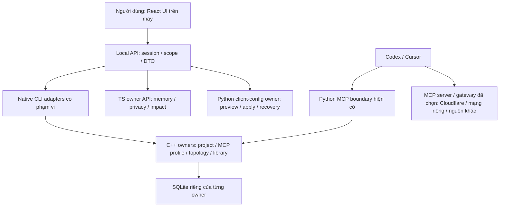

# LMTI — Chuyển giao diện sang web, giữ core và các owner

Ngày: 2026-10-13. Trạng thái: **WEB-00 đã có bản mẫu và hợp đồng API để review;
WEB-01 API/native façade và WEB-02 React/package đã có; WEB-03 cutover còn gate mở**. [Master r6](../LMTI_MASTER_PLAN.md) là thẩm
quyền ưu tiên duy nhất. Đây là phụ lục thực hiện, không roadmap song song.

## 1. Kết quả cần đạt

LMTI có giao diện web rõ ràng, nhất quán, dễ điều chỉnh bố cục và dùng được trong
trình duyệt trên máy. Người dùng chọn dự án, thiết lập bộ MCP dùng chung cho
Codex/Cursor, xem cấu trúc và kiểm soát thay đổi. Cloudflare/Tailscale là các
kết nối của dự án, không phải các trang trang trí hay trạng thái giả.

Chủ sản phẩm đã chọn **web trên máy, mở bằng trình duyệt**. Kiến trúc đề xuất:
**React/TypeScript SPA + local Node.js API + core C++/SQLite và Python MCP hiện có**.
Desktop wrapper và chia sẻ qua mạng chưa được chọn. Chủ sản phẩm đã yêu cầu
thực hiện. [WEB-00](2026-10-13-web-ui-execution.md) có study tương tác giả lập và
[contract](2026-10-13-web-ui-contract.md). [WEB-01](2026-10-13-web-api-execution.md)
đã nối owners qua API local. [WEB-02](2026-10-13-web-react-execution.md) thêm React/Vite
đã review, giữ domain/schema và không chuyển dữ liệu.

Chất lượng UX vẫn cần thiết kế và thử luồng thực tế. Đổi framework giúp tách
giao diện khỏi domain và dễ lặp thiết kế; không tự chứng minh giao diện tốt.

## 2. Công nghệ theo trách nhiệm

| Thành phần | Công nghệ đề xuất | Trách nhiệm và lý do |
| --- | --- | --- |
| Giao diện chính | React + TypeScript, Vite SPA, CSS với bộ token/component nhỏ | Bố cục, tương tác, trạng thái, điều hướng, keyboard và responsive; chưa cần SSR/RSC |
| API cho người dùng trên máy | Node.js 24 + TypeScript, HTTP server mỏng | Xác thực phiên local, scope, DTO, giới hạn request, gọi owner và phục vụ static bundle; tái dùng hệ TS hiện có |
| Domain dự án/MCP/topology | Typed C++ hiện có | Validation, identity, revision, quan hệ và generator; tái dùng code đã kiểm chứng, không viết lại domain bằng JS |
| Lưu trữ native | SQLite qua Qt Core/Sql adapters hiện có | Một owner cho mỗi LMPR/LMCP/topology/library schema; UI và Node không mở SQLite trực tiếp |
| Agent/MCP và client-config adapter | Python hiện có | Giữ stdio SDK/MCP và owner cấu hình/DPAPI; backend gọi qua boundary cố định |
| Memory/privacy/verification | TypeScript owners hiện có | Project Atlas, context và lesson theo policy; không chuyển memory vào frontend |
| Go | Compatibility hiện có | Không thêm domain hoặc rewrite để phục vụ đổi UI |
| Rust/CUDA/training | Chưa thêm ở bước này | Chỉ đánh giá nếu có nhu cầu native shell/GPU đã đo; LMTI hiện tổ chức hiểu biết, không huấn luyện model ChatGPT |

Qt Widgets trở thành UI tương thích trong giai đoạn chuyển đổi. Qt Core/Sql vẫn
là dependency native khi owner dùng chúng; chuyển sang web không tự xóa Qt khỏi
package. Python cũng là integration/SDK runtime, không được gọi là bộ não LLM.

## 3. Kiến trúc đích của slice

API quản trị UI và MCP endpoint là hai boundary khác nhau. Đổi UI không buộc
đổi stdio sang HTTP, đưa token phiên người dùng cho Agent hoặc xây universal proxy.
Mọi rule domain/storage tiếp tục nằm tại owner; API không tạo schema/domain thứ hai.

Native profile/library đã có console adapter get/save/generate ở WEB-01,
tái dùng functions/validation/storage. Chọn/tạo/link thư mục vẫn nằm tại Qt;
không thêm web file picker tổng quát. React nối các API thật ở WEB-02. Không thêm N-API addon,
Protobuf, gRPC, arbitrary shell hoặc raw Agent DB handles.

Browser gửi project/server IDs và các field được phép, không gửi executable,
database filename, môi trường hoặc grant có thẩm quyền. Local API resolve chúng
từ registry/launcher tin cậy và gọi binary/script cố định bằng argv, shell=false.
Chọn thư mục qua picker native có phạm vi hoặc cơ chế operator được thiết kế;
không dùng upload toàn repository hay file browser tổng quát.

## 4. Giao diện đầu tiên

Một shell có chọn/tìm dự án, nội dung chính và panel chi tiết khi cần. Màn hình
đầu mở vào **MCP & Agents**; chưa thêm chatbot nhúng hay chuyển Work thành điểm vào.

| Vùng | Người dùng làm gì | Trạng thái cần thấy |
| --- | --- | --- |
| MCP & Agents | Thêm kết nối, chọn bộ MCP, thiết lập Codex/Cursor, xem diff, apply hoặc restore | Profile revision; chưa áp dụng/cần cập nhật; auth required; client chưa kiểm chứng; lỗi/unsupported |
| Cấu trúc dự án | Tìm component/service, nguồn, release, host/device và quan hệ | Declared/desired/observed, evidence, source/freshness và mapping gap |
| Hoạt động & xét duyệt | Xem thao tác thuộc boundary, diff, kết quả và proposal | Expected revision, pending/stale/accepted/rejected; không dựng lịch sử không có dữ liệu |

WEB-02 chỉ triển khai hoàn chỉnh vùng MCP & Agents và project switcher. Cấu trúc
ban đầu dùng read API hiện có khi thuộc luồng thử; editor topology phức tạp giữ
Qt fallback cho đến gate parity. Hoạt động/review chỉ hiện bằng chứng đã có;
không suy ra tool-call audit từ log cấu hình. IoT live tiếp tục milestone OBS-01.

Ba luồng prototype phải review trước port UI đầy đủ:

1. Dự án mới → thêm một MCP → preview → thiết lập Codex và Cursor.
2. Đổi dự án/revision → thấy client cần cập nhật → kiểm tra diff và conflict.
3. Thiếu auth/client/offline hoặc update dở dang → hướng xử lý/restore → trạng thái đúng.

Điều khiển chính dễ thấy; field technical và JSON/TOML preview nằm ở chi tiết.
EN mặc định/VI tùy chọn, keyboard, focus/back/selection và loading/cancel nhất
quán. Empty/error/unknown là trạng thái thực. Danh sách lớn dùng pagination;
không tải toàn graph rồi lọc trong browser. Thử desktop 1280×720 và 1440×900;
responsive nhỏ hơn không được hiểu là đã có ứng dụng mobile native.

## 5. Hợp đồng API phải chốt trước code

Các thao tác dưới đây đã có HTTP endpoint trong [contract](2026-10-13-web-ui-contract.md):

- Project list/select: stable ID, revision, operator-permitted root reference.
- Profile read/update: typed server definitions, expected revision, capability errors.
- Client preview: server-side generated config, added/updated/removed names, opaque
  preview ID gắn project/session/profile revision/config hash và TTL.
- Client apply/restore: preview ID và operation được phép; không nhận raw config
  hay path từ browser để ghi trực tiếp. Recheck owner/file revision và token tại commit.
- Check results: configuration/endpoint/client evidence riêng, checkedAt và unknowns.

UI browser không có đặc quyền vì cùng máy. Frontend validation chỉ hỗ trợ thao
tác; service và C++/Python owners vẫn kiểm tra dữ liệu/quyền. Version DTO/error rõ;
concurrent Qt/web changes phải tạo conflict thay vì silently overwrite.

## 6. Bảo mật mới do web UI

**[CẢNH BÁO BẢO MẬT]** Local HTTP API có thêm attack surface so với process-only
Qt UI. Bind 127.0.0.1, chống cross-origin/CSRF và DNS rebinding, xác thực phiên
ngắn hạn do launcher cấp; localhost không tự chứng minh caller được phép.

- Một origin cho static UI và API ở bản đóng gói; exact Host/Origin allowlist,
  CORS không wildcard. Review bootstrap token/cookie/header và vòng đời phiên
  trước triển khai; không bỏ auth để demo chạy. Agent không nhận UI session token.
- Token phiên không vào URL query, log, chat hay localStorage. Provider keys và
  OAuth tokens nằm ở owner/client secret store; browser không đọc env/config bí mật.
  Session bootstrap không chống được cùng OS user đã có quyền filesystem/process.
- Không remote analytics, CDN scripts/fonts hoặc arbitrary HTML rendering. CSP
  và frame restrictions; hiển thị tool metadata như text không tin cậy. Không
  expose directory listing, shell, arbitrary URLs/SQL hoặc writable filesystem API.
- `VITE_*` là dữ liệu public trong bundle: tuyệt đối không dùng cho secrets.
  API/request/log chỉ tối thiểu; body/output/timeouts và process concurrency có cap.
- Audit hiện có không chứa raw tokens/chat/customer data. SQLite nonsecret và
  DPAPI backup giữ giới hạn hiện tại; không tuyên bố encryption/RBAC đã hoàn tất.
- Chưa expose service qua Cloudflare Tunnel/Tailscale Serve hoặc LAN. Chia sẻ
  nhiều người cần service authentication, authorization và deployment ADR riêng.
- React có advisory RCE/DoS cho RSC packages. Slice chọn client SPA, không cài
  react-server-dom-* hay RSC plugin; advisory này không áp cho app không dùng RSC.
  Pin phiên bản đã kiểm tra, review transitive dependencies/CVE trước khi cài.
  Không tự đổi lockfile hoặc chạy audit fix --force trong lượt lập kế hoạch.
- Giữ `.gitignore` cho local env, credential và client runtime. Chạy publish
  preflight trước push/PR/release/remote work.

## 7. Thứ tự thực hiện và gate

| Mốc | Làm gì | Hoàn tất khi |
| --- | --- | --- |
| WEB-00 — Chốt UX/contract | Wireframe ba luồng, owner/API inventory, threat model local server, lựa chọn packaging và dependency review | Chủ sản phẩm review prototype; field/error/capabilities/security boundary rõ; chưa gọi fixture là live |
| WEB-01 — Façade local | Native CLI profile/library adapters, Node broker, session/scope, typed DTO; contract/integration tests | Cùng owner và revision với Qt; reject wrong root/project/session/origin, no shell/storage bypass; faults không phá config |
| WEB-02 — React MCP slice | Project selector, profile CRUD, Codex/Cursor preview/apply/restore, check/status | Chạy trên dữ liệu nonsecret thật qua API; Windows recovery/credential gates giữ; frontend không chỉ là mock |
| WEB-03 — Parity và cutover | Cùng thao tác trên Qt và web; interoperability khi sửa từ hai UI; client proof, operator/recovery và package smoke | Không mất profile/history; các tests CP-01 giữ; Codex/Cursor thật dùng đúng project; người thứ hai làm được |

WEB-02 React/package đã triển khai; browser thử có bằng chứng owner thật trên
dữ liệu tổng hợp. WEB-03 actual client/operator/cutover còn mở. Ngừng mở rộng trang trí Qt; duy trì bug/security
fix và fallback. Không đồng thời rewrite memory, thay database, mở Agent runtime
hoặc dựng gateway/cloud service. Chưa đặt deadline khi chưa chốt scope/pilot.

Đo setup/update/recovery time và lỗi so với Qt và cấu hình trực tiếp; ghi startup,
memory, p95 local API và workload. Khóa ngưỡng trước thử nghiệm, không tự gán số
đạt. Existing native 8/8 CTest và Python 52 passed/2 skipped là baseline r4,
không phải test React/local service hoặc bằng chứng bảo mật web.

Rủi ro kỹ thuật cần đo: mỗi lần gọi owner qua process có chi phí khởi động và
đọc snapshot; gọi riêng cho từng card/node sẽ tăng độ trễ. Hợp đồng nên cung cấp
projection theo scope và phân trang, giới hạn concurrency, hủy request và đo
p95 trước khi thêm cache hoặc worker lâu dài. Cache mới phải giữ revision và
recheck quyền; không tối ưu bằng cách bỏ qua owner. Node/Python/Qt cùng package
làm tăng số runtime phải hỗ trợ: launcher/doctor cần kiểm tra phiên bản, nguồn
binary và thông báo lỗi rõ, rồi thử trên Windows sạch ở WEB-03.

Sau WEB-03 mới cân nhắc desktop wrapper (Electron/Tauri) và shared web theo nhu
cầu vận hành. Wrapper tái sử dụng cùng React UI; quyền IPC/network cần ADR riêng.
Không chọn Rust hay thêm Chromium chỉ để có thêm một ngôn ngữ/framework.

## 8. Phần tái sử dụng và cutover

Giữ native C++ core/SQLite owners, LMCP v1 profile, generator và Python DPAPI
owner vừa làm; không restart domain từ đầu. Giữ Python MCP/SDK, TS memory/privacy
và Go compatibility. Trong chuyển đổi, Qt và web gọi chung owners; không shadow
write data vào một web database. CLI thêm là API boundary, không data migration.

Giữ Qt launcher hiện có cho operator phục hồi. Launcher web mới là opt-in cho
đến gate WEB-03, rồi đổi default có release note và rollback command rõ. Không
đóng cửa sổ/bản nháp hiện tại hoặc xóa package/store cũ trong lượt lập kế hoạch.

## 9. Căn cứ

- [React: xây app từ đầu](https://react.dev/learn/build-a-react-app-from-scratch),
  [Vite env](https://vite.dev/guide/env-and-mode),
  [React RSC advisory](https://react.dev/blog/2025/12/11/denial-of-service-and-source-code-exposure-in-react-server-components).
- [OpenAI PyTorch announcement, 2020](https://openai.com/index/openai-pytorch/),
  [Triton, 2021](https://openai.com/index/triton/): dẫn chứng công nghệ theo vai trò;
  không xác nhận toàn bộ stack ChatGPT hiện tại hoặc tỷ lệ Python/Go/Rust/UI/mobile.
- [CP-01 evidence](2026-10-13-project-mcp-execution.md) và
  [M2 evidence](2026-10-13-agent-layer-m2-execution.md): baseline tái sử dụng.
- [Web transition ADR draft](../adr/2026-10-13-web-presentation.md): thay đổi lớp
  trình bày đang hoạch định; không sửa lịch sử ADR native thành triển khai web.
