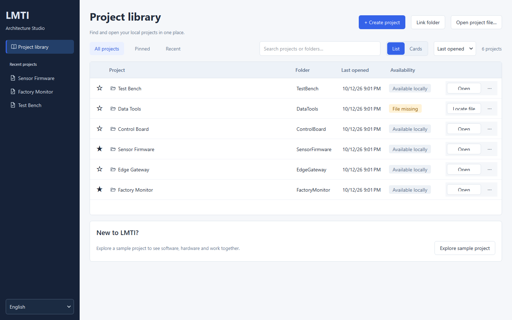
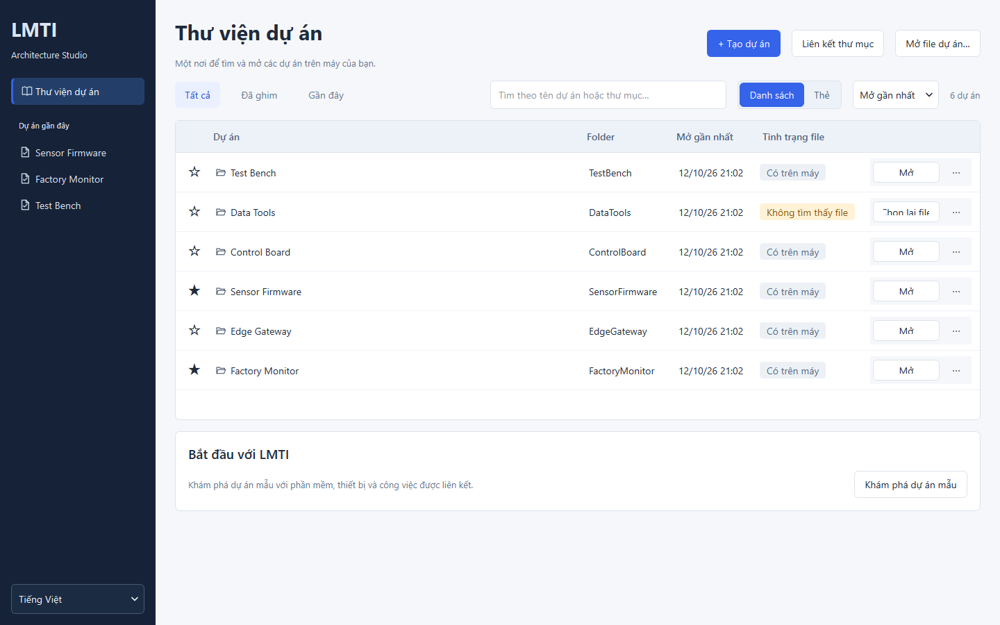
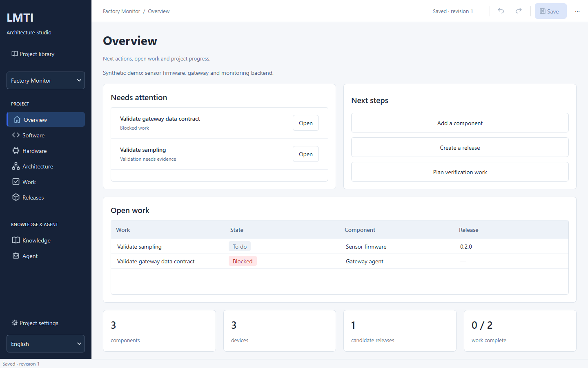
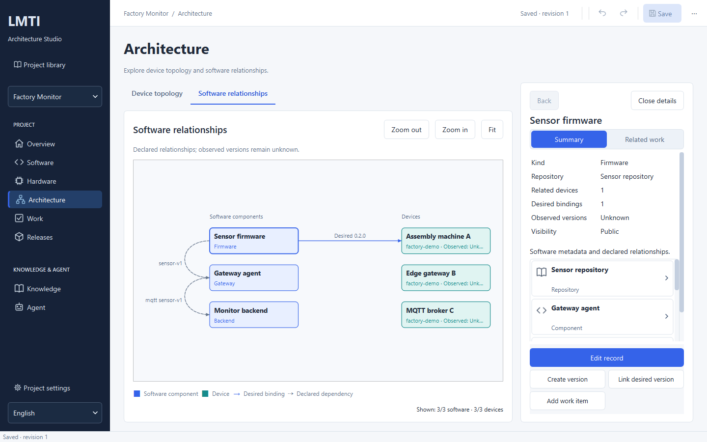
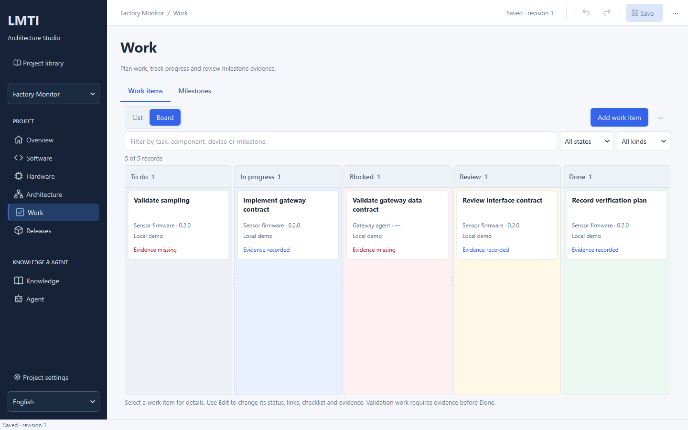

# Projects — local software/hardware management

> **Scope update 2026-10-23:** Qt desktop has been removed. Desktop screens,
> screenshots and launcher instructions below are historical and no longer runnable.
> Use the [React + Vite workspace](local-web.md) and [headless build](release-build.md).
> Standalone CLI/SDK owners retain their documented boundaries; former Qt-only
> features are not automatically available in the browser UI.

Updated: 2026-10-13. Status: implemented experimental local alpha; manual operator,
product MCP-client and clean Windows acceptance remain pending.

## Open the new desktop

For the isolated current design review, double-click
[`scripts/open-studio-design-review.cmd`](../scripts/open-studio-design-review.cmd).
It opens `build/studio-design-20261012-ee28c7de` with a synthetic demo and its own
`review-data` directory. Existing app windows and user drafts remain untouched.
The selected 26-page implementation has current render and workflow evidence;
operator visual preference and clean Windows acceptance remain separate.

From the repository:

```powershell
& .\scripts\start-studio-ui.ps1
```

The current impact package is `build/studio-impact-20261013`; the launcher prefers
it, then `build/studio-ui-fix-20261012`, `build/studio-design`, `build/studio-ui-v2`
and the original `build/studio-ui` when newer packages are absent. The selected 26 pages have
native implementations and page-level workflow/render evidence; see the
[26-screen implementation audit](plans/2026-10-12-design-implementation.md).
When the original package's
`data/` directory exists, the launcher uses that same local library/settings
directory without copying indexes. `-PackageDirectory` and `-DataDirectory` remain
explicit overrides. Use `-PrintLaunchInfo` to inspect the selected package, binary
hash, data directory and arguments without starting an app or changing its data.
The launcher configures the trusted Node
24+/built TS CLI for Knowledge and Impact. Direct executable launch supports native projects
without a Knowledge runtime. This side-by-side package preserves older open windows and their unsaved work.
After closing the old executable, the normal build script can package this same
source to `build/studio/`. The new desktop starts at **Project library**.
English is the default language. Choose **Tiếng Việt** at the bottom of the sidebar
for Vietnamese; switching languages retains the open project and unsaved work.
User-authored metadata, technical domain errors and literal SDK commands may remain English.



## Manage project folders as a library

The **Impact** page reviews changes against a saved project and an explicitly connected
review workspace. Start the launcher with `-AllowImpactReview` for staging, source
acceptance, exact report saving and human verification. Saved reports can be reopened
without recreating their history; every open rechecks source freshness and policy.
See the [complete workflow and migration instructions](impact-review.md#review-trong-studio).
This adds declared architecture review, not observed device state or execution.

1. **Create project:** enter a project name/goal and choose a parent folder plus
   a new folder name. Review the destination before Create. The new folder contains
   `project.lmti.sqlite`; existing folders are never overwritten. Clearing either
   destination field clears the old destination preview. Invalid input remains
   editable with the full field/error visible, and Create/Cancel stay outside the
   scrolling form body.
2. **Link folder:** select an existing local folder. If it has `project.lmti.sqlite`,
   that project is opened. Otherwise a new metadata document is stored in the
   package's `data/documents/`. Source files are left untouched; linking does not
   scan code, clone a repository or import `.lmti/` memory. Folders inside `.lmti/`
   cannot be linked as project folders.
3. **Find and reopen:** search by name or local path; use All projects, Pinned or
   Recent. Pin useful projects. Up to 500 entries are retained, with 24 cards per
   page and responsive columns, rather than dropping projects after 30 opens.
4. **Repair a reference:** a card indicates missing files/folders. Locate the
   project file or choose its folder using the card menu; a replacement project
   file must match the saved project ID. Open folder uses the OS file manager.
5. **Remove from library:** removes the reference after confirmation. It does not
   delete the database, folder or source code. Saving that project later can add
   the reference again. Returning to the library keeps unsaved work; switching
   projects prompts to save/discard/cancel.

The local `data/project-library.sqlite` index stores folder/file references and
pins. On first use it imports an existing recent catalog beside it without
modifying that source. It never scans other installations for databases. The
legacy `projects-catalog.sqlite` remains compatible. Library references are not
exported through Agent APIs. `ui-settings.ini` stores only the UI language.
The portable package needs a writable `data/` directory.





## Work through a project

1. **Overview:** Needs attention, Next steps and Open work lead to the relevant
   records. Use Open on an attention row; Back returns to Overview. Blocked work
   comes first. The dashboard shows three priorities and reports the total if more
   exist. Plan verification work starts an Internal Validation draft. Counts show
   current metadata and Done/total, not production readiness.
   Edit the project name, goal, visibility and local-folder reference through the
   dedicated **Project settings** page; Apply changes the draft and Save persists it.
   Empty inventories explain the next step; filtered no-match results suggest
   clearing filters. Release, dependency, binding and evidence creation remains
   disabled until its required records exist, with a tooltip explaining what to add.
2. **Software:** add repository aliases/locators and components. A component may
   reference one repo; many components may share a repo. Declare dependencies and
   interface contracts. Repositories show typed visibility badges and the actual
   number of linked components; locators remain local metadata and never clone or
   scan source. Select a row to open its inspector and related releases,
   devices, work or evidence. Use **More (⋯)** beside the search/filter controls
   for the selected record's Edit/Remove actions, or Edit in the inspector.
   Search/sort and selection preserve the record identity; Back
   restores the prior page/filter/selection. Forms retain input and focus failing
   fields. **Knowledge → References** retains references/fingerprints without
   reading or exporting memory content.

   Component details offer **Summary / Related work**. Summary distinguishes
   declared binding counts from Unknown observed versions; Related work shows
   linked work only and provides an empty-state explanation when none exists.
   Back retains the selected component and detail mode. Record titles, review
   badges and prominent version actions stay visible while the details body scrolls.
   At short window heights, sidebar scrolling follows the selected page without
   changing project data; Library returns to its own navigation entry.
3. **Hardware:** browse devices and their linked software/work; **Add device** opens
   a metadata form. Add board/model targets in **Targets**. Edit devices through
   the device inspector for simple metadata, or **Architecture → Device topology**
   for layout and links. Device kinds,
   sites and privacy retain existing topology semantics.
   Fitted compact topology cards keep their identifying text readable, while
   secondary metadata remains in the selected-device panel and full tooltip.
   Protocol labels keep a readable size during zoom; graph positions and declared
   connections are preserved. Zooming and panning never edit project metadata.
4. **Releases:** create a version for a component and optional hardware target;
   record its source revision and draft/candidate/approved state. Approved metadata
   cannot be edited or deleted; create a new release for changes. This is metadata
   review, not Git publication or firmware deployment.
5. **Hardware → Software bindings:** choose a device and desired release; component
   and target come from that release. **Add validation work** in a binding's details
   opens a Validation draft with that component, device and release filled in.
   It defaults Internal, opens the new work record after submission and requires
   Save for storage. It does not execute the device.
   **Architecture → Software relationships** shows
   typed software/device cards, desired bindings and declared dependencies. Its
   overview caps at 50 nodes of each type and shows displayed/total counts.
   Zoom/fit and node selection open details; full inventory stays in tables.
6. **Work:** add tasks/bugs/integration/validation, linked component/device/release
   and milestone. List/Board share selection; choose a row/card and use Edit or
   the inspector for state, checklist or evidence. List/Board remains your choice
   when resizing. Narrow boards scroll their columns without moving the primary
   controls offscreen. Use **More (⋯)** for the selected work item's Edit/Remove
   actions, or Edit in the inspector.
   A single click also reopens details for an already-selected list row or Board
   card after closing the inspector or returning to the page.
   Filter by task/component/device/milestone text. Validation Done needs evidence.
7. **Milestones:** criteria and optional YYYY-MM-DD date; acceptance is an explicit
   operator checkbox with evidence after all linked tasks are Done. Task counts
   never auto-accept a milestone. Reopen acceptance before reopening its tasks.
8. **Save / Open:** one SQLite stores the whole document/revision. Undo/Redo spans
   software, work and topology, and clears on save/open. Conflicting saved revisions
   are rejected; reopen before editing. Save as requires a new filename and retains
   project identity, updating its library locator while preserving pins/folder.

Use the sidebar to switch sections. Save, Undo and Redo appear in the workspace;
the options menu contains less frequent file/edit/Agent actions. Agent tools are
under **Agent → Context / Review / Setup**. Context has a structured summary and
collapsed technical JSON. The library remains accessible in the sidebar.

Desired bindings do not prove installed software. Observed version remains
**unknown**. Evidence records carry operator-entered source/result and a locally
recorded creation timestamp; they are
not a live observation connector. Referenced rows must be unlinked before removal.
New projects and newly added metadata default internal.





## Connect project knowledge

Build the TS CLI (`node node_modules/typescript/bin/tsc -b packages/cli`) and
launch `scripts/start-studio-ui.ps1`. In **Knowledge**, choose
**Connect source** and explicitly select a project containing a compiled
`.lmti/project.amf.json`. Its recorded root must match the selected canonical
folder. Missing sources are not initialized or compiled by the desktop. Native
project identity and AMF source identity remain distinct.

Project map shows explicitly public summaries. Memory shows policy-checked
summaries from an existing supported TS store; missing memory is **Not connected**,
not a zero count. Lessons displays eligible local review summaries with actual
pending/approved/rejected state. Pending/rejected lessons never enter task context.
Raw source/memory, repository locators and source roots are not copied/exported.

Project map, Memory and Lessons have local search and matched/allowed counts for
the loaded snapshot. Filtering reads no new source and changes no project or memory.
Hidden selections clear their details and lesson confirmation; a filtered-out
lesson cannot be approved. A reload of the same source retains search, while
switching sources/projects clears it. Missing memory storage has an explicit
Not connected state rather than a zero-record count. Selected summaries show the
actual source and available category/update metadata, without invented provenance.

Enter a nonsecret task and choose **Prepare context**. Read the tables, source/
compile/fetch timestamps, truncation and skill recommendation. Copy/Export is
explicit and enabled only for a checked current result. A project edit invalidates
exports; switching projects clears the connection. Language changes retain data
and task input. Loading supports cancellation and a ten-second timeout. Wrong
source/project, malformed, unsupported and oversized data is denied without
exposing raw source errors. Loading, failure, cancellation and a document change clear the current
snapshot and show the selected source as not loaded; Prepare stays disabled until
a checked source read succeeds. Correcting an empty/invalid task does not require
another source read when the source snapshot is still valid.
The source map must already be compiled; compilation is a separate
CLI action under the source's policy.

Lesson review is disabled by default. Launch
`scripts/start-studio-ui.ps1 -AllowLessonReview` to enable that separate local
capability. Select a pending lesson, read evidence/confidence/verification state,
and explicitly confirm evidence/privacy review before Approve/Reject. Writes
check candidate fingerprint and commit state, approved memory and audit event
atomically. Approval does not execute suggested verification. After a cancelled
write, reload to inspect actual state. See the
[knowledge boundary ADR](adr/2026-10-12-desktop-knowledge.md).

## Keep topology v1 compatible

Opening a topology v1 file in Projects imports it into a new unsaved project.
It preserves IDs, privacy, site, config, layout and links, records source-file
fingerprint/revision, and refuses to save over the source. This is not a memory
migration or permission to retire a store.

For the existing topology v1 UI/configuration-proposal workflow:

```powershell
& .\build\studio-design\bin\lmti-desktop.exe --legacy .\build\factory-demo.sqlite
```

`lmti-topology` and `lmti_topology` remain v1 interfaces; they reject project-format
files. `lmti-project` and `lmti_project` read the separate project format.

## Agent access

Use a file saved from Projects, or create a fresh synthetic project demo:

```powershell
$env:PYTHONPATH = Join-Path (Get-Location) 'python\src'
$env:LMTI_PROJECT_BINARY = Join-Path (Get-Location) 'build\studio-design\bin\lmti-project.exe'
$env:LMTI_PROJECT_DATABASE = Join-Path (Get-Location) 'build\factory-monitor.sqlite'
& $env:LMTI_PROJECT_BINARY init-demo $env:LMTI_PROJECT_DATABASE
```

`init-demo` refuses existing files. The demo's project ID is `factory-monitor`
and site is `factory-demo`; real project IDs come from the saved document.

```python
import os
from lmti_project import Client, Grant

client = Client(os.environ["LMTI_PROJECT_BINARY"], os.environ["LMTI_PROJECT_DATABASE"],
                Grant(project_id="factory-monitor", site="factory-demo"))
context = client.context(limit=100)
impact = client.impact("sensor-firmware")
proposal = client.propose_work("validate-sampling", "review")
```

MCP uses the same trusted runtime/database/project/site/model-target settings:

```powershell
python -m lmti_project.mcp --binary $env:LMTI_PROJECT_BINARY --database $env:LMTI_PROJECT_DATABASE --project factory-monitor --site factory-demo --target external
```

Tools: `project_context`, `project_impact`, `project_propose_work`. There is no
storage or execution tool. Context caps at 200 per category/2 MiB and marks
truncation; records outside that context need a future lookup/pagination feature.
Repository locators and local knowledge references are not exported. Parent
privacy and site checks apply before relationships/work are returned.

Write only the synthetic/nonsecret proposal to a local file when needed.
**Review proposal** opens the project work-proposal format and shows old/new state,
ID and revision. It is enabled only on a clean saved document. Apply changes the
document, Save changes the database. Review/Blocked are the only Agent-proposed
states; a proposal cannot claim Done, deploy software or act on a device.

The Agent section previews public context of the current document, which may be
unsaved. SDK/MCP reads the saved file. An internal project rejects external reads;
do not mark private data public simply to make a tool succeed.

## Safety and verification

**[CẢNH BÁO BẢO MẬT]** Project SQLite/catalog/library are unencrypted. Use only nonsecret
metadata. No credentials in URLs, tokens, connection strings or raw customer/build
data. Classification is not OS isolation. Check `.gitignore` for databases,
WAL/SHM and secrets before pushing; run `lmti publish preflight` before publication.

The project domain, adapter and constraints are specified in the
[project document ADR](adr/2026-10-11-project-document.md). Current implementation
evidence and remaining gates are in the [project execution report](plans/2026-10-11-project-execution.md)
and [library execution report](plans/2026-10-12-library-execution.md). The
[library plan](plans/2026-10-12-project-library.md) specifies folder ownership and UI contracts.
TS/Go memory/privacy/lesson contracts remain separate. The implemented
[UI/Knowledge slice](plans/2026-10-12-ui-execution.md) provides the read-only
bridge and separate opt-in review writer. The [Impact slice](plans/2026-10-13-native-impact-review.md)
adds its own backed-up LMIP v1→v2 upgrade. Native-project schema upgrade/recovery and
production GUI frame-time/RAM,
product Agent setup and clean-machine distribution still need work.
