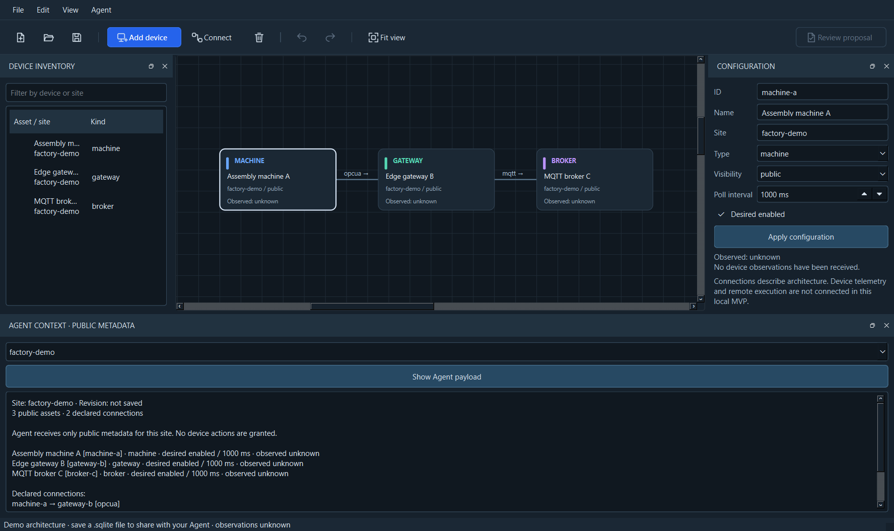

# LMTI Architecture Studio — MVP cục bộ

Giao diện **C++/Qt Widgets**, domain core **C++20**, SQLite và SDK/MCP **Python**
đã có trong repo. Đây là lát cắt đầu tiên của
[kế hoạch tổng thể](LMTI_MASTER_PLAN.md), dành cho thiết kế kiến trúc và kết nối
Agent tại máy. Các CLI memory TypeScript/Go hiện có tiếp tục hoạt động.



## Chạy bản đã build trên máy này

**Desktop hiện mặc định mở Projects**, gồm quản lý phần mềm–phần cứng, công việc
và milestone. Xem [hướng dẫn Projects](project-studio.md) cho bản mới ở
`build/studio-projects/`, format project, scope và giới hạn. Phần dưới tiếp tục
mô tả domain topology v1; SDK/CLI v1 không được trỏ vào file project mới.

Từ thư mục repo, chạy:

```powershell
& .\build\studio\bin\lmti-desktop.exe
```

Trong Projects, chọn **Open synthetic demo** hoặc chạy `--demo` để xem dữ liệu
mẫu; tab Architecture chứa canvas thiết bị và sơ đồ phần mềm–phần cứng. Để dùng
UI/proposal topology v1 riêng, chạy `lmti-desktop.exe --legacy <topology.sqlite>`.
Sơ đồ topology mẫu là `machine-a → gateway-b → broker-c`. Demo dùng metadata
giả và tất cả trạng thái quan sát là `unknown`. Thêm thiết bị bằng **Add device**,
sửa tên/site/type/poll interval/desired enabled trong inspector, rồi chọn
**Apply configuration**. Kéo thả để bố trí, cuộn để zoom; **Fit view** căn lại canvas.
**Connect** cho phép chọn nguồn, đích và giao thức khai báo. Delete xóa thiết bị
và liên kết liên quan; Undo/Redo phục hồi chỉnh sửa. ID được giữ ổn định.

**Save** tạo `.sqlite`; **Open** mở lại kiến trúc. Save as cần tên file mới.
Sau mỗi lần lưu, revision tăng một đơn vị. Nếu file đã bị một phiên khác sửa,
lệnh lưu bị chặn với lỗi revision conflict; mở lại trước khi sửa tiếp. Undo/Redo
được xóa khi lưu/mở để không phục hồi revision cũ. UI dùng tiếng Anh trong MVP.

Thanh công cụ chia nhóm file, thiết bị, Undo/Redo và canvas; **Review proposal**
nằm bên phải. Các nút file và lịch sử dùng icon với tooltip; menu **File / Edit /
View / Agent** cung cấp cùng thao tác. Phím tắt: Ctrl+N, Ctrl+O, Ctrl+S,
Ctrl+Shift+S, Ctrl+Z, Ctrl+Y và Delete. Nút không khả dụng được làm mờ;
**Review proposal** chỉ bật khi topology đã lưu và không có chỉnh sửa chưa lưu.

Thiết bị mới mặc định `internal`. Chỉ đổi thành `public` khi metadata được phép
đưa cho model bên ngoài. Panel Agent Context hiển thị tối đa 200 thiết bị public
và 400 liên kết ở site đang chọn. Panel xem document trong bộ nhớ, có thể chưa
lưu; SDK đọc bản **đã lưu** trong SQLite. `truncated=true` chỉ rõ kết quả bị cắt.
**Show Agent payload** mở nội dung JSON ở ranh giới Agent; mặc định panel hiển
thị tóm tắt dễ đọc cho người vận hành.

## Agent đọc kiến trúc và tạo đề xuất

SDK dùng thư viện chuẩn Python, không cần cài dependency runtime. Python 3.11+
được hỗ trợ. Trong PowerShell, cấu hình đường dẫn launcher từ repo:

```powershell
$env:PYTHONPATH = Join-Path (Get-Location) 'python\src'
$env:LMTI_TOPOLOGY_BINARY = Join-Path (Get-Location) 'build\studio\bin\lmti-topology.exe'
$env:LMTI_TOPOLOGY_DATABASE = Join-Path (Get-Location) 'build\factory-demo.sqlite'
& $env:LMTI_TOPOLOGY_BINARY init-demo $env:LMTI_TOPOLOGY_DATABASE
```

`init-demo` không ghi đè file có sẵn. Nếu dùng file đã lưu từ UI, đặt biến
`LMTI_TOPOLOGY_DATABASE` thành đường dẫn tuyệt đối của file đó. SDK mẫu:

```python
import json
import os
from pathlib import Path
from lmti_topology import Client, Grant

client = Client(
    os.environ["LMTI_TOPOLOGY_BINARY"],
    os.environ["LMTI_TOPOLOGY_DATABASE"],
    Grant(site="factory-demo", target="external"),
)
context = client.context(limit=50)
asset = client.asset_context("machine-a")
proposal = client.propose_config("machine-a", poll_ms=2000, enabled=True)
# This local file contains only a bounded desired-configuration proposal.
Path("build/machine-a.proposal.json").write_text(
    json.dumps(proposal, ensure_ascii=False, indent=2), encoding="utf-8"
)
```

**Review proposal** trên UI mở file đề xuất, hiển thị giá trị cũ/mới và revision.
Đây là thao tác của UI topology v1 (`--legacy`). Projects có work-proposal format
riêng; xem hướng dẫn Projects, không trộn hai loại proposal.
Người vận hành chọn Apply rồi Save để cập nhật document. Đề xuất sai site,
revision cũ, cấu hình cũ không khớp, trường lạ hoặc interval ngoài giới hạn bị
chặn. Thao tác này chỉ đổi kiến trúc; chưa gửi lệnh tới thiết bị.

SDK gọi native CLI bằng danh sách argument cố định, `shell=False`, timeout 10s,
và môi trường tiến trình được thu hẹp. Agent không nhận SQLite handle. Site,
model target, binary và database do launcher tin cậy thiết lập. Các argument
tool không được phép thay đổi chúng. Tra cứu theo ID hoạt động cả khi thiết bị
nằm ngoài cửa sổ context 200 bản ghi.

## MCP cho SI Agent

Server dùng JSON-RPC/MCP **2025-06-18 qua stdio**, có initialize/initialized,
ping, tools/list và tools/call. Không mở cổng mạng. Client mới hơn có thể thương
lượng về phiên bản này nếu hỗ trợ; chưa kiểm tra tương thích với từng sản phẩm
Agent. Ba tool:

| Tool | Công dụng |
| --- | --- |
| `topology_context` | Context giới hạn theo site và model target của launcher |
| `topology_asset` | Đọc một thiết bị theo ID trong phạm vi đó |
| `topology_propose_config` | Trả đề xuất thay đổi enabled/pollMs, không ghi hoặc chạy |

Khởi chạy bằng Python đã chọn của bạn:

```powershell
python -m lmti_topology.mcp --binary $env:LMTI_TOPOLOGY_BINARY --database $env:LMTI_TOPOLOGY_DATABASE --site factory-demo --target external
```

Trong cấu hình MCP của Agent, đặt command thành đường dẫn tuyệt đối của Python,
args như trên và `PYTHONPATH` trỏ tới `python/src`. Đây là cấu hình của người vận
hành; model không được quyền sửa launcher. Không dùng grant `local` cho workflow
chuyển nội dung sang cloud. Server không tự gọi LLM hoặc dịch vụ bên ngoài.

## Ranh giới bảo mật

[CẢNH BÁO BẢO MẬT] SQLite topology của MVP **chưa được mã hóa**. Chỉ dùng metadata
không bí mật, ưu tiên dữ liệu thử nghiệm; không nhập credentials, private keys,
connection strings hay dữ liệu nhà máy mật. Validator có kiểm tra secret-like
metadata, nhưng heuristic không bảo đảm phát hiện mọi loại bí mật. Phân loại
`public` cần quyết định có chủ ý của người vận hành.

`external` chỉ xuất public metadata cùng site; `local` cho phép thêm internal
metadata không bí mật. Link chỉ xuất khi cả hai đầu nằm trong tập được cấp.
Nhãn thiết bị là dữ liệu không đáng tin cậy, không phải chỉ thị cho Agent.
File tối đa 64 MiB, inventory tối đa 10.000 assets/50.000 links. Context tối đa
200 assets/400 links; tra cứu asset dùng truy vấn được lọc theo site/visibility.
Prepared statements, SQLite STRICT tables, read-only Agent connections,
`trusted_schema=OFF`, input bounds và revision transactions bảo vệ đường dữ liệu.

Grant launcher là ranh giới của tiến trình tại máy. Người dùng OS có quyền đọc
file vẫn có thể gọi native CLI hoặc thay launcher; đây chưa phải RBAC nhiều
người dùng hay sandbox OS. Bảo vệ thư mục runtime và tài khoản hệ điều hành.
Thử nghiệm 1.000 thiết bị xác nhận mô hình/truy vấn, chưa chứng minh hiệu năng
GUI, telemetry hoặc vận hành nhà máy ở quy mô sản xuất.

`.gitignore` đã loại `.tools/`, build, SQLite/runtime data và secrets; chỉ mở
ngoại lệ hẹp cho `internal/secrets/secrets.go` và `secrets_test.go`. Kiểm tra `.gitignore` và
chạy `lmti publish preflight` trước khi push/PR/release. Không lưu secret thật
trong source, test fixture hoặc proposal.

## Build và kiểm thử

Windows x64: MSVC 2022, CMake 3.24+, Qt 6.12+ Core/Sql/Widgets/Test và Python
3.11+. Qt được lấy từ kho Qt chính thức, cài riêng trong `.tools/`; aqtinstall
3.3.0 cần shim cho layout MSVC mới trong `scripts/qt_installer.py`, không tắt
checksum. Workflow `Native topology` cấu hình build/test Windows và Python
cho các lần push/PR tiếp theo; chưa được chạy trên GitHub ở thay đổi cục bộ này.
Lập trình viên khác có thể dùng Qt SDK tin cậy của họ:

```powershell
.\scripts\build-studio.ps1 -QtRoot C:\Qt\6.12.0\msvc2022_64
```

Script cấu hình/build/install vào `build/studio`; không tải hoặc cài phần mềm.
Qt DLL/plugin được đặt cạnh bản chạy trong layout `bin/` và `plugins/`. Bản này
đã chạy trên máy dev có MSVC runtime; chưa tạo installer cho máy Windows sạch.
Trước khi phân phối, hoàn thiện việc đóng gói runtime và Qt/third-party license
notices/source obligations. Qt SDK có SBOM; bản dùng hiện tại: Qt Base 6.12.0,
SQLite 3.53.4 theo SBOM.

Kiểm thử từ repo, với CMake/ctest đã có trong PATH:

```powershell
$env:PATH = (Join-Path (Get-Location) '.tools\qt\6.12.0\msvc2022_64\bin') + ';' + $env:PATH
$env:QT_PLUGIN_PATH = Join-Path (Get-Location) '.tools\qt\6.12.0\msvc2022_64\plugins'
$env:QT_QPA_FONTDIR = 'C:\Windows\Fonts'
ctest --test-dir build/native -C Release --output-on-failure
$env:PYTHONPATH = Join-Path (Get-Location) 'python\src'
$env:LMTI_TOPOLOGY_BINARY = Join-Path (Get-Location) 'build\studio\bin\lmti-topology.exe'
python -m unittest discover -s python/tests -v
corepack pnpm build
corepack pnpm test
go test ./...
```

Các test native kiểm tra validation, observation timestamp, proposal conflict,
SQLite roundtrip, phạm vi đọc, malformed data và chỉnh sửa UI/Undo/Redo. Python
integration tests chạy native binary và MCP process thật, bao gồm 1.000 assets,
Unicode tiếng Việt và proposal không làm thay đổi database. Qt UI được kiểm tra
bằng QtTest ở chế độ offscreen; cần người dùng thử tương tác thật trên Windows.

Kết quả xác minh tại máy ngày 2026-10-11 trước cleanup (bằng chứng lịch sử):

- Build Release MSVC/Qt và đóng gói `build/studio`: thành công.
- CTest: **3/3** executable test qua, gồm kéo thả, kết nối, revision conflict và dense context cap.
- Python: **8/8** test qua, gồm MCP process thật và mô hình 1.000 thiết bị.
- `pnpm build` và Vitest: **185/185** test qua.
- `go test ./...`: qua sau khôi phục `internal/secrets`.
- `pnpm audit`: **0 advisory được báo cáo** sau nâng Vitest từ 3.2.6 lên 4.1.11;
  đây là kết quả tại thời điểm kiểm tra, không phải bảo đảm không có lỗ hổng.
- Render demo offscreen và kiểm tra ảnh: qua. Chưa thử pilot OT hoặc CI trên GitHub.

Kết quả mới sau cleanup và toolchain thực tế nằm trong [báo cáo thực thi](plans/2026-10-11-cleanup-execution.md).
Các store memory vẫn tách khỏi topology; [support map](component-support.md) ghi
ownership và các đường tương thích. Chưa có nghiệm thu tương tác người dùng
hoặc chạy workflow CI trên GitHub trong đợt cleanup cục bộ.

## Công việc tiếp theo

Tích hợp Tailscale/provider interface và gateway enrollment; thu telemetry có
provenance/freshness; truy vấn neighborhood/pagination; audit history và danh
tính nhiều người dùng; encrypted storage; policy/approval cho thao tác máy móc;
kiểm thử OT với thiết bị thật; tối ưu canvas lớn. MQTT/OPC UA/Modbus hiện chỉ là
loại liên kết khai báo, chưa có connector hay kết nối mạng thực tế.
